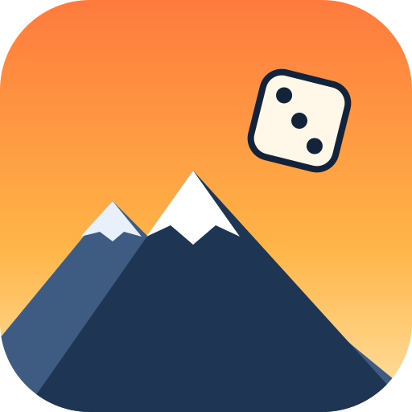

# Altitude Arcade

> L'application s'appelait **DesDés** jusqu'à la version 77, puis **Altitude** (version 78) ; elle s'appelle **Altitude Arcade** depuis la version 79. Le nom affiché et le logo ont changé, mais les clés de sauvegarde internes (`desdes-…`, `DesDesSauvegarde`) sont gardées pour ne perdre aucune partie, et les anciens fichiers de sauvegarde (« DesDés », « Altitude ») s'importent toujours. Logo : coucher de soleil sur la montagne, le soleil est un dé (`logo.svg`, icônes dans `icons/`).

Plate-forme web (application installable) qui regroupe nos carnets de score de jeux de dés, un quiz de géographie, une course à dessiner, un jeu de neige de culture en 3D et un jeu de fusée en musique.



## Les carnets

| Jeu | Fichier | Joueurs |
| --- | --- | --- |
| **10 000** : ouverture à 1 000, croix (effacées dès qu'on note des points ou le −500 du 1er lancer), reprises, pénalités ; il faut finir à 10 000 pile, dépasser donne une croix, et on ne peut pas reprendre des points qui mèneraient à 10 000 ou plus | `jeux/10000.html` | 2 à 15 |
| **Yam's** : feuille de marque classique, bonus à 63 | `jeux/yams.html` | 1 à 10 |
| **Géographie** : drapeaux et cartes (pays, régions et départements français, États américains), défi du jour, chrono, records et statistiques | `jeux/geo.html` | 1 |
| **Draw Race** : course de monoplaces dont on dessine la trajectoire, 20 circuits inspirés de la F1, pneus, météo et arrêts au stand ; modes Arcade et Championnat | `jeux/drawrace.html` | 1 à 4 (+ adversaires) |
| **Nivoculteur** : sur un domaine tiré au sort, construire le réseau de neige de culture et produire la nuit selon le froid et le vent, en 2D vu de dessus | `jeux/nivoculteur/index.html` | 1 |
| **Fusée Rythme** : piloter une fusée à gauche et à droite au rythme d'un morceau (fourni ou pris dans vos fichiers) et éviter les points ; la partie dure le temps de la musique | `jeux/fusee.html` | 1 |
| **Dameuse de nuit** : damer une piste vue du dessus avant l'ouverture, avec la lame, la fraise et le treuil ; 8 pistes et un défi du jour | `jeux/dameuse.html` | 1 |
| **Freeride** : ski ou snowboard hors-piste vu du dessus ; fuir une avalanche sans fin, 7 descentes à étoiles, 4 snowparks (kickers, boxes, rails), 3 slaloms chronométrés et un défi du jour | `jeux/freeride.html` | 1 |
| **Tour de contrôle** : guider les avions du doigt jusqu'à la piste de leur couleur sans qu'ils se touchent ; 4 aérodromes | `jeux/tour.html` | 1 |
| **Tir au panier** : viser au doigt (la trajectoire s'affiche jusqu'à l'apogée) et marquer un maximum de paniers en 1 minute 30 ; bonus (feu, balle ×3, panier large) en allumant la planche, 10 balles inventées à débloquer, 7 thèmes, mode gaucher | `jeux/panier.html` | 1 |

La page d'accueil (`index.html`) permet de choisir un carnet et indique si une partie est en cours (qui mène, à qui c'est le tour).
Chaque partie est enregistrée dans le navigateur de l'appareil : on peut quitter un jeu et le reprendre plus tard.

### Sauvegarde dans un fichier

Une page web ne peut pas écrire seule dans les fichiers du téléphone. Le bloc **Sauvegarde dans mes fichiers** (accueil, Géographie, réglages du Yam's, bas du carnet du 10 000) a deux boutons :

- **Exporter** écrit toutes les parties, records et statistiques dans un fichier qui porte **toujours le même nom**, `altitude-sauvegarde.json`, pour remplacer l'ancien au lieu d'en créer un nouveau :
  - sur ordinateur (Chrome, Edge) et dans les navigateurs qui savent réécrire un fichier, on choisit l'endroit au premier export ; ensuite, chaque export **réécrit directement ce même fichier** (l'accès est gardé dans IndexedDB, le navigateur peut redemander l'autorisation). « Enregistrer dans un autre fichier… » permet d'en changer ;
  - sur iPhone, le partage s'ouvre : choisir *Enregistrer dans Fichiers*, au même endroit que la dernière fois, et accepter de remplacer le fichier existant ;
  - ailleurs, le fichier est téléchargé (le navigateur peut ajouter « (1) » au nom si l'ancien est encore dans les téléchargements).
- **Importer** recharge un fichier exporté, après confirmation : les données de l'appareil sont remplacées.

Le code est dans `jeux/sauvegarde.js`.

### Yam's

- Une case rayée est barrée d'une seule barre oblique.
- Les cases qui restent à remplir sont teintées. La colonne du joueur qui doit jouer est plus marquée et son nom est souligné.
- La ligne des noms reste visible quand on fait défiler la feuille.
- Le bouton **Réglages** permet de :
  - cacher les totaux (ils réapparaissent à la fin de la partie) ;
  - choisir la couleur du carton (Classique, Vieux papier, Ardoise, Menthe, Nuit) ;
  - faire d'un joueur un robot (facile, moyen ou fort) ;
  - voir les statistiques par joueur (parties, victoires, record, moyenne) ;
  - exporter ou importer la sauvegarde.

### 10 000

- La barre de score est plus épaisse. Toucher un joueur (ou sa barre) ouvre sa **fiche** en plein écran : score en grand, reste à faire, croix, et le bloc du tour pour jouer depuis la fiche.
  Une fois le tour noté, la fiche montre le résultat et un bouton **Joueur suivant**. On peut aussi balayer pour passer d'un joueur à l'autre.
- Le bouton pour reprendre les points du joueur précédent est doré, plus grand et clignote doucement, dans le carnet comme sur le tapis.
- On peut ajouter des robots (facile, moyen, fort) dans la liste des joueurs.
- *Statistiques et sauvegarde* (bas de page) : parties, victoires et score moyen par joueur. *Couleur du carnet* : vert, bordeaux, bleu nuit, bois, ardoise.

## Plateau de dés

Si on a oublié les dés, le bouton rouge **Dés** de chaque carnet ouvre un tapis avec 5 dés : on les lance en glissant le doigt sur le tapis (ou avec le bouton *Lancer*), et on touche un dé pour le garder.

- **Yam's** : 3 lancers au plus par tour ; on garde ou reprend les dés de son choix entre deux lancers.
  Après chaque lancer, le plateau reconnaît les figures (brelan, full, suites, Yam's…) et propose les cases libres du joueur avec leurs points ; un toucher note le score dans la feuille. On peut aussi rayer une case.
- **10 000** : lancers sans limite ; il faut mettre de côté au moins un dé qui rapporte avant de relancer (bouton pour mettre de côté tout ce qui compte). Les points passent dans le tour du carnet à chaque relance, et « Garder les points » les inscrit.
  - Si tous les dés lancés rapportent, les points sont ajoutés et la relance des 5 dés est obligatoire.
  - Si les 2 derniers dés font un double (2, 3, 4 ou 6), relance obligatoire des 5 dés, sans points. Un double 1 ou 5 rapporte ses points, puis relance des 5.
  - Si aucun dé ne rapporte, le plateau propose de noter le raté.
  - Quand un joueur reprend les points du précédent, il ne lance que les dés que celui-ci avait laissés (par exemple 2 dés pour 2 700 points gardés avec 2 dés restants). Il doit lancer et marquer des points avant de pouvoir garder : on ne peut pas reprendre un score et le noter sans jouer (règle appliquée aussi dans le carnet).

Les dés ne se chevauchent jamais sur le tapis : après chaque lancer, ceux qui se touchent sont légèrement écartés.

- **Couleurs** (bouton « 🎨 Couleur du tapis », tout en bas, sous les boutons de jeu) : feutre vert, casino, bleu, bois, ardoise avec dés rouges, nuit avec dés noirs. Ce choix est commun aux deux jeux.
- **Conseils** (Yam's, bouton 💡) : après chaque lancer, les dés à garder sont entourés de jaune.
  Le plateau donne aussi les chances de faire chaque figure encore libre (brelan, carré, full, suites, Yam's) à la fin du tour.
  Après le dernier lancer, la case conseillée est marquée d'une étoile.
  Le calcul est exact : il essaie toutes les façons de garder les dés sur les lancers restants. Il tient compte des cases libres du joueur et du bonus de 63.
- **Figure à 5 dés** (10 000) : quand tous les dés lancés rapportent, la figure s'affiche (« Suite ! », « Cinq 3 ! »…) avec ses points pendant 2 s avant que les dés passent de côté.
- **Robot** : à son tour, le plateau s'ouvre et le robot lance les dés lui-même. On voit ce qu'il garde, puis il note son score dans le carnet. *Arrêter le robot* interrompt son tour.
  Les décisions sont dans `jeux/ia.js`. En simulation :
  - au Yam's, un robot fait en moyenne 152 points en facile, 185 en moyen et 198 en fort ;
  - au 10 000, il atteint 10 000 en 39, 36 et 34 tours en moyenne.

Le plateau repart de zéro dès qu'un score est noté dans le carnet. Le code est dans `jeux/plateau.js`, partagé par les deux jeux.

## Géographie

Quatre terrains de jeu :

| Terrain | Éléments | Zones |
| --- | --- | --- |
| Pays du monde | 195 pays : membres de l'ONU, Vatican et Palestine | les continents, ou tous mélangés |
| Régions de France | 18 régions, outre-mer en encarts | — |
| Départements | 101 départements, outre-mer en encarts | toute la France, une région, ou l'outre-mer |
| États-Unis | 50 États, Alaska et Hawaï en encarts | — |

Les jeux proposés :

- **Drapeaux** (pays et États) : un drapeau et quatre noms (pays du même continent) ; il faut trouver le bon.
- **Mélange** (pays et États) : drapeaux et carte en alternance.
- **Numéros** (départements) : le numéro d'un département, ou l'inverse ; les propositions sont des départements voisins.
- On joue **10 ou 20 questions tirées au hasard, ou toutes**.
- **Défi du jour** : 12 questions, les mêmes pour tout le monde ce jour-là (4 drapeaux, 4 pays sur la carte, 2 départements, 2 États).
  Seul le premier essai du jour compte. Le nombre de jours d'affilée est affiché.
- **Statistiques** : parties jouées, pourcentage de réponses justes du premier coup, et une liste **À revoir** des pays et départements les plus souvent ratés (un élément sort de la liste quand on le trouve du premier coup).
- **Carte** : un nom de pays ; il faut le toucher sur la carte (on peut zoomer en pinçant ou avec les boutons, et se déplacer en glissant). Trois essais par pays, puis la réponse s'affiche. Les tout petits pays ont un repère rond pour pouvoir les toucher.
- **Déplacer la carte** : un doigt glisse (le point touché reste sous le doigt), deux doigts zooment et déplacent en même temps, boutons + − ⤢. Pendant le geste, la carte est seulement déplacée comme une image (fluide même avec les 101 départements) ; la vue est posée au lâcher. Quand la hauteur de l'écran change (barre d'adresse, rotation), la vue est gardée au lieu de revenir à la carte entière.

Le chrono tourne pendant toute la partie. Les 5 meilleurs résultats de chaque jeu et de chaque zone sont gardés sur l'appareil (score du premier coup, puis temps).

La carte du monde rattache à leur pays les morceaux que la source sépare : l'Australie avec les îles Ashmore-et-Cartier, le Somaliland avec la Somalie, et Chypre du Nord avec Chypre.
Avant ce correctif, l'Australie était presque invisible et la corne de l'Afrique fausse.

Les données (`jeux/geo/monde.js`, `france.js`, `usa.js`, `drapeaux/` et `drapeaux-us/`) sont produites par `outils/construire-geo.mjs`.
Sources : IGN Admin Express via france-geojson (Licence ouverte), U.S. Census Bureau via us-atlas (domaine public), drapeaux des États us-state-flags (ISC), Natural Earth via world-atlas (domaine public), mledoze/countries via world-countries (licence ODbL), drapeaux flag-icons (licence MIT), noms français du CLDR.

## Draw Race

Deux modes de jeu, au choix en haut du menu :

- **Arcade** : une course, de 1 à 4 joueurs sur le même appareil, contre des adversaires. Tout se règle : circuit, nombre de tours, difficulté, météo.
- **Championnat** : un joueur seul contre 5 pilotes, course après course.

### Championnat

- **Réglages au départ** :
  - nom et couleur du pilote ;
  - difficulté (curseur de 0 à 100 %), **fixée pour tout le championnat** ;
  - nombre de courses, de 2 à 20, avec − et + (ou les raccourcis 5, 8, 12, 20) ; chaque course a lieu sur un circuit différent ;
  - un **minimum de tours** par course (3 à 10) : chaque circuit garde son nombre de tours habituel (2 à 5), relevé à ce minimum si besoin ;
  - météo : variable (chaque course a sa météo, découverte en arrivant sur le circuit) ou toujours sèche ;
  - calendrier : au hasard, ou du plus facile au plus dur.
- **Adversaires** : 5 pilotes tirés parmi 12 noms inspirés de vrais pilotes de F1, chacun avec sa couleur : Max Verstapin, Lewis Hamiltown, Charles Leclaire, Lando Norrish, Oscar Piastrino, Fernando Alonsso, George Russelle, Carlos Sainze, Pierre Gaslight, Esteban Ocone, Yuki Tsunodo, Valtteri Bottass.
  Il y a toujours l'un des trois plus forts. Chaque pilote a sa force (au plus ±1 % de vitesse autour de la difficulté choisie), plus une forme du jour qui change à chaque course.
- **Points** : 25, 18, 15, 12, 10 et 8 du 1er au 6e, et 1 point pour le meilleur tour en course. Un abandon ne rapporte rien.
  Les autres pilotes terminent la course (simulée d'un coup) pour avoir de vrais temps. À égalité de points, le nombre de victoires puis les meilleures places départagent.
- **Avant chaque course**, l'écran du championnat montre :
  - la prochaine course (circuit, nombre de tours, météo à découvrir) ;
  - le calendrier, avec les courses faites et celle à venir ;
  - le classement général, avec les points gagnés à la dernière course.
- **Grille de départ** : dans l'ordre du classement général (au hasard pour la première course).
- **Abandons** :
  - *Abandonner* pendant une course donne 0 point, et les autres finissent la course ;
  - pendant le tracé, on retourne au classement sans pénalité, et la course reste à faire ;
  - *Abandonner le championnat* (sur l'écran du classement ou au menu) efface le championnat en cours.
- **Sauvegarde** : le championnat est gardé sur l'appareil. On peut quitter et reprendre plus tard : le menu propose *Continuer*. L'accueil d'Altitude Arcade affiche la course et la place.
- **Fin** : classement final et champion. Un **palmarès** garde les derniers championnats (date, nombre de courses, difficulté, place, points).

Le jeu se joue le téléphone à l'horizontale (un message le demande en vertical), pour des pistes plus larges.

1. En Arcade, on choisit :
   - le nombre de joueurs (1 à 4, sur le même appareil), la couleur et les **pneus** de chaque monoplace ;
   - la difficulté des adversaires avec un **curseur** de 0 à 100 % (Facile, Normal, Difficile, Expert, et tous les réglages entre deux) et la **météo** ;
   - le circuit dans le carrousel : 20 circuits inspirés de la F1, de difficulté 1 à 5, de 2 à 5 tours, chacun avec son décor.
   - le **nombre de tours**, de 1 à 10 (le nombre habituel du circuit est proposé). Les records sont gardés à part quand on ne fait pas le nombre habituel.

   La météo réelle du circuit est annoncée dès l'arrivée sur la piste (une météo « Surprise » est découverte à ce moment-là).
2. Chaque joueur dessine ses tours d'affilée, sans lever le doigt, en partant de la ligne à damier (on peut reprendre au bout du trait, ou tout recommencer). La vitesse du doigt devient la vitesse de la voiture : la jauge et la couleur du trait passent du vert (lent) au rouge (rapide). Dans les virages, la voiture freine toute seule avant le virage, mais un virage tracé trop vite la fait déraper (voir *Physique*). Le trait est épais (9 px), pour bien voir sa trajectoire.
3. La course se joue à 4 voitures (les places libres sont prises par des adversaires, qui partent derrière les joueurs). Chaque voiture suit, à chaque tour, le tracé dessiné pour ce tour. Les tours forment un seul chemin continu : au passage de la ligne, la voiture enchaîne directement sur le tracé du tour suivant, sans écart ni saut (avant la ligne et après l'arrivée, elle suit la piste, à la même distance du bord que le début et la fin du tracé). Le **Boost** (vitesse ×1,4 pendant 1,3 s) se recharge : 2 charges au départ, 3 au plus, une charge de plus toutes les 6 s (la petite jauge du bouton montre la recharge). On peut abandonner à tout moment (la partie ne compte pas).

   Les monoplaces sont dessinées en détail, vues de dessus : ailerons avant et arrière avec leurs dérives, museau, pontons et prises d'air, halo, casque du pilote, rétroviseurs, suspensions, roues avec jantes, bande de décoration dans une teinte plus claire.

### Départ au temps de réaction

Option **Départ au temps de réaction** (cochée par défaut), dans le menu de l'Arcade (aussi à plusieurs joueurs) et dans les réglages du Championnat.

- Les 5 feux rouges s'affichent en grand au milieu de l'écran et s'allument un à un. Ils restent allumés un temps au hasard, puis s'éteignent : c'est le départ.
- Sous les feux, chaque joueur a son bouton **🚦 Départ**. Le bouton affiche le temps de réaction mesuré (par exemple « 0,250 s · très bien » ; excellent sous 0,2 s, correct sous 0,45 s, lent au-delà).
- Meilleur est le temps de réaction, plus la voiture démarre tôt et accélère fort dans les premiers mètres.
- Appuyer avant l'extinction des feux est un **faux départ** : la voiture part 1 s après les autres.
- Sans appui, la voiture part toute seule au bout de 1,5 s.
- Les adversaires réagissent en 0,2 à 0,45 s (plus vite aux niveaux élevés).
- Les résultats donnent le temps de réaction de chacun.

Sans l'option, les voitures partent toutes ensemble à l'extinction des feux.

### Physique

- **Dérapage** : un virage tracé plus vite que possible fait glisser la voiture vers l'extérieur. Elle se met en travers, ses pneus fument, elle perd de la vitesse et use ses pneus. Un message prévient.
- **Patinage** : sous la pluie, la voiture accélère moins bien, surtout en pneus lisses (Tendres, Mediums, Durs).
- **La difficulté règle la physique** (×0,6 à 0 %, ×1,4 à 100 %). En simulation sur le Tourniquet, tracer à fond partout au lieu de ralentir avant les virages coûte 0,4 s en Facile, 1,4 s à 50 % et 2,8 s en Expert, et use bien plus les pneus.
- **Hors piste**, la voiture freine fort (75 au plus) et un message s'affiche.
- **Pneus usés** : la vitesse de pointe baisse (jusqu'à −7 % à 100 % d'usure), en plus de l'adhérence.

Les virages sont bordés de vibreurs rouge et blanc, dessinés en bande continue le long du bord. Il n'y en a pas à l'intérieur des épingles très serrées, et rouler dessus use les pneus (seulement là où ils sont dessinés). Les records (5 meilleurs temps et meilleur tour) sont gardés par circuit.

### Adversaires

Ils suivent une **trajectoire de course** calculée pour chaque circuit : un ruban tendu entre les bords de la piste, qui coupe les virages.

Ils font aussi des **erreurs** dans les virages : une glissade qui leur fait perdre de la vitesse, ou une sortie large dans l'herbe (un message l'annonce). Elles sont plus fréquentes aux niveaux faciles (environ une tentative toutes les 2 s de virage en Facile, 8 s en Expert) et 2,5 fois plus fréquentes sous le déluge.

Le curseur mélange les réglages des deux niveaux voisins : à 50 %, par exemple, les adversaires sont entre Normal et Difficile.

| Niveau (curseur) | Trajectoire | Vitesse et adhérence | Pneus |
| --- | --- | --- | --- |
| Facile (0 %) | à mi-chemin entre le milieu de la piste et la trajectoire idéale | 78 % et 80 % | au hasard (secs) |
| Normal (33 %) | presque idéale | 90 % | souvent les bons |
| Difficile (67 %) | idéale | 96 % | les bons |
| Expert (100 %) | idéale | 100 % : un tour parfait | les bons, Boosts dans les longues lignes droites |

En course simulée sur l'Aérodrome, un tracé propre bat Normal, se joue au dixième contre Difficile et perd contre Expert, sauf avec des Boosts bien placés.

### Pneus et météo

| Pneus | Au sec | Sous la pluie |
| --- | --- | --- |
| Tendres (T, rouge) | les plus rapides, mais usure rapide et chute après 3 tours | très glissants |
| Mediums (M, jaune) | rapides, tiennent 5 tours | glissants |
| Durs (D, blanc) | moins d'adhérence, presque pas d'usure | glissants |
| Intermédiaires (I, vert) | lents et vite usés | les meilleurs sous la pluie légère |
| Pluie (P, bleu) | très lents | les meilleurs sous le déluge |

L'adhérence limite la vitesse dans les virages et l'accélération en sortie. Exemple sur le Tourniquet (3 tours) : 35,7 s en Tendres, 36,7 en Mediums, 37,9 en Durs au sec. Sous la pluie : 39,3 s en Intermédiaires contre 41,2 en Tendres.

Météo : Sec, Averse (la pluie arrive pendant la course, entre 30 et 65 % de la distance), Pluie, Déluge, ou Surprise (tirée en arrivant sur le circuit).

- **Grille de départ** : une fois les trajectoires tracées, la grille montre la météo du circuit (pour une averse, le tour où la pluie est attendue). Chaque joueur y choisit ses pneus, avec le conseil de l'ingénieur.
- **Usure des 4 pneus** : pendant la course, le panneau de chaque joueur montre l'usure de chaque pneu (AVG, AVD, ARG, ARD), du vert au rouge. 100 % correspond à la fin de vie du pneu. Le classement donne, pour toutes les voitures, l'usure du pneu le plus abîmé.
  L'usure avance avec la distance, et plus vite :
  - dans les virages pris près de la limite : surtout les pneus extérieurs, et l'avant plus que l'arrière ;
  - en accélérant (arrière) et en freinant fort (avant) ;
  - **sur les vibreurs** : les deux pneus du côté du vibreur s'usent environ 4 fois plus vite ; le panneau affiche « vibreur ! » ;
  - dans l'herbe : les quatre pneus.
  L'adhérence dépend de l'usure moyenne des quatre pneus. Elle chute (Tendres, Mediums) dès qu'un pneu est au bout.
  En simulation, une trajectoire propre à fond use les pneus d'environ une durée de vie par tour (de 0,8 à 1) ; une trajectoire collée aux bords, sur les vibreurs, use de 50 à 65 % plus vite.
  Durées de vie : environ 3 tours pour les Tendres, 5 pour les Mediums, 15 pour les Durs ; Intermédiaires 3 tours au sec et 10 sous la pluie ; Pluie 2,5 tours au sec et 14 sous la pluie.
  **La difficulté règle la vitesse d'usure** : ×0,6 à 0 % (Facile), ×1 à 50 %, ×1,4 à 100 % (Expert). Le menu l'indique sous le curseur.
  La grille de départ donne la durée de vie du pneu choisi avec la météo du jour.
- **Stand** : pendant la course, le bouton 🔧 Stand permet de choisir de nouveaux pneus. Le changement se fait au prochain passage de la ligne : arrêt de 3 s, pneus neufs (l'usure repart de zéro). Un nouveau toucher annule.
  Les adversaires (sauf en Facile) s'arrêtent aussi quand le changement leur fait gagner du temps sur les tours restants, par exemple quand la pluie arrive. La pluie s'affiche sur la piste et les voitures soulèvent des gerbes d'eau. Le classement montre les pneus de chacun, et un message prévient quand les pneus d'un joueur chutent.

### Décors

Chaque circuit a un paysage : montagne avec sapins et névés, parc, campagne et champs, collines d'oliviers, forêt, sapins, désert, dunes et mer, ville, ville de nuit (néons, lampadaires), cerisiers et grande roue, île au milieu de l'eau, lac, port avec bateaux, prairie.
On trouve aussi des tribunes avec le public le long de la ligne droite et des stands en face.
Les décors sont placés automatiquement loin de la piste, toujours au même endroit pour un circuit donné.
Les circuits sont dans `jeux/drawrace/circuits.js` (points de passage et décor), la géométrie et la trajectoire de course dans `jeux/drawrace/piste.js`.

## Nivoculteur

Jeu de gestion sur le métier de nivoculteur, **en 2D, vu de dessus** (la version 3D a été remplacée) : un domaine tiré au sort, un budget, quelques nuits pour mettre assez de neige sur les pistes. Le projet, les règles et l'avancement sont décrits dans `jeux/nivoculteur/CLAUDE.md`.

- La page `jeux/nivoculteur/index.html` charge les scripts de `jeux/nivoculteur/js/` (`config.js`, `domaine.js`, `simulation.js`, `carte.js`, `jeu.js`) ; elle s'ouvre aussi seule en double-cliquant (garder le dossier entier). Tous les chiffres réglables sont dans `js/config.js`.
- **Les pistes** : une piste par partie, au choix parmi 9 pistes de Luchon-Superbagnères (Baby en verte ; Le Renard, Le Lac, Les Marmottes en bleues ; Hount Estrete, Lafforgue en rouges ; Le Gouron, Les Violettes, Le Bois des Coqs en noires), de 260 à 680 m, avec chacune son budget (170 à 400 k€) et son objectif en m³ (4 ou 5 nuits, 6 pour le Bois des Coqs). Relief avec courbes de niveau, forêt, salle des machines et retenue sur le front de neige, départs électriques. Tranchées : eau 380 €/m, câble 250 €/m, commune 450 €/m.
- **La retenue** est toujours sur le côté du front de neige, à plus de 30 m du bord de la piste, là où il n'y a ni piste ni remontée.
- **Décor** : un télésiège à l'arrêt longe la piste, en ligne droite du front de neige au sommet (gares aval et amont, pylônes, câble, sièges immobiles, saignée dans la forêt) ; purement décoratif.
- **Le jour, construire** : « Eau + câble » depuis la salle (qui a son départ électrique) ou un regard, puis un regard existant ou un endroit libre (nouveau regard avec son ventilateur) ; « Eau », « Câble » (depuis un départ ⚡), « + Regard », « Démonter », ↶ annuler. Devis avant chaque achat. Fiche d'un canon : mode, orientation, pression prévue, part de neige sur la piste, changement d'enneigeur (V8, puis V9 et V10 débloqués à 5 000 et 15 000 m³) et de support (trépied, tour, tour haute).
- **La nuit** (3 min = 18 h → 6 h, ×1 / ×3 / ×10) : la température humide (prévue la veille, plus froide en altitude) décide de la production : rien au-dessus de −2 °C, la moitié à −4 °C, tout à −7 °C ; redoux possibles. Le vent tourne pendant la nuit et déporte la neige ; seule la neige tombée sur une piste rapporte (20 €/m³). Canons en auto (démarrent seuls sous −2 °C), en marche (même au chaud : de l'eau, pas de neige) ou à l'arrêt. Pression = pompes − longueur − montée − débit demandé : trop de canons ouverts et les plus défavorisés se ferment.
- **Écran allégé** : quatre compteurs en haut (budget, neige, nuit, météo ▾ qui ouvre la prévision), une rangée de boutons en bas (🔧 Construire ouvre le tiroir des outils, 🗺 Canons, 🏭 Salle, 🌙 Nuit), ☰ Menu pour le reste. Carte : glisser avec élan, pincer, boutons ＋ − ⌖.
- **Vue des canons** (🗺) : tous les canons sur un plan du domaine, avec leur état, leur pression, leur production ; démarrer, arrêter, mettre en auto un canon ou tous d'un coup.
- **Salle des machines** (🏭, ou toucher la salle) : les 3 pompes (en automatique pour l'instant), la pression et le débit de départ, la retenue et son remplissage payant, la courbe de température de la nuit, le vent.
- **Bilan** chaque matin (neige produite, sur les pistes, perdue, électricité, eau). Dès que l'objectif est atteint, la piste est terminée (même avant la dernière nuit) ; sinon, échec à la dernière nuit.
- **Étoiles et points** : la piste est découpée en tronçons d'environ 25 m (pastilles le long du bord : verte = assez de neige, au moins 40 % de la part du tronçon ; jaune = un peu ; grise = rien ; le jour, anneau rouge = aucun canon ne vise ce tronçon). ★ objectif de m³ atteint ; ★★ en plus toutes les zones en vert ; ★★★ en plus 130 % de l'objectif et 20 % du budget de départ restant. Quand l'objectif est atteint, le bilan du matin montre les étoiles du moment et propose « Terminer la piste » ou « Continuer » une nuit de plus. Points : neige (jusqu'à 1 500 pour 150 %), longueur enneigée (jusqu'à 1 000), 800 par nuit d'avance, 1 par 100 € restants ; 0 en cas d'échec. Écran de fin : étoiles, détail des points, critères cochés, « Piste suivante ». Partie en cours dans `nivo-partie`, étoiles, points et record par piste dans `nivo-records`.
- `index.html?test` affiche les vérifications de la simulation (65).

## Fusée Rythme

Jeu d'adresse musical, inspiré de Rhythm Rocket (iPhone, 2012) : on choisit un morceau, la partie dure le temps de la musique, et une fusée en forme de flèche, avec son jet, file vers le haut en évitant des points qui arrivent au rythme du morceau. Tout est dans `jeux/fusee.html` (canvas 2D, Web Audio).

- **Commandes** : toucher la moitié gauche ou droite de l'écran (ou les flèches du clavier). Gauche / droite font tourner la fusée : plus on appuie longtemps, plus elle tourne (jusqu'à 77°, atteint en 0,5 s) et plus elle se déplace vite, pour des écarts serrés ; un appui court ne la décale qu'un peu (environ 10 % de la largeur pour 0,1 s, 25 % pour 0,2 s, 68 % pour 0,5 s), et elle se redresse vite au lâcher. Elle avance là où pointe son nez et dessine des courbes, avec une traînée qui part de la tuyère (même penchée) et descend avec le défilement ; au lâcher, elle se redresse. La fusée est petite (5 % de la largeur). Pause : bouton ⏸ (ou Échap) ; quitter l'application met en pause.
- **Formes et décors** : 5 formes de fusée au choix dans le menu, avec un aperçu (Flèche, Delta aux bords courbes, Ogive à ailerons, Plume, Navette), gardée dans `fusee-forme`. 7 décors sobres : Espace (ciel étoilé dont les étoiles filantes descendent avec le défilement), et des fonds unis où rien ne bouge (Nuit, Ardoise, Océan, Forêt, Couchant, Volcan) ; chacun a ses couleurs de points et de fusée. « Aléatoire » (par défaut) en tire un nouveau à chaque partie. Le choix est gardé dans `fusee-theme`.
- **La musique** : un fichier audio du téléphone (MP3, M4A, WAV…, choisi dans Fichiers), ou l'un des 3 morceaux composés par le jeu (Décollage 96 bpm, Orbite 124 bpm, Hyperespace 172 bpm), synthétisés en moins d'une seconde sans aucun fichier. Une page web n'a pas accès à la bibliothèque protégée de l'app Musique ni à Spotify. Sur iPhone (iOS 17 et plus), le son joue même en mode silencieux.
- **L'analyse** : avant la partie, le morceau est découpé en tranches de 20 ms ; trois bandes (graves sous 160 Hz, médiums, aigus au-dessus de 3,8 kHz) donnent les attaques, et l'énergie lissée sur 1,5 s donne l'intensité.
- **Le parcours** : chaque attaque devient un point placé pour arriver sur la fusée au moment du son : graves → très gros points roses, médiums → points orange moyens, aigus → tout petits points bleus (parfois par 2 ou 3), et de temps en temps une étoile dorée à ramasser. Au début, peu de points (au moins 1 s entre deux en Normal, seulement les coups forts), puis l'écart minimum diminue peu à peu jusqu'à 0,32 s à la fin. Les points sont de simples ronds transparents, au bord net (les tout petits un peu plus remplis pour rester visibles). Il reste toujours un passage assez large. Le défilement garde la même vitesse du début à la fin (un peu plus lent en Facile, un peu plus rapide en Difficile). Le même morceau donne toujours le même parcours.
- **La difficulté monte, sans accélérer** : la vitesse ne change pas ; c'est le nombre de points qui augmente, au fil du morceau (voir ci-dessus) et avec le multiplicateur : entre les points habituels, des points « en plus » apparaissent d'autant plus souvent que le multiplicateur est haut (jusqu'à presque deux fois plus de points à ×8). Plus on enchaîne, plus la fusée monte dans l'écran (elle part à 70 % de la hauteur, au-dessus des pouces, et grimpe jusqu'à 40 %), ce qui laisse moins de temps pour réagir. La flamme du jet grandit peu à peu à chaque enchaînement (jusqu'à 3 fois plus longue).
- **Points** : des points chaque seconde, multipliés (×1 à ×8). Frôler un point sans le toucher rapporte des points tant qu'on reste le long : trois zones autour de la fusée, mesurées entre le bord du point et le bord de la fusée (ailes comprises) — « rasé ! » tout contre : 100 par 100, « tout près » : 50 par 50, « frôlé » un peu plus loin : 10 par 10 — toutes les 0,1 s, multipliés, avec un tintement à chaque nouvelle zone. Si on finit par toucher ce point, ce qu'il a rapporté est perdu. Un point frôlé puis passé fait avancer l'enchaînement. Les chocs se calculent aussi sur la vraie forme de la fusée. Les bonus rapprochés (frôlements et étoiles à moins de 1,4 s d'écart) s'additionnent dans un seul « +… » affiché à côté de la fusée, comme le −400 ; une étoile donne 150 points multipliés ; les deux font monter le multiplicateur (+1 tous les 4). Un choc : −400 points, le multiplicateur retombe à ×1, la musique s'éteint 1,3 s puis revient doucement (étouffée au début), la fusée ralentit un peu (−15 %, puis reprend tout doucement sa vitesse), redescend en bas de l'écran, la flamme diminue, et elle clignote 1,6 s ; la partie continue jusqu'à la fin du morceau.
- **Difficultés** : Facile, Normal, Difficile (vitesse, écart entre les points, marge pour frôler).
- **Records** : par morceau et par difficulté, dans `fusee-records` ; vos fichiers joués restent dans la liste (il faut rechoisir le fichier pour rejouer). La difficulté choisie est gardée dans `fusee-niveau`.

## Dameuse de nuit

Jeu d'adresse sur le métier de dameur : la station ferme, il faut damer une piste avant l'ouverture. Vue du dessus, de nuit (seuls les phares, les projecteurs arrière et quelques lumières éclairent). Tout est dans `jeux/dameuse.html` (canvas 2D).

- **Conduite** : à droite, un curseur de vitesse vertical qui reste où on le laisse (vers le haut : marche avant jusqu'à 18 km/h ; vers le bas : marche arrière, à 45 % de la vitesse ; cran d'arrêt au milieu ; il affiche la vitesse). Pour tourner, on touche la moitié gauche ou droite de l'écran et on reste appuyé (66° par seconde, un peu moins vite à pleine vitesse ; elle pivote aussi à l'arrêt) ; lâcher : tout droit. Les boutons Treuil, Lame et Fraise sont en colonne sur le côté gauche. Clavier : flèches haut / bas (vitesse), gauche / droite (tourner), L (lame), F (fraise), T (treuil), Échap (pause).
- **Le terrain** : une grille de cases de 1 m qui garde l'écart d'épaisseur de neige (bosses, creux, manques où la terre apparaît, champs de bosses) et la qualité du damage de chaque case. Chaque perche a produit un gros tas de neige de culture (1,2 à 1,7 m) juste sous sa tête, étiré par le vent en deux tas plus petits : c'est la réserve de neige à étaler, bien blanche et en relief.
- **La fraise** (arrière, 6,4 m) : en marche avant, elle dame et laisse le velours (des rayures dans le sens de la marche). Qualité parfaite jusqu'à 14 km/h, moins bonne au-delà ; médiocre sur une bosse ou un creux de plus de 10 cm (elle aplanit un peu à chaque passage).
- **La lame** (avant, 5,6 m) : baissée, elle rabote ce qui dépasse et charge la neige ; chargée, elle se vide d'elle-même, vite, dans les creux et les manques qu'elle croise (et juste devant elle), puis étale le reste sur le plat. La charge se voit : un bourrelet de neige devant la lame qui grossit, un anneau autour du bouton et le compteur « Lame » en haut. Pleine, elle pousse le tas devant elle (la dameuse ralentit). Relevée chargée, elle monte en 1,5 s et se vide peu à peu ; sa neige comble d'abord les creux et les manques dans un rayon de 6 m autour de l'avant (les plus profonds d'abord), le reste fait un tas. Elle remue la neige : il faut repasser la fraise derrière.
- **Le treuil** : dans les murs (34 à 60 % selon la piste), sans treuil la dameuse ne remonte pas, et au-delà de 42 % elle glisse vers le bas. Au pied du mur ou dedans, on accroche le treuil à l'ancrage du haut (câble de 320 m au plus).
- **Gasoil** : la conduite, la fraise, la lame et le treuil consomment ; le plein se fait arrêté sur l'aire du garage, en bas.
- **Obstacles** : enneigeurs (perches) en bord de piste et sapins ; hors piste, la neige profonde ralentit. Les jalons de balisage, à la couleur de la piste, brillent dans la nuit.
- **Chrono** (plus de limite de temps) : quand on a fini, on rentre au garage et on touche 🏁 Fin (ou ⏸ puis « Terminer »). Score : surface damée × qualité (jusqu'à 1 000), moins les bosses et manques restants, plus la rapidité (si au moins 80 % est damé : jusqu'à 250 points selon le chrono et un temps de référence), le gasoil restant et le retour au garage, moins les accrochages (enneigeur −40, sapin −15) et une panne sèche (−150). Étoiles : 60 %, 80 %, et 92 % avec presque plus de bosses.
- **Pistes** (noms et couleurs de Luchon-Superbagnères, vérifiés par l'utilisateur) : Baby (verte), Le Renard, Le Lac et Les Marmottes (bleues), Hount Estrete et Lafforgue (rouges), Le Gouron, Les Violettes et Le Bois des Coqs (noires), toujours les mêmes ; un **défi du jour** (Les Sarrats, Les Biches, Les Gentianes, Le Tétras…) différent chaque jour (même piste pour tout le monde ce jour-là). Records et étoiles dans `dameuse-records`, son du moteur dans `dameuse-son`. La mini-carte montre ce qui est damé ; la toucher (ou ⏸ puis « Carte des épaisseurs ») ouvre la **carte des épaisseurs de neige** (épaisseur = 40 cm + l'écart de la case) : manque (< 10 cm), trop mince, un peu mince, bonne épaisseur (30 à 50 cm), un peu épaisse, trop épaisse, tas (> 110 cm), avec la part de la piste dans chaque classe, l'épaisseur moyenne, la surface damée, la dameuse et les perches ; la partie est en pause pendant ce temps. Le bouton **📡 Radar** (touche R) affiche ces mêmes couleurs d'épaisseur directement sur la neige, dans le faisceau des phares, avec une ligne de balayage ; il reste allumé d'une partie à l'autre (`dameuse-radar`).

## Freeride

Jeu de glisse vu du dessus, en plongée (les sapins et les rochers ont de la hauteur, le skieur passe derrière eux). Le skieur (ou le snowboardeur) est en 3D, fait de petites pièces projetées (genoux et coudes placés par une petite cinématique inverse) : on le voit basculer pendant les flips, tourner pendant les 360, attraper ses skis aux grabs. Au sol il skie vraiment : il s'incline dans les virages (plus il va vite et serre le virage, plus il penche, les hanches vers l'intérieur et le buste plus droit), plie les jambes en virage, garde le buste tourné vers la pente, plante le bâton à l'intérieur au début de chaque virage, se met en œuf en schuss au-delà de 16 m/s et amortit la réception d'un saut. Tout est dans `jeux/freeride.html` (canvas 2D).

- **Commandes** : l'écran entier sert de manette. Au sol, maintenir la moitié gauche ou droite : le skieur tourne de ce côté, de plus en plus (jusqu'à 83°), ce qui coupe la pente et ralentit ; au-delà d'environ 60°, ça dérape et freine fort. Lâcher : il se remet doucement dans la pente. **Accélérer** : gauche / droite répétés vite (moins de 0,45 s entre deux changements) font un pas de patineur : +1,1 m/s à l'arrêt, de moins en moins vite (15 % au-delà de 13,6 m/s). **Freiner** : un doigt à gauche et un à droite glissés ensemble vers le bas (28 px) : le skieur met les skis en travers et dérape (−9 m/s² environ, gerbe de neige) tant que les doigts restent posés ; flèche du bas au clavier. Zone en bas au milieu, au sol : petit saut (passe les souches, les petits cailloux et les crevasses). **En l'air et sur un rail**, l'écran est découpé en six cases (trois en haut jusqu'à 36 % de la hauteur, trois au milieu jusqu'à 66 %) dont le nom s'affiche en transparence (case en orange = figure en cours ; affichage réglable) ; le bas de l'écran, gauche / droite, sert à s'orienter en l'air et à garder l'équilibre sur un rail. Il faut avoir fini avant de toucher la neige et atterrir à peu près face à la pente, sinon c'est la chute. Clavier : flèches, espace (saut), Q W E / A S D ou 1 à 6 (les six cases). Le fond est un blanc uni.
- **Figures en l'air** (`FIGURES`) : backflip et frontflip (500), 180 (150), 360 (300), 540 (450), mute (200, skis croisés, la main droite tient la carre extérieure du ski gauche devant la fixation), japan (300, ski droit replié derrière l'autre jambe, la main gauche passe sous le genou et tient la carre intérieure), safety (150, la main sous la chaussure ; indy en snowboard), truck driver (250, chaque main tient l'avant de son ski ; nose grab en snowboard). Six cases par défaut : en haut backflip, 360, frontflip ; au milieu mute, 180, japan. Une rotation se combine avec un flip ou un grab ; deux rotations s'ajoutent (360 puis 180 = 540). Rotation : 1 tour par seconde à ski, 0,85 s en snowboard.
- **Switch** : un nombre impair de demi-tours (180, 540, 180 sur un rail) fait atterrir en marche arrière ; le skieur continue en switch (dessiné tourné de 180°) jusqu'au prochain demi-tour ou à une chute. Une figure ou un slide partis en switch rapportent 20 % de plus et s'appellent « Switch … ».
- **Menu 🤸 Figures** (accueil du jeu et pause) : une liste déroulante par case, pour l'air et pour les rails, la liste des figures avec leur description et leurs points, « Par défaut », et la case « Afficher le nom des figures ». Gardé dans `freeride-figures` (`{ air:{ hg…md }, rail:{ hg…md }, zones }`).
- **Vitesse** : la pente pousse, l'air et la neige freinent (environ 70 km/h au plus). Ski : tourne plus vite et accroche mieux ; snowboard : glisse un peu mieux et tourne plus vite en l'air.
- **Le terrain** : une « ligne sûre » serpente dans chaque descente, jamais bouchée. Sections : clairière, forêt (claire, normale, dense), tremplins, rochers et souches, couloir entre deux parois, barre rocheuse (de 4 à 8 m, avec une ou deux rampes de neige pour passer sans sauter), champ de bosses, glacier (crevasses, séracs). Sapins, gros rochers et séracs font chuter (1,3 s, le combo retombe à ×1) ; une crevasse fait chuter et reculer.
- **Points** : la vitesse rapporte un peu ; chaque saut rapporte selon le temps en l'air, les figures, les rotations (150 par 180°), la hauteur d'une barre sautée (90 par mètre) et une réception propre (+25 %), multiplié par le combo (jusqu'à ×5, il monte à chaque figure réussie) ; les flocons ❄ rapportent 50 × combo. Un petit saut sans figure ne rapporte rien.
- **Sans fin** : la montagne se construit au fur et à mesure, de plus en plus dense et variée. Une avalanche part 70 m derrière et accélère (de 13,5 à 27 m/s) ; la jauge du haut montre si elle se rapproche. Record de points et de distance.
- **Descentes** : 7 parcours fixes (Première trace, Sous les mélèzes, Le Couloir, Les Barres, Champ de bosses, Le Glacier, Big Mountain). 1 étoile à l'arrivée, 2 avec la moitié des flocons, 3 avec 85 %.
- **Combos** : un flip et un grab se font en même temps (`P.salto` et `P.grab` séparés), avec une rotation en plus ; +25 % par sorte de figure en plus (flip, grab, rotation : +50 % pour les trois, « Combo ! »).
- **Cases des figures** (`rectCase`) : sous les compteurs (112 px, ou 27 % de la hauteur) et au-dessus de la bande du bas (66 % de la hauteur en portrait, 78 % en paysage) ; en portrait trois lignes de deux, en paysage deux lignes de trois, dans l'ordre de lecture. En l'air et sur un rail, chaque case est dessinée dans un cadre avec le nom de sa figure (orange = figure en cours) ; opacité réglable de 0 à 100 % dans le menu 🤸 Figures (`opacite`, 60 % par défaut).
- **Frôler** (mode Sans fin) : passer à moins de 1,2 m du bord d'un sapin ou d'un gros rocher sans le toucher : « Frôlé ! » 50 points, « Rasé ! » 120 points à moins de 45 cm, × combo, une fois par obstacle ; compté à l'écran de fin.
- **Snowpark sans fin** (`parkinfini`) : sections de park tirées au sort (kickers, rails, jib, ligne, boxes, big ; plus grosses après 350 puis 1 100 m), avalanche 60 m derrière qui accélère de 8,5 à 12,6 m/s ; seules les figures rapportent des points. Record dans `freeride-records.parkInfini`.
- **Concepteur de snowpark** : piste de 200 à 1 200 m, palette (kicker S / M / L / XL, box, rail, kink, arc-en-ciel, effacer), longueur des boxes et rails de 6 à 24 m ; on touche la piste pour poser (refusé s'il chevauche un autre module ou touche le départ ou l'arrivée), ↶ annule, 🗑 supprime le park. Enregistré à chaque changement dans `freeride-parcs` (`[{ id, n, L, mods }]`) ; dans le menu, une ligne par park (toucher = jouer, ✏️ = modifier) ; records dans `freeride-records.parks['perso-…']`. Des modules à moins de 6 m les uns des autres forment un même rang.
- **Snowparks** : 4 parks sur piste damée avec filets, du vert au noir — Park Découverte (760 m : petits kickers et boxes), Jib Park (840 m : boxes et rails en série), Slopestyle (1 000 m : rails, boxes et kickers enchaînés), Pro Line (1 150 m : kink, rails arc-en-ciel, big air). Vitesse limitée à 13,5 m/s (environ 49 km/h) dans les parks, pour avoir le temps des figures. Les modules sont posés par **rangs** : boxes ou rails côte à côte sur deux lignes (x = ±6) ou trois (−7, 0, 7), kickers au milieu (avec leur table, haut de la réception marqué en bleu ; de 1,2 à 1,9 s en l'air selon le park et la taille), et rangs « ligne » où l'on choisit entre un kicker au milieu et des rails sur les côtés. Pas de bosses : seulement des kickers, des boxes et des rails. Boxes de 11 à 14 m, rails de 12 à 17 m (kink plus long). On monte sur une box ou un rail en arrivant dans son axe, face à la pente (le prendre par le côté = chute) ; la vitesse est ramenée à 11,5 m/s au plus, puis baisse doucement. Sur le module, une barre d'équilibre : la bille part d'un côté (plus vite sur un rail, encore plus sur le kink, l'arc-en-ciel et selon la figure), le bas de l'écran gauche / droite la ramène ; au bout, chute.
- **Figures sur les rails** (`SLIDES`, points par mètre glissé × la forme du module) : 50-50 (×1, on commence toujours ainsi), boardslide (×1,6, en travers), lipslide (×1,8, en travers de l'autre côté), nose press (×1,5, penché sur les spatules), tail press (×1,5, sur les talons), 180 (×1,7, +100 ; il change le sens : les figures suivantes se font en switch et on finit en switch), mute et safety (indy) tenus en glissant (×1,7 et ×1,5). Six cases par défaut : en haut boardslide, nose press, lipslide ; au milieu tail press, 50-50, 180. Changer de figure en glissant = switch-up (+60). Points : (longueur × figure × forme + 80 + switch-ups + bonus) × combo, ×1,2 en switch ; le nom affiché enchaîne les figures (« 50-50 → Boardslide → Nose press sur le kink »). Au bout, petit saut : un grab ou une rotation reste possible. Étoiles : 1 à l'arrivée, 2 avec la moitié des rangs réussis (kicker bien reçu, box ou rail glissé jusqu'au bout), 3 avec 85 %. Records dans `freeride-records.parks`.
- **Slalom** : piste damée avec filets ; passer entre les deux piquets de chaque porte, porte manquée +5 s, piquet touché : on ralentit. Géant, Spécial et Super-G (avec deux tremplins). 3 étoiles sous un temps de référence, 2 jusqu'à 15 % de plus.
- **Défi du jour** : une descente de 6 sections tirées au sort à partir de la date (la même pour tout le monde ce jour-là).
- **Tenue** : 6 tenues (veste, pantalon, casque) et 6 couleurs de skis ou de planche, au choix dans le menu avec un aperçu du personnage qui tourne et fait un grab ; gardé dans `freeride-tenue`. Aux grabs, les mains attrapent vraiment les skis ou la planche (voir les six figures ci-dessus) ; l'aperçu du menu enchaîne mute, safety, japan et truck driver.
- **Records** dans `freeride-records`, engin choisi dans `freeride-engin`, son (vent, carres, grondement de l'avalanche) dans `freeride-son`.

## Tour de contrôle

Jeu de contrôle aérien vu du ciel, dans l'esprit des jeux où l'on trace la route des avions au doigt (dessins, aérodromes et textes originaux).

- **Le but** : des appareils entrent par les bords (un **!** de leur couleur annonce d'où, 2,5 s avant). On pose le doigt sur un appareil et on trace sa route ; il la suit à vitesse constante. Arrivée au **seuil de la piste de sa couleur, dans le sens des flèches** (ou sur l'hélistation, de n'importe quel côté), la route s'allume de la couleur de l'appareil : il se posera tout seul (il ralentit et rapetisse sur la piste), +1. Sans route, un appareil va tout droit et fait demi-tour au bord de l'écran. On peut retracer une route à tout moment et guider plusieurs appareils avec plusieurs doigts. **Prendre un avion** : le doigt le prend s'il tombe à moins de 46 px de lui à l'écran (le plus proche s'il y en a plusieurs) ; si le doigt est posé à côté, le jeu réessaie pendant 0,35 s en glissant ; l'avion tenu est entouré d'un anneau blanc. Le dessin est à la taille exacte de l'écran visible (mesurée), pour que l'avion touché soit bien celui qu'on voit — même correction dans le Freeride et la Dameuse.
- **Appareils** (`TYPES`) : jets rouges (rapides, grande piste rouge), avions légers jaunes (petite piste jaune), hélicoptères bleus (lents, hélistation H), hydravions verts (plan d'eau entre les bouées, au Lac).
- **Danger** : deux appareils trop proches (moins de 2,4 fois leurs rayons) sont entourés d'un cercle rouge, avec un bip ; s'ils se touchent, collision : la partie s'arrête.
- **Difficulté** : un appareil toutes les 7 s au début, de plus en plus souvent jusqu'à toutes les 2,6 s (vers 3 min). ⏩ double la vitesse, ⏸ pause (aussi quand on quitte l'application). Un mot d'encouragement tous les 10 appareils posés.
- **Aérodromes** (`CARTES`, monde de 1 200 × 750, tourné d'un quart de tour en portrait) : La Vallée (champs, deux pistes, une hélistation), Le Porte-avions (en mer, pistes sur le pont du navire), L'Altiport (montagne enneigée, petite piste en pente et grande piste dans la vallée), Le Lac (hydravions en plus).
- **Records** par aérodrome dans `tour-records` (meilleur score, parties, total ; `dernier` pour l'accueil), son dans `tour-son`.

## Tir au panier

Jeu de basket tout simple, vu de côté, dans l'esprit des petits jeux de tir au panier sur téléphone (dessins, nom et textes originaux) : seulement le ballon, le panier et un fond uni, avec le score en grand et en transparence au milieu.

- **La visée** : on pose le doigt n'importe où et on glisse vers le panier ; la trajectoire prévue s'affiche en points, **jusqu'à l'apogée seulement** (il faut deviner la descente). Le vecteur glissé donne la direction et la force (0,45 × le petit côté de l'écran = 15 m/s, au plus 18). On lâche pour tirer ; revenir près du point de départ annule.
- **La physique** (pas de 1/480 s) : pesanteur, freinage par l'air ; le cercle vu de côté est deux points (avant et arrière, 70 cm d'écart, 1,15 m avec le bonus « panier large »), sans filet ; il est **collé au bas de la première case de la planche** (7 cm d'écart), et la planche est tout entière au-dessus du cercle (4 cases de 40 cm) ; la planche est un segment épais ; rebonds avec perte d'énergie, frottement et rotation ; le ballon qui retombe juste au-dessus du cercle est légèrement attiré vers le milieu (`AIMANT`). Un panier compte quand le centre du ballon passe le cercle en descendant, entre l'avant et l'arrière.
- **Points** : 2, ou 3 pour un ballon marqué « 3 PTS » (au-delà de 6,75 m) ; +1 pour un « tout filet », qui ajoute aussi 2 secondes. **Multiplicateur** : chaque panier de suite multiplie les points (le 1er ×1, le 2e ×2… jusqu'à ×10, `multiplicateur`) ; le HUD « Multi » montre celui du prochain panier ; un tir raté le remet à ×1. Le feu double encore le résultat.
- **Bonus** (cumulables) : la planche est divisée en **4 cases** ; chaque contact du ballon allume la case touchée. Les 4 allumées, un bonus tombe de la planche, **tiré au hasard**, pour **10 secondes** (le même bonus encore une fois ajoute 10 s) : **feu** (points doublés), **balle ×3** (chaque tir part en trois ballons en éventail ; une seule trajectoire affichée) ou **panier large** (le cercle s'élargit). Un tir compte comme réussi si au moins un de ses ballons marque ; un tir entièrement raté remet le multiplicateur à ×1.
- **Progression** : le panier ne bouge jamais ; après chaque tir, un nouveau ballon apparaît ailleurs, toujours à la même hauteur (1,6 m), de plus en plus loin (1,9 à 8 m). La caméra zoome selon la distance entre le ballon et le panier.
- **Balles** (`BALLES`), toutes inventées : Orbe (boule de lumière, celle de départ), Bulle (énorme et légère, irisée, elle flotte), Comète (minuscule et très rapide, traîne de glace), Gelée (molle, elle s'écrase et ne rebondit presque pas), Météorite (pierre brûlante très lourde, fissures de lave), Pixel (en gros carrés, tourne par quarts de tour), Atome (nerveuse et très rebondissante, électrons qui tournent), Planète (grosse et lourde, avec son anneau), Œil (regarde toujours le panier et cligne), Étoile dorée (rapide, +1 point par panier). Chacune a sa taille (rayon), sa masse (les légères se laissent plus attirer par le cercle), son freinage par l'air, sa rapidité (le temps passe plus ou moins vite pour elle) et son rebond ; certaines laissent une traîne et s'écrasent au choc. Elles se débloquent avec les **points cumulés** contre la montre (0, 300, 800, 1 600, 2 600, 4 000, 6 000, 8 500, 12 000, 16 000) et se choisissent dans le menu, avec leurs jauges.
- **Thèmes** (`THEMES`, au choix dans le menu) : Nuit, Plage, Néon, Montagne, Forêt, Coucher de soleil, Bonbon (fond uni, petit motif, couleurs du cercle, de la planche et du filet). **Sens du jeu** : droitier (panier à droite) ou gaucher (panier à gauche, tout est inversé).
- **Paysage sur téléphone** : plus de bandeau noir en haut, le tableau de bord passe en colonne sur le côté opposé au panier, et la taille de l'écran est vérifiée à chaque image (après une rotation, rien n'est écrasé).
- **Modes** : contre la montre (1 min 30, `DUREE`, décompte 3-2-1, buzzer) et entraînement (sans chrono, ne compte pas pour débloquer). **Aide à la visée** (réglage) : la trajectoire du tir précédent reste en pointillés. Un doigt animé montre le geste à la toute première partie.
- **Données** : record, parties, paniers, points cumulés et dernière partie dans `panier-records` ; ballon choisi `panier-ballon`, thème `panier-theme`, sens `panier-gaucher`, aide `panier-trace`, son `panier-son`. Pour les essais, `Panier.tir(x, y, vx, vy)` simule un tir dans la console.

## Mise en ligne

Le site est fait de fichiers statiques, sans installation ni compilation.
Avec GitHub Pages : *Settings → Pages → Deploy from a branch*, choisir la branche `main` et le dossier `/ (root)`.

Pour l'installer sur un téléphone : ouvrir le site, puis *Partager → Sur l'écran d'accueil* (iPhone) ou *Installer l'application* (Android).
Une fois ouvert une première fois, il fonctionne aussi sans réseau : toutes les pages, les cartes et les 245 drapeaux sont mis en cache dès l'installation.

## Ajouter un jeu

1. Déposer le carnet dans `jeux/` (un fichier HTML autonome).
2. Y ajouter le lien de retour `<a class="home" href="../index.html">…</a>` et les balises du manifeste, comme dans les deux carnets existants.
3. Ajouter sa carte dans `index.html`.
4. Ajouter le fichier à la liste `SHELL` de `sw.js`.
5. À chaque mise à jour, lancer `sh outils/version.sh` : il change `VERSION` dans `sw.js` et le numéro `?v=` des scripts dans toutes les pages.
   Sans cela, un téléphone peut garder d'anciens scripts avec une nouvelle page. C'est ce qui bloquait le comptage des tours de Draw Race : l'ancien `piste.js` était utilisé avec la nouvelle page.
   Les pages et les scripts sont pris sur le réseau d'abord (le cache ne sert que hors ligne). Seules les images passent d'abord par le cache.
   Quand une nouvelle version s'installe, la page se recharge une fois d'elle-même.

## Fichiers

```
index.html             accueil : choix du jeu
jeux/10000.html        carnet du 10 000
jeux/yams.html         feuille de Yam's
jeux/plateau.js        plateau de 5 dés à lancer, commun aux deux jeux
jeux/ia.js             robots et conseils (Yam's, 10 000)
jeux/sauvegarde.js     export et import de toutes les données dans un fichier
jeux/geo.html          jeu de géographie
jeux/geo/              données de la carte et drapeaux
outils/                scripts : données de géographie, version, icône
jeux/drawrace.html     jeu Draw Race
jeux/drawrace/         circuits et géométrie de Draw Race
jeux/nivoculteur/      jeu Nivoculteur (page, scripts js/, CLAUDE.md)
jeux/fusee.html        jeu Fusée Rythme
jeux/dameuse.html      jeu Dameuse de nuit
jeux/freeride.html     jeu Freeride
jeux/tour.html         jeu Tour de contrôle
jeux/panier.html       jeu Tir au panier
logo.svg               logo (source vectorielle)
apple-touch-icon.png   icône de l'écran d'accueil de l'iPhone (180 px, pleine) ; elle est aussi écrite dans chaque page (lien apple-touch-icon en data:image/png;base64), recopiée par outils/icone.sh après un changement de logo
icons/                 icônes du manifeste, fichiers altitude-*.png (192, 512, masquable, 180), toutes pleines (sans transparence)
icone.html             page de test de l'icône : version du site, icône iPhone et icônes du manifeste téléchargées et affichées
.nojekyll              le site est publié tel quel par GitHub Pages
manifest.webmanifest   description de l'application installable
sw.js                  fonctionnement hors ligne
```
