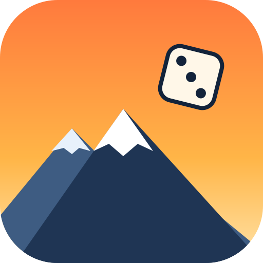

# Altitude Arcade

> L'application s'appelait **DesDés** jusqu'à la version 77, puis **Altitude** (version 78) ; elle s'appelle **Altitude Arcade** depuis la version 79. Le nom affiché et le logo ont changé, mais les clés de sauvegarde internes (`desdes-…`, `DesDesSauvegarde`) sont gardées pour ne perdre aucune partie, et les anciens fichiers de sauvegarde (« DesDés », « Altitude ») s'importent toujours. Logo : coucher de soleil sur la montagne, le soleil est un dé (`logo.svg`, icônes dans `icons/`).

Plate-forme web (application installable) qui regroupe nos carnets de score de jeux de dés, un quiz de géographie, une course à dessiner, un jeu de neige de culture en 3D et un jeu de fusée en musique.



## Les carnets

| Jeu | Fichier | Joueurs |
| --- | --- | --- |
| **10 000** : ouverture à 1 000, croix (effacées dès qu'on note des points ou le −500 du 1er lancer), reprises, pénalités ; il faut finir à 10 000 pile, dépasser donne une croix, et on ne peut pas reprendre des points qui mèneraient à 10 000 ou plus | `jeux/10000.html` | 2 à 15 |
| **Yam's** : feuille de marque classique, bonus à 63 | `jeux/yams.html` | 1 à 10 |
| **Géographie** : drapeaux et cartes (pays, régions et départements français, États américains), placer des villes et monuments au plus près (points selon les km), défis du jour, chrono, records et statistiques | `jeux/geo.html` | 1 |
| **Draw Race** : course dont on dessine la trajectoire ; Formule (monoplaces, 20 circuits inspirés de la F1), Rallye (voitures de rallye, 12 circuits de terre, neige, gravier et goudron), Prototypes (endurance, 12 circuits) ou Tourisme (12 circuits) ; création de ses propres circuits ; pneus, météo et arrêts au stand ; modes Arcade, Championnat, Fantôme, Défis, Élimination, Endurance et Défi du jour | `jeux/drawrace.html` | 1 à 4 (+ adversaires) |
| **Nivoculteur** : sur un domaine tiré au sort, construire le réseau de neige de culture et produire la nuit selon le froid et le vent, en 2D vu de dessus | `jeux/nivoculteur/index.html` | 1 |
| **Fusée Rythme** : piloter une fusée à gauche et à droite au rythme d'un morceau (fourni ou pris dans vos fichiers) et éviter les points ; la partie dure le temps de la musique | `jeux/fusee.html` | 1 |
| **Dameuse de nuit** : damer une piste avant l'ouverture, en 3D derrière la dameuse (caméra réglable) ou vue du dessus, avec la lame, la fraise et le treuil ; 6 dameuses inspirées de vraies machines, 9 pistes et un défi du jour | `jeux/dameuse.html` | 1 |
| **Freeride** : ski ou snowboard hors-piste, en 3D derrière le skieur ou vu du dessus ; fuir une avalanche sans fin, 7 descentes à étoiles, 4 snowparks (kickers, boxes, rails), 3 slaloms chronométrés et un défi du jour | `jeux/freeride.html` | 1 |
| **Tour de contrôle** : guider les avions du doigt jusqu'à la piste de leur couleur sans qu'ils se touchent ; 11 sortes d'appareils (avions de chasse, de ligne, hélicoptères militaires…), 8 aérodromes, 4 niveaux | `jeux/tour.html` | 1 |
| **Tir au panier** : viser au doigt (on place le sommet de la courbe) et marquer un maximum de paniers en 1 minute 30 ; bonus (feu, balle ×3, panier large) en allumant la planche, 10 balles inventées à débloquer, 7 thèmes, mode gaucher | `jeux/panier.html` | 1 |
| **Tables au sommet** : apprendre les tables de multiplication de 1 à 10 (niveau CM1) en grimpant la montagne : leçon avec dessins et astuces, table dans l'ordre puis dans le désordre, entraînement, défi chrono, tableau des progrès | `jeux/tables.html` | 1 |
| **Les aventures de Pépin** : jeu de plateforme en pixels dans l'esprit des grands classiques 2D (personnages, dessins et musiques originaux) ; Pépin le plombier-montagnard traverse 4 mondes et 16 niveaux (prairie, grotte, cimes, lac, neiges, volcan, châteaux du Yéti) ; blocs mystère, cèpes, piments de feu, étoile, tuyaux secrets ; manette à l'écran | `jeux/pepin.html` | 1 |
| **Le Grand Quiz** : culture générale à trois niveaux (Junior, Ado, Adulte), près de 800 questions sur 12 thèmes ; l'échelle des 15 questions jusqu'au million (une erreur n'arrête pas la partie, joker 50/50), la série rapide contre la montre, et le petit bac seul ou à plusieurs | `jeux/quiz.html` | 1 à 6 |
| **Arpenteur** : jeu de sortie avec le GPS : carte OpenStreetMap, pièces et objets rares à ramasser autour de soi (deux albums, 4 raretés), vue AR (caméra + boussole), lieux Wikipédia à visiter (fiches, carnet de cartes postales), points pour chaque 10 m parcourus, journal des sorties, mode essai | `jeux/arpenteur.html` | 1 |
| **Escale** : gestion d'aéroport en 3D ; contrats des compagnies, planning des portes sur 24 h, opérations au sol avec des véhicules, terminal à aménager (files d'attente, satisfaction, commerces), confiance des compagnies et livrées, 3 aéroports inventés (Col-Blanc, Port-Azur, Grand-Val) | `jeux/escale.html` | 1 |
| **Le Buteur** : transformations de rugby en 3D (derrière le ballon) ; glisser vers le haut dans la direction du coup, la vitesse du doigt donne la force ; places et vent au hasard ; 60 secondes, défi du jour, mini-jeux (record de distance, mort subite, plein centre, tempête) | `jeux/rugby.html` | 1 |
| **Billard** : vu de dessus, pool 8 boules (15 boules, 6 poches) ou billard français (3 boules, en 15 points) ; trajectoire de la blanche et début de celle de la boule touchée, effets (rétro, coulé, latéral), réglage fin (◀ ▶, molette), force en tirant la queue ; contre un robot à 3 niveaux ou à deux | `jeux/billard.html` | 1 ou 2 |
| **Flèche d'or** : tir à l'arc en 3D (style dessin animé) : tirer le doigt vers le bas pour bander, viser, lâcher ; concours à 18, 30, 50 et 70 m (3 volées de 3 flèches), parcours en montagne (animaux-cibles à des distances inconnues, repères de distance dans le viseur), cibles mobiles (60 s), défi du jour ; vent, chute de la flèche, tremblement, 3 arcs à débloquer | `jeux/arc.html` | 1 |
| **Rock Altitude** : jeu de guitare rythmique : les notes arrivent sur un manche en 3D (style dessin animé), on les joue sur 3 boutons (Facile) ou 4 (Moyen, Difficile) ; 8 morceaux composés pour le jeu et joués par l'application (pop rock, blues, folk, funk, rock, hard rock, punk, métal), ou ses propres MP3 (notes fabriquées en écoutant le morceau) ; notes longues, accords, multiplicateur, mode Star, jauge du public | `jeux/rock.html` | 1 |
| **Nuancier** : la couleur a disparu d'une partie de l'image (Mario, Pikachu, Coca-Cola, Spotify, le taxi de New York…) : il faut la retrouver de mémoire avec un spectre de couleurs et la luminosité ; 119 images, 10 couleurs par partie notées sur 10 | `jeux/nuancier.html` | 1 |

La page d'accueil (`index.html`) permet de choisir un carnet et indique si une partie est en cours (qui mène, à qui c'est le tour).
Chaque partie est enregistrée dans le navigateur de l'appareil : on peut quitter un jeu et le reprendre plus tard.

### Sauvegarde dans un fichier

Une page web ne peut pas écrire seule dans les fichiers du téléphone. Le bloc **Sauvegarde dans mes fichiers** (accueil, Géographie, réglages du Yam's, bas du carnet du 10 000) a deux boutons :

- **Exporter** écrit toutes les parties, records et statistiques dans un fichier qui porte **toujours le même nom**, `altitude-sauvegarde.json`, pour remplacer l'ancien au lieu d'en créer un nouveau :
  - sur ordinateur (Chrome, Edge) et dans les navigateurs qui savent réécrire un fichier, on choisit l'endroit au premier export ; ensuite, chaque export **réécrit directement ce même fichier** (l'accès est gardé dans IndexedDB, le navigateur peut redemander l'autorisation). « Enregistrer dans un autre fichier… » permet d'en changer ;
  - sur iPhone, le partage s'ouvre : choisir *Enregistrer dans Fichiers*, au même endroit que la dernière fois, et accepter de remplacer le fichier existant ;
  - ailleurs, le fichier est téléchargé (le navigateur peut ajouter « (1) » au nom si l'ancien est encore dans les téléchargements).
- **Importer** recharge un fichier exporté, après confirmation : les données de l'appareil sont remplacées.

Le code est dans `jeux/sauvegarde.js`.

### Yam's

- Une case rayée est barrée d'une seule barre oblique.
- Les cases qui restent à remplir sont teintées. La colonne du joueur qui doit jouer est plus marquée et son nom est souligné.
- La ligne des noms reste visible quand on fait défiler la feuille.
- Le bouton **Réglages** permet de :
  - cacher les totaux (ils réapparaissent à la fin de la partie) ;
  - choisir la couleur du carton (Classique, Vieux papier, Ardoise, Menthe, Nuit) ;
  - faire d'un joueur un robot (facile, moyen ou fort) ;
  - voir les statistiques par joueur (parties, victoires, record, moyenne) ;
  - exporter ou importer la sauvegarde.

### 10 000

- La barre de score est plus épaisse. Toucher un joueur (ou sa barre) ouvre sa **fiche** en plein écran : score en grand, reste à faire, croix, et le bloc du tour pour jouer depuis la fiche.
  Une fois le tour noté, la fiche montre le résultat et un bouton **Joueur suivant**. On peut aussi balayer pour passer d'un joueur à l'autre.
- Le bouton pour reprendre les points du joueur précédent est doré, plus grand et clignote doucement, dans le carnet comme sur le tapis.
- On peut ajouter des robots (facile, moyen, fort) dans la liste des joueurs.
- *Statistiques et sauvegarde* (bas de page) : parties, victoires et score moyen par joueur. *Couleur du carnet* : vert, bordeaux, bleu nuit, bois, ardoise.

## Plateau de dés

Si on a oublié les dés, le bouton rouge **Dés** de chaque carnet ouvre un tapis avec 5 dés : on les lance en glissant le doigt sur le tapis (ou avec le bouton *Lancer*), et on touche un dé pour le garder.

- **Yam's** : 3 lancers au plus par tour ; on garde ou reprend les dés de son choix entre deux lancers.
  Après chaque lancer, le plateau reconnaît les figures (brelan, full, suites, Yam's…) et propose les cases libres du joueur avec leurs points ; un toucher note le score dans la feuille. On peut aussi rayer une case.
- **10 000** : lancers sans limite ; il faut mettre de côté au moins un dé qui rapporte avant de relancer (bouton pour mettre de côté tout ce qui compte). Les points passent dans le tour du carnet à chaque relance, et « Garder les points » les inscrit.
  - Si tous les dés lancés rapportent, les points sont ajoutés et la relance des 5 dés est obligatoire.
  - Si les 2 derniers dés font un double (2, 3, 4 ou 6), relance obligatoire des 5 dés, sans points. Un double 1 ou 5 rapporte ses points, puis relance des 5.
  - Si aucun dé ne rapporte, le plateau propose de noter le raté.
  - Quand un joueur reprend les points du précédent, il ne lance que les dés que celui-ci avait laissés (par exemple 2 dés pour 2 700 points gardés avec 2 dés restants). Il doit lancer et marquer des points avant de pouvoir garder : on ne peut pas reprendre un score et le noter sans jouer (règle appliquée aussi dans le carnet).

Les dés ne se chevauchent jamais sur le tapis : après chaque lancer, ceux qui se touchent sont légèrement écartés.

- **Couleurs** (bouton « 🎨 Couleur du tapis », tout en bas, sous les boutons de jeu) : feutre vert, casino, bleu, bois, ardoise avec dés rouges, nuit avec dés noirs. Ce choix est commun aux deux jeux.
- **Conseils** (Yam's, bouton 💡) : après chaque lancer, les dés à garder sont entourés de jaune.
  Le plateau donne aussi les chances de faire chaque figure encore libre (brelan, carré, full, suites, Yam's) à la fin du tour.
  Après le dernier lancer, la case conseillée est marquée d'une étoile.
  Le calcul est exact : il essaie toutes les façons de garder les dés sur les lancers restants. Il tient compte des cases libres du joueur et du bonus de 63.
- **Figure à 5 dés** (10 000) : quand tous les dés lancés rapportent, la figure s'affiche (« Suite ! », « Cinq 3 ! »…) avec ses points pendant 2 s avant que les dés passent de côté.
- **Robot** : à son tour, le plateau s'ouvre et le robot lance les dés lui-même. On voit ce qu'il garde, puis il note son score dans le carnet. *Arrêter le robot* interrompt son tour.
  Les décisions sont dans `jeux/ia.js`. En simulation :
  - au Yam's, un robot fait en moyenne 152 points en facile, 185 en moyen et 198 en fort ;
  - au 10 000, il atteint 10 000 en 39, 36 et 34 tours en moyenne.

Le plateau repart de zéro dès qu'un score est noté dans le carnet. Le code est dans `jeux/plateau.js`, partagé par les deux jeux.

## Le Grand Quiz

Quiz de culture générale, tout dans `jeux/quiz.html` ; les questions sont dans `jeux/quiz/junior.js`, `ado.js` et `adulte.js`, les mots du petit bac dans `jeux/quiz/mots.js`.

- **Niveaux et thèmes** : Junior (8-12 ans, 248 questions), Ado (12-16 ans, 271) et Adulte (279). Douze thèmes en trois familles qu'on coche ou décoche : *Classiques* (histoire, géographie, sciences, arts et lettres), *Loisirs* (sport, cinéma, musique, jeux) et *Vie quotidienne* (animaux, cuisine, langue française, corps humain). Une question s'écrit `[thème, difficulté 1 à 5, question, bonne réponse, trois mauvaises]` ; les réponses sont mélangées à l'affichage. Les questions déjà vues reviennent le plus tard possible (`quiz-vus`).
- **L'échelle des 15 questions** : de plus en plus difficiles (trois questions par degré de difficulté), chaque question rapporte sa marche de l'échelle (de +100 à +500 000 ; les 15 réussies font 1 000 000 de points, `GAINS`). Une erreur n'arrête pas la partie : la question ne rapporte rien (sa marche est barrée en rouge) et on passe à la suivante, jusqu'à la 15e. Un joker 50/50 retire deux mauvaises réponses. La réponse choisie s'allume en orange, puis la bonne en vert. À la fin : le score, le nombre de bonnes réponses, et les questions ratées avec leur réponse.
- **Série rapide** : 10 questions de difficulté croissante, 15 secondes chacune ; 100 points plus 10 par seconde restante, doublés à partir de 3 bonnes réponses d'affilée.
- **Petit bac** : de 1 à 6 joueurs sur le même téléphone, chacun son tour (on passe le téléphone). On choisit les catégories (12 au choix : prénom, animal, pays, ville, fruit ou légume, métier, sport, vêtement, couleur, instrument, plat ou aliment, objet de la maison), le temps (1, 2, 3 minutes ou sans limite), le nombre de manches et les lettres (faciles ou toutes). La lettre est tirée sans revenir dans la partie. À la correction, un mot de la liste de l'appli est validé tout seul (la comparaison ignore majuscules, accents, tirets, article et pluriel) ; un mot inconnu est en pointillés : seul, on peut l'accepter à la main (5 points au lieu de 10) ; à plusieurs, on décide ensemble en touchant les mots (un mot valable vaut 10 points, ou 5 si un autre joueur a le même). Sous les scores, « Des idées de mots avec cette lettre » propose jusqu'à 6 mots de la liste par catégorie (en vert ceux qu'un joueur a trouvés).
- **Données** : `quiz-reglages` (niveau, thèmes), `quiz-records` (meilleur gain de l'échelle et nombre de millions par niveau, record de la série, meilleure manche de petit bac en solo), `quiz-stats` (réponses, bonnes réponses, par thème : l'accueil du quiz en tire le point fort et le thème à travailler), `quiz-vus`, `quiz-bac` (joueurs et réglages), `quiz-dernier`, `quiz-son` ; dans la sauvegarde d'Altitude Arcade et dans l'onglet Suivi du tableur.

## Sauvegarde en ligne (Google Sheet)

Chaque joueur peut avoir un **compte** (pseudo + code secret à 4 chiffres). Une fois connecté, ses parties, records et statistiques sont sauvegardés tout seuls dans un Google Sheet, et reviennent sur n'importe quel téléphone où il se connecte. Sans compte, tout marche comme avant (sur l'appareil seulement, avec l'export et l'import de fichier).

- **Le serveur** : `outils/sauvegarde-google.gs`, un petit programme Apps Script collé dans le Google Sheet et publié comme « Application Web ». Son adresse (elle finit par `/exec`) se met dans `SERVEUR_DEFAUT` en haut de `jeux/compte.js`. Tant qu'elle est vide, l'application ne montre rien de la sauvegarde en ligne.
- **Installer** :
  1. ouvrir le projet Apps Script du serveur (ou, dans le Google Sheet, *Extensions › Apps Script*) ;
  2. remplacer tout le contenu de `Code.gs` par celui de `outils/chargeur-google.gs` (le fichier « Altitude Arcade – CHARGEUR à coller dans Apps Script.txt », dans le Drive, contient le même texte), enregistrer ;
  3. *Déployer › Nouveau déploiement*, type *Application Web*, « Exécuter en tant que : moi », « Qui peut accéder : Tout le monde », *Déployer*, accepter les autorisations (le tableur et « se connecter à un service externe ») ; pour un déploiement qui existe déjà : *Déployer › Gérer les déploiements*, crayon, *Version : nouvelle version* (l'adresse reste la même) ;
  4. copier l'adresse de l'application Web dans `jeux/compte.js`.
- **Le chargeur** : `outils/chargeur-google.gs` ne fait que lire le vrai programme, `outils/sauvegarde-google.gs`, sur GitHub (branche main, le dépôt est public), et le faire tourner. Une modification du serveur arrive donc toute seule au plus tard 10 minutes après la fusion dans main, sans rien recoller ni republier ; pour la prendre tout de suite, ouvrir l'adresse de l'application Web suivie de `?maj=1`. Le chargeur garde une copie du dernier programme lu (propriétés du script) : si GitHub ne répond pas, le serveur continue avec elle, et un programme qui contient une erreur n'est jamais pris. Attention : le programme tourne avec le compte Google du propriétaire, donc seules des personnes de confiance doivent pouvoir modifier la branche main. `ID_TABLEUR`, en haut de `outils/sauvegarde-google.gs`, désigne le tableur « Altitude arcade ».
- **Le tableur** (onglets créés tout seuls) :
  - *Comptes* : pseudo, code, actif (oui / non), création, dernière visite, appareil, jeton. On peut changer un code, bloquer un compte (*non*), effacer le jeton pour déconnecter tous ses appareils, ou supprimer la ligne.
  - *Suivi* : une ligne par joueur, une colonne par jeu, avec le même texte que sur l'accueil (niveaux réussis, records…), mis à jour à chaque passage sur l'accueil.
  - *Données* : les sauvegardes (une ligne par joueur et par élément du stockage ; les longues valeurs sont coupées en morceaux de 40 000 caractères, chacun précédé de « ~ » pour que le tableur n'en fasse jamais un nombre ou une formule). À ne pas modifier à la main.
  - *Classement* : une ligne par joueur et par jeu, avec ses meilleurs scores et ses statistiques (voir « Classement et statistiques »). À ne pas modifier à la main.
  - *Journal* : créations de comptes, connexions, codes faux.
- **Connexion** (accueil) : la fenêtre s'ouvre à la première visite (« Plus tard » la cache 3 jours). Un pseudo inconnu crée le compte ; un pseudo connu demande le bon code (les majuscules ne comptent pas). Après 6 codes faux, il faut attendre 10 minutes. En se connectant, les parties du compte remplacent celles de l'appareil, et ce qui n'existe pas encore en ligne est envoyé. Se déconnecter envoie tout puis efface les parties de l'appareil (pratique quand plusieurs enfants partagent un téléphone).
- **Synchronisation** (`jeux/compte.js`, chargé par toutes les pages après `sauvegarde.js`) : à l'ouverture d'une page, on récupère ce qui a changé ailleurs (si des parties arrivent juste à l'ouverture, la page se recharge une fois) ; ensuite on envoie ce qui a changé toutes les 20 secondes et en quittant la page. Chaque élément garde l'empreinte de sa dernière version envoyée ou reçue (`compte-sync`) : on sait ainsi ce qui a changé de chaque côté ; si un élément a changé des deux côtés, celui de l'appareil gagne. Les clés `compte-*` restent sur l'appareil.
- **Sécurité** : l'adresse du serveur est visible dans le code du site ; le code à 4 chiffres empêche de jouer sur le compte d'un autre, mais ce n'est pas un coffre-fort : on n'y met que des parties de jeux.
- **Essais** : le chargeur a été essayé avec GitHub qui répond, GitHub en panne (copie de secours) et un programme cassé (refusé) ; `outils/sauvegarde-google.gs` a été essayé hors de Google avec un faux tableur qui imite le vrai (codes à zéros, nombres, formules, longues valeurs, comptes bloqués), puis l'application entière avec deux « téléphones » sur le même compte.

## Classement et statistiques

Page `jeux/classement.html`, ouverte par le bouton **🏆 Classement** dans le bandeau du compte sur l'accueil (il faut être connecté).

- **Chaque épreuve a son classement** : chaque circuit de Draw Race (course et meilleur tour), chaque piste de la Dameuse, chaque télésiège de Chef de quai, le marathon de Blocs, le Nuancier, la carrière de Paddock, chaque niveau de Pépin, de la Tour de contrôle, de Tables au sommet, chaque chanson de Fusée Rythme, chaque mode de Géographie, du Grand Quiz, de Freeride, du Tir au panier, du Yam's, du 10 000 et de Nivoculteur. Pour chaque épreuve, les joueurs sont rangés du meilleur au moins bon (🥇🥈🥉), la ligne du joueur connecté est en couleur.
- **Tableau d'honneur** : en haut, le nombre de premières, deuxièmes et troisièmes places de chaque joueur (seulement sur les épreuves jouées par au moins deux joueurs).
- **Statistiques** : sous les épreuves de chaque jeu, un tableau pour se comparer (parties jouées, victoires, étoiles, niveaux réussis…), la meilleure valeur en doré.
- **Comment ça marche** : `jeux/scores.js` lit les records rangés sur l'appareil et en tire, pour chaque jeu, les épreuves et les statistiques du joueur. L'accueil les envoie au tableur à chaque passage (avec le résumé de l'onglet Suivi), dans l'onglet *Classement* (une ligne par joueur et par jeu). La page du classement demande au tableur les scores de tous les comptes actifs (un compte bloqué n'apparaît plus) ; elle garde la dernière réponse pour s'afficher même sans réseau.
- **Le nom du joueur** : quand on est connecté, le pseudo du compte est mis tout seul comme nom de joueur dans la Géographie, Draw Race, le Yam's et le 10 000 (on peut toujours le changer).
- Le classement demande la version du programme du tableur qui connaît l'action « classement » (elle arrive toute seule par le chargeur une fois la branche fusionnée dans main).

## Le classement dans chaque jeu, et le carrousel

- **Dans chaque jeu**, un bouton **🏆 Classement** (juste le trophée sur un écran étroit), à côté du lien vers l'accueil, ouvre le classement de tous les joueurs pour ce jeu seulement : chaque épreuve avec les médailles, et les statistiques pour se comparer. C'est `jeux/classement-jeu.js`, chargé par chaque jeu après `compte.js` : il reconnaît le jeu par le nom de sa page, charge `scores.js` au besoin, montre d'abord le dernier classement gardé puis demande au tableur le classement à jour (après avoir envoyé ses propres scores). Sans compte, il montre seulement ses scores sur l'appareil. Un lien mène au classement de tous les jeux.
- **Le carrousel** : dans la fenêtre du profil (bouton Compte de l'accueil), « Présentation des jeux sur l'accueil » : **liste** (comme avant) ou **carrousel** (une grande carte à la fois, on glisse du doigt ; flèches, points et le nom du jeu dessous). Deux petits boutons ☰ et 🎠, à côté de « Choisir un jeu », font la même chose. Le choix (`desdes-presentation`) et le dernier jeu regardé (`desdes-carrousel`) sont gardés, et suivent le compte d'un téléphone à l'autre.

## Géographie

Quatre terrains de jeu :

| Terrain | Éléments | Zones |
| --- | --- | --- |
| Pays du monde | 195 pays : membres de l'ONU, Vatican et Palestine | les continents, ou tous mélangés |
| Régions de France | 18 régions, outre-mer en encarts | — |
| Départements | 101 départements, outre-mer en encarts | toute la France, une région, ou l'outre-mer |
| États-Unis | 50 États, Alaska et Hawaï en encarts | — |

Les jeux proposés :

- **Drapeaux** (pays et États) : un drapeau et quatre noms (pays du même continent) ; il faut trouver le bon.
- **Mélange** (pays et États) : drapeaux et carte en alternance.
- **Numéros** (départements) : le numéro d'un département, ou l'inverse ; les propositions sont des départements voisins.
- On joue **10 ou 20 questions tirées au hasard, ou toutes**.
- **Défi du jour** : 12 questions, les mêmes pour tout le monde ce jour-là (4 drapeaux, 4 pays sur la carte, 2 départements, 2 États).
- **Mini-jeux** : *Record de distance* (face aux poteaux à 22 m, petit vent jusqu'à 3 m/s, on recule de 5 m à chaque réussite, un raté arrête ; record = la plus longue réussie), *Mort subite* (places de plus en plus dures sans chrono, le premier raté arrête ; record = réussites), *Plein centre* (10 coups, une réussite vaut de 10 points au milieu à 2 contre le poteau : 10 − 8 × écart / 2,8 m ; bandes jaune, orange, blanche entre les poteaux ; max 100), *Tempête* (60 s, vent de 8 à 14 m/s, places à moins de 35 m).
  Seul le premier essai du jour compte. Le nombre de jours d'affilée est affiché.
- **Statistiques** : parties jouées, pourcentage de réponses justes du premier coup, et une liste **À revoir** des pays et départements les plus souvent ratés (un élément sort de la liste quand on le trouve du premier coup).
- **Carte** : un nom de pays ; il faut le toucher sur la carte (on peut zoomer en pinçant ou avec les boutons, et se déplacer en glissant). Trois essais par pays, puis la réponse s'affiche. Les tout petits pays ont un repère rond pour pouvoir les toucher.
- **Placer** (pays du monde et départements) : un lieu célèbre à placer sur la carte : grandes villes, monuments, sites naturels, et en France aussi des stations de ski (165 lieux dans le monde, 106 en France, dans `jeux/geo/lieux.js`). On touche la carte pour poser l'épingle (on peut la déplacer), puis **Valider** : la bonne place s'affiche avec un trait, la distance à vol d'oiseau en km et les points. 10 lieux par partie, **5000 points** chacun au plus : 5000 tout près (moins de 25 km dans le monde, 3 km en France), puis la moitié tous les 300 km dans le monde (50 km en France), 0 au-delà de 4000 km (600 km en France). Dans le monde, on peut choisir un continent ; en France, c'est toute la métropole, sur la carte des départements. Les records se comptent en points.
- **Défi des lieux** : 10 lieux à placer, les mêmes pour tout le monde ce jour-là (6 dans le monde, 4 en France), avec son propre nombre de jours d'affilée.
- **Les kilomètres** : `lieux.js` refait les calculs des deux projections de la carte (Natural Earth pour le monde, conique conforme de Lambert pour la France, avec l'échelle et le décalage de `outils/construire-geo.mjs`) dans les deux sens : du lieu vers la carte, et du point touché vers sa latitude et sa longitude ; la distance se calcule ensuite sur la sphère terrestre (formule de haversine). Les deux sens ont été comparés à d3-geo (écart nul) et chaque lieu a été vérifié dans son pays ou son département.
- **Déplacer la carte** : un doigt glisse (le point touché reste sous le doigt), deux doigts zooment et déplacent en même temps, boutons + − ⤢. Pendant le geste, la carte est seulement déplacée comme une image (fluide même avec les 101 départements) ; la vue est posée au lâcher. Quand la hauteur de l'écran change (barre d'adresse, rotation), la vue est gardée au lieu de revenir à la carte entière.

Le chrono tourne pendant toute la partie. Les 5 meilleurs résultats de chaque jeu et de chaque zone sont gardés sur l'appareil (score du premier coup, puis temps).

La carte du monde rattache à leur pays les morceaux que la source sépare : l'Australie avec les îles Ashmore-et-Cartier, le Somaliland avec la Somalie, et Chypre du Nord avec Chypre.
Avant ce correctif, l'Australie était presque invisible et la corne de l'Afrique fausse.

Les données (`jeux/geo/monde.js`, `france.js`, `usa.js`, `drapeaux/` et `drapeaux-us/`) sont produites par `outils/construire-geo.mjs`. La liste des lieux à placer (`jeux/geo/lieux.js`) est écrite à la main ; si les cartes sont reconstruites avec un autre cadrage, il faut y recopier l'échelle et le décalage des projections, que le script affiche.
Sources : IGN Admin Express via france-geojson (Licence ouverte), U.S. Census Bureau via us-atlas (domaine public), drapeaux des États us-state-flags (ISC), Natural Earth via world-atlas (domaine public), mledoze/countries via world-countries (licence ODbL), drapeaux flag-icons (licence MIT), noms français du CLDR.

## Draw Race

### Catégories de véhicules

Quatre catégories, chacune avec ses circuits, ses pilotes, son championnat (`drawrace-championnat`, `drawrace-championnat-rallye`, `-endurance`, `-tourisme`) et ses records :

- **🏎 Formule** et **🚙 Rallye** : comme avant.
- **🌙 Prototypes** (les voitures des courses d'endurance) : 6 circuits à eux (`jeux/drawrace/categories.js` : La Sarthe, Le Grand Ovale, Les Marais, Le Volcan, L'Algarve, La Forêt verte), plus 6 circuits de Formule (`SELECTION_ENDURANCE`). Très rapides en ligne droite (vitesse de pointe × 1,07), un peu moins d'adhérence en virage (× 0,93), pneus qui s'usent deux fois moins vite. Pilotes aux noms inspirés des grands pilotes d'endurance.
- **🚗 Tourisme** : 6 circuits à eux (Le Port de Guia, Le Vieux Bourg, Les Collines, Le Plateau, La Puszta, Le Boulevard), plus 6 circuits de Formule (`SELECTION_TOURISME`). Plus lentes (× 0,8), moins d'adhérence (× 0,82), freinages plus longs (× 0,72), accélérations plus molles, pneus qui s'usent plus vite (× 1,35) ; les adversaires sont très proches les uns des autres (écarts de vitesse réduits). Pilotes aux noms inspirés des pilotes de tourisme.

La conduite de chaque catégorie est dans `VEHICULES` ; `Piste.regler({ vmax, grip, frein })` change la vitesse de pointe, l'adhérence et le freinage de toute la géométrie (trajectoires, vitesse du doigt, adversaires). Les circuits de Formule repris dans une autre catégorie sont des copies (`prefixe` « end: » ou « tou: ») : leurs records, fantômes, étoiles et tours choisis sont à part (`cleBase`, `idCat`). Chaque catégorie a son dessin de voiture (`voitureProto`, `voitureTourisme`).

### Les circuits du joueur

Au-dessus du carrousel des circuits, on choisit entre les circuits officiels de la catégorie et **« Circuits de (nom du joueur) »**. Le bouton **➕ Créer un circuit** ouvre l'éditeur (à l'horizontale) :

1. **Tracer** la boucle au doigt, d'un seul trait : elle est lissée, fermée, gardée dans le cadre, et ramenée à des points de passage tous les 70 environ (`edPoints`). La ligne de départ est au début du trait, la course dans le sens du trait.
2. **Retoucher** : chaque point se déplace au doigt ; 🏁 déplace la ligne de départ au point suivant, ⇄ inverse le sens, ✏️ redessine. Les endroits où la piste se touche sont entourés de rouge (`edVerifier` : deux morceaux éloignés le long du tracé, à moins d'une largeur de piste, et pas en croisement franc comme au Huit) ; on peut quand même enregistrer.
3. **Régler** : nom, décor (17 au choix), nombre de tours (2 à 8), sol en Rallye ; la difficulté (1 à 5 points) est calculée d'après le temps passé à freiner et à tourner.

Les circuits sont gardés dans `drawrace-perso` ; chacun est construit dans chaque catégorie (`construirePerso` ; en Rallye avec le sol choisi). Ils se jouent avec toutes les voitures, dans tous les modes sauf le Championnat et le Défi du jour ; ils ont leurs records, fantômes et étoiles (ils ne vont pas au classement de tous les joueurs). ✏️ Retoucher un circuit le fait repartir de zéro (records, fantômes, étoiles, temps cible : `oublierCircuit`), 🗑 Supprimer aussi.

Sept modes de jeu, au choix en haut du menu (les réglages affichés changent avec le mode, `regles()` donne ceux de la course) :

- **Arcade** : une course, de 1 à 4 joueurs sur le même appareil, contre des adversaires. Tout se règle : circuit, nombre de tours, difficulté, météo.
- **Championnat** : un joueur seul contre 5 pilotes, course après course.
- **👻 Fantôme** : seul en piste, sur piste sèche, contre le fantôme du meilleur temps du circuit (pour ce nombre de tours). Le fantôme est une voiture transparente qui refait la course du record ; à côté du chrono, l'écart en direct (vert : en avance, rouge : en retard), calculé à la même progression dans la course. Les temps comptent dans les records habituels. Chaque course d'un humain est enregistrée (une position toutes les 0,1 s : `v.rec`) ; le meilleur temps arrivé, dans tous les modes qui comptent pour les records, devient le fantôme s'il est meilleur que l'ancien (clé `drawrace-fantome-<circuit>`, une par circuit et nombre de tours).
- **⭐ Défis** : sur chaque circuit, 3 défis contre 3 adversaires à 40 %, piste sèche, nombre de tours habituel : gagner la course, finir sans sortie de piste, battre le temps cible (`tempsCible` : course simulée d'un adversaire à 45 %, sans erreur ni hasard, gardée dans `drawrace-cibles`). Chaque défi réussi donne une étoile pour toujours (`drawrace-etoiles`) ; les étoiles s'affichent sur les cartes des circuits. Les temps comptent dans les records.
- **💥 Élimination** : seul contre 5 pilotes, 5 tours. Quand tous les pilotes encore en course sauf un ont fini un tour, le dernier est éliminé (`eliminer`) ; au dernier tour, le premier à passer la ligne gagne. Si le joueur est éliminé, la course des autres est simulée d'un coup. Pas de records.
- **⏱ Endurance** : 10, 15 ou 20 tours. Chaque joueur trace un seul tour, répété toute la course. La météo change 1 à 3 fois (`planMeteo`, appliqué quand la tête de course arrive à chaque moment prévu) ; 2 arrêts au stand obligatoires, 10 s de pénalité par arrêt manquant (les adversaires font les leurs, `arretsObligatoires`). Pas de records.
- **📅 Défi du jour** : chaque jour, un circuit, une météo (et le moment de l'averse), la difficulté des adversaires et le nombre de tours tirés d'après la date et la catégorie (`defiDuJour`), les mêmes sur tous les téléphones. Autant d'essais qu'on veut : le meilleur temps de chaque pilote du jour est gardé (`drawrace-jour`) et envoyé au classement de tous les joueurs (épreuve « Défi du jour » du jour dans `scores.js`).

### Championnat

- **Réglages au départ** :
  - nom et couleur du pilote ;
  - difficulté (curseur de 0 à 100 %), **fixée pour tout le championnat** ;
  - nombre de courses, de 2 à 20, avec − et + (ou les raccourcis 5, 8, 12, 20) ; chaque course a lieu sur un circuit différent ;
  - un **minimum de tours** par course (3 à 10) : chaque circuit garde son nombre de tours habituel (2 à 5), relevé à ce minimum si besoin ;
  - météo : variable (chaque course a sa météo, découverte en arrivant sur le circuit) ou toujours sèche ;
  - calendrier : au hasard, ou du plus facile au plus dur.
- **Adversaires** : 5 pilotes tirés parmi 12 noms inspirés de vrais pilotes de F1, chacun avec sa couleur : Max Verstapin, Lewis Hamiltown, Charles Leclaire, Lando Norrish, Oscar Piastrino, Fernando Alonsso, George Russelle, Carlos Sainze, Pierre Gaslight, Esteban Ocone, Yuki Tsunodo, Valtteri Bottass.
  Il y a toujours l'un des trois plus forts. Chaque pilote a sa force (au plus ±1 % de vitesse autour de la difficulté choisie), plus une forme du jour qui change à chaque course.
- **Points** : 25, 18, 15, 12, 10 et 8 du 1er au 6e, et 1 point pour le meilleur tour en course. Un abandon ne rapporte rien.
  Les autres pilotes terminent la course (simulée d'un coup) pour avoir de vrais temps. À égalité de points, le nombre de victoires puis les meilleures places départagent.
- **Avant chaque course**, l'écran du championnat montre :
  - la prochaine course (circuit, nombre de tours, météo à découvrir) ;
  - le calendrier, avec les courses faites et celle à venir ;
  - le classement général, avec les points gagnés à la dernière course.
- **Grille de départ** : dans l'ordre du classement général (au hasard pour la première course).
- **Abandons** :
  - *Abandonner* pendant une course donne 0 point, et les autres finissent la course ;
  - pendant le tracé, on retourne au classement sans pénalité, et la course reste à faire ;
  - *Abandonner le championnat* (sur l'écran du classement ou au menu) efface le championnat en cours.
- **Sauvegarde** : le championnat est gardé sur l'appareil. On peut quitter et reprendre plus tard : le menu propose *Continuer*. L'accueil d'Altitude Arcade affiche la course et la place.
- **Fin** : classement final et champion. Un **palmarès** garde les derniers championnats (date, nombre de courses, difficulté, place, points).

Le jeu se joue le téléphone à l'horizontale (un message le demande en vertical), pour des pistes plus larges.

**Pendant le tracé et la course**, toutes les informations sont dans le bandeau sombre du haut (à la place du bandeau noir) : Abandonner, le circuit, la météo, le chrono, la vitesse du doigt, le classement en petites pastilles (les trois premières lettres de chaque pilote, en capitales ; J1, J2… pour un joueur sans nom), les messages, et pendant le tracé les boutons Effacer et C'est parti. Le circuit prend toute la largeur dessous. Boost et Stand sont de gros boutons ronds dans les coins, un coin par joueur (joueur 1 en bas à droite, 2 en bas à gauche, 3 en haut à droite, 4 en haut à gauche) ; à 3 ou 4 joueurs, les panneaux sont plus petits, sans le détail de l'usure des pneus (le classement donne la lettre des pneus).

**À plusieurs, où est mon bouton Boost ?** Sur la grille de départ, chaque joueur voit un petit écran avec son coin allumé (« Tes boutons ⚡ Boost et 🔧 Stand : en bas à droite de l'écran »). Pendant les feux, les quatre coins s'allument à la couleur de leur pilote avec son nom et une main (👇 ou 👆) qui montre le bouton, pendant 4 secondes et demie.

**Toutes les tailles d'écran** : le circuit prend toute la place libre, sans déborder sous l'encoche ni sous la barre d'accueil des iPhone (les marges de sécurité de l'écran sont retirées avant le calcul), et il se recalcule tout seul quand le téléphone tourne, quand la barre du navigateur apparaît ou disparaît, ou quand le bandeau du haut change de hauteur. Le jeu suit la partie vraiment visible de l'écran (sous la barre de Safari). Pendant le tracé, des boutons **+ et −** en bas à gauche règlent la taille du circuit, de 50 % à 100 % de la place libre (par pas de 5 %) : le réglage sert aussi pour la course et reste gardé pour les parties suivantes (`drawrace-zoom`). Sur un écran étroit, « Abandonner » devient une croix. Sur un petit téléphone à l'horizontale, le bandeau du haut se resserre (pastilles plus petites, la météo et la vitesse du doigt cachées) pour que les 4 pilotes tiennent ; les boutons « Départ » restent entre les coins des Boost (sur deux lignes à 3 ou 4 joueurs). En portrait, le jeu demande de tourner le téléphone.

### Rallye

Deuxième catégorie, au choix tout en haut du menu (🏎 Formule ou 🚙 Rallye), avec les mêmes modes (Arcade, Championnat), la même difficulté et la même météo.

- **Voitures de rallye** vues de dessus : caisse courte et large, livrée à bandes sur le capot, toit avec son numéro, grand aileron, rampe de quatre phares, bavettes.
- **12 circuits** fermés façon rallye (`jeux/drawrace/rallye.js`), inspirés des grands rallyes : Le Chili (gravier), La Suède (neige), Les Mille Lacs (gravier très rapide), Le Safari (terre rouge), Le Portugal (terre), La Sardaigne (gravier), Le Pays de Galles (terre et gravier), Le Japon (goudron), La Catalogne (goudron et terre), Monte-Carlo (épingles, goudron et plaques de neige), L'Acropole (gravier, virages lents), La Corse (goudron, virages sans fin).
- **Les sols** (`SOLS`) : goudron, terre, gravier, neige, par morceaux du tour (`sols`). Chaque morceau a sa couleur, son bord (talus de terre, murs de neige), ses ornières et ses cailloux ; vibreurs seulement sur le goudron. Les voitures soulèvent la poussière ou la neige. **Sur la terre et le gravier, elles glissent** dans les virages, d'autant plus qu'elles les prennent près de la limite (dès la moitié de la vitesse possible) : elles se mettent en travers, perdent un peu de vitesse et soulèvent un nuage de poussière (sans message d'alerte : c'est normal sur ces sols).
- **Pneus** (`PNEUS_R`) : Asphalte (A), Terre (T), Neige (N, cloutés) et Pluie (P). L'adhérence dépend du sol et du pneu, en chaque point de la piste (`gripSol`) :

  | Sol | Asphalte | Terre | Neige | Pluie |
  | --- | --- | --- | --- | --- |
  | Goudron | 1 | 0,84 | 0,72 | 0,9 |
  | Terre | 0,6 | 0,82 | 0,68 | 0,7 |
  | Gravier | 0,56 | 0,78 | 0,66 | 0,64 |
  | Neige | 0,38 | 0,52 | 0,8 | 0,45 |

  La pluie fait perdre de l'adhérence (beaucoup sur le goudron, un peu sur la terre et le gravier, presque pas sur la neige), sauf en pneus Pluie. Durées de vie : 4 tours (Asphalte), 5 (Terre, Pluie), 6 (Neige). Le conseil de l'ingénieur et les adversaires tiennent compte de la part de chaque sol dans le tour.
- **Pilotes du championnat** : 12 noms inspirés de grands pilotes de rallye (Sébastien Loebb, Sébastien Ogiée, Kalle Rovanperra, Thierry Neuvil, Ott Tanakka, Elfyn Evance, Colin McRaie, Tommi Mäkinan, Petter Solbergh, Marcus Grönholmm, Didier Auriolle, Walter Röhrll). Un championnat en cours par catégorie (`drawrace-championnat`, `drawrace-championnat-rallye`) ; le palmarès est commun (🚙 devant les championnats de rallye).

1. En Arcade, on choisit :
   - le nombre de joueurs (1 à 4, sur le même appareil), la couleur et les **pneus** de chaque monoplace ;
   - la difficulté des adversaires avec un **curseur** de 0 à 100 % (Facile, Normal, Difficile, Expert, et tous les réglages entre deux) et la **météo** ;
   - le circuit dans le carrousel : 20 circuits inspirés de la F1, de difficulté 1 à 5, de 2 à 5 tours, chacun avec son décor.
   - le **nombre de tours**, de 1 à 10 (le nombre habituel du circuit est proposé). Les records sont gardés à part quand on ne fait pas le nombre habituel.

   La météo réelle du circuit est annoncée dès l'arrivée sur la piste (une météo « Surprise » est découverte à ce moment-là).
2. Chaque joueur dessine ses tours d'affilée, sans lever le doigt, en partant de la ligne à damier (on peut reprendre au bout du trait, ou tout recommencer). La vitesse du doigt devient la vitesse de la voiture : la jauge et la couleur du trait passent du vert (lent) au rouge (rapide). Dans les virages, la voiture freine toute seule avant le virage, mais un virage tracé trop vite la fait déraper (voir *Physique*). Le trait est épais (9 px), pour bien voir sa trajectoire.
3. La course se joue à 4 voitures (les places libres sont prises par des adversaires, qui partent derrière les joueurs). Chaque voiture suit, à chaque tour, le tracé dessiné pour ce tour. Les tours forment un seul chemin continu : au passage de la ligne, la voiture enchaîne directement sur le tracé du tour suivant, sans écart ni saut (avant la ligne et après l'arrivée, elle suit la piste, à la même distance du bord que le début et la fin du tracé). Le **Boost** (vitesse ×1,4 pendant 1,3 s) se recharge : 2 charges au départ, 3 au plus, une charge de plus toutes les 6 s (la petite jauge du bouton montre la recharge). On peut abandonner à tout moment (la partie ne compte pas).

   Les monoplaces sont dessinées en détail, vues de dessus : ailerons avant et arrière avec leurs dérives, museau, pontons et prises d'air, halo, casque du pilote, rétroviseurs, suspensions, roues avec jantes, bande de décoration dans une teinte plus claire.

### Départ au temps de réaction

Option **Départ au temps de réaction** (cochée par défaut), dans le menu de l'Arcade (aussi à plusieurs joueurs) et dans les réglages du Championnat.

- Les 5 feux rouges s'affichent en grand au milieu de l'écran et s'allument un à un. Ils restent allumés un temps au hasard, puis s'éteignent : c'est le départ.
- Sous les feux, chaque joueur a son bouton **🚦 Départ**. Le bouton affiche le temps de réaction mesuré (par exemple « 0,250 s · très bien » ; excellent sous 0,2 s, correct sous 0,45 s, lent au-delà).
- Meilleur est le temps de réaction, plus la voiture démarre tôt et accélère fort dans les premiers mètres.
- Appuyer avant l'extinction des feux est un **faux départ** : la voiture part 1 s après les autres.
- Sans appui, la voiture part toute seule au bout de 1,5 s.
- Les adversaires réagissent en 0,2 à 0,45 s (plus vite aux niveaux élevés).
- Les résultats donnent le temps de réaction de chacun.

Sans l'option, les voitures partent toutes ensemble à l'extinction des feux.

### Physique

- **Dérapage** : un virage tracé plus vite que possible fait glisser la voiture vers l'extérieur. Elle se met en travers, ses pneus fument, elle perd de la vitesse et use ses pneus. Un message prévient.
- **Patinage** : sous la pluie, la voiture accélère moins bien, surtout en pneus lisses (Tendres, Mediums, Durs).
- **La difficulté règle la physique** (×0,6 à 0 %, ×1,4 à 100 %). En simulation sur le Tourniquet, tracer à fond partout au lieu de ralentir avant les virages coûte 0,4 s en Facile, 1,4 s à 50 % et 2,8 s en Expert, et use bien plus les pneus.
- **Hors piste**, la voiture freine fort (75 au plus) et un message s'affiche.
- **Pneus usés** : la vitesse de pointe baisse (jusqu'à −7 % à 100 % d'usure), en plus de l'adhérence.

Les virages sont bordés de vibreurs rouge et blanc, dessinés en bande continue le long du bord. Il n'y en a pas à l'intérieur des épingles très serrées, et rouler dessus use les pneus (seulement là où ils sont dessinés). Les records (5 meilleurs temps et meilleur tour) sont gardés par circuit.

### Adversaires

Ils suivent une **trajectoire de course** calculée pour chaque circuit : un ruban tendu entre les bords de la piste, qui coupe les virages.

Ils font aussi des **erreurs** dans les virages : une glissade qui leur fait perdre de la vitesse, ou une sortie large dans l'herbe (un message l'annonce). Elles sont plus fréquentes aux niveaux faciles (environ une tentative toutes les 2 s de virage en Facile, 8 s en Expert) et 2,5 fois plus fréquentes sous le déluge.

Le curseur mélange les réglages des deux niveaux voisins : à 50 %, par exemple, les adversaires sont entre Normal et Difficile.

| Niveau (curseur) | Trajectoire | Vitesse et adhérence | Pneus |
| --- | --- | --- | --- |
| Facile (0 %) | à mi-chemin entre le milieu de la piste et la trajectoire idéale | 78 % et 80 % | au hasard (secs) |
| Normal (33 %) | presque idéale | 90 % | souvent les bons |
| Difficile (67 %) | idéale | 96 % | les bons |
| Expert (100 %) | idéale | 100 % : un tour parfait | les bons, Boosts dans les longues lignes droites |

En course simulée sur l'Aérodrome, un tracé propre bat Normal, se joue au dixième contre Difficile et perd contre Expert, sauf avec des Boosts bien placés.

### Pneus et météo

| Pneus | Au sec | Sous la pluie |
| --- | --- | --- |
| Tendres (T, rouge) | les plus rapides, mais usure rapide et chute après 3 tours | très glissants |
| Mediums (M, jaune) | rapides, tiennent 5 tours | glissants |
| Durs (D, blanc) | moins d'adhérence, presque pas d'usure | glissants |
| Intermédiaires (I, vert) | lents et vite usés | les meilleurs sous la pluie légère |
| Pluie (P, bleu) | très lents | les meilleurs sous le déluge |

L'adhérence limite la vitesse dans les virages et l'accélération en sortie. Exemple sur le Tourniquet (3 tours) : 35,7 s en Tendres, 36,7 en Mediums, 37,9 en Durs au sec. Sous la pluie : 39,3 s en Intermédiaires contre 41,2 en Tendres.

Météo : Sec, Averse (la pluie arrive pendant la course, entre 30 et 65 % de la distance), Pluie, Déluge, ou Surprise (tirée en arrivant sur le circuit).

- **Grille de départ** : une fois les trajectoires tracées, la grille montre la météo du circuit (pour une averse, le tour où la pluie est attendue). Chaque joueur y choisit ses pneus, avec le conseil de l'ingénieur.
- **Usure des 4 pneus** : pendant la course, le panneau de chaque joueur montre l'usure de chaque pneu (AVG, AVD, ARG, ARD), du vert au rouge. 100 % correspond à la fin de vie du pneu. Le classement donne, pour toutes les voitures, l'usure du pneu le plus abîmé.
  L'usure avance avec la distance, et plus vite :
  - dans les virages pris près de la limite : surtout les pneus extérieurs, et l'avant plus que l'arrière ;
  - en accélérant (arrière) et en freinant fort (avant) ;
  - **sur les vibreurs** : les deux pneus du côté du vibreur s'usent environ 4 fois plus vite ; le panneau affiche « vibreur ! » ;
  - dans l'herbe : les quatre pneus.
  L'adhérence dépend de l'usure moyenne des quatre pneus. Elle chute (Tendres, Mediums) dès qu'un pneu est au bout.
  En simulation, une trajectoire propre à fond use les pneus d'environ une durée de vie par tour (de 0,8 à 1) ; une trajectoire collée aux bords, sur les vibreurs, use de 50 à 65 % plus vite.
  Durées de vie : environ 3 tours pour les Tendres, 5 pour les Mediums, 15 pour les Durs ; Intermédiaires 3 tours au sec et 10 sous la pluie ; Pluie 2,5 tours au sec et 14 sous la pluie.
  **La difficulté règle la vitesse d'usure** : ×0,6 à 0 % (Facile), ×1 à 50 %, ×1,4 à 100 % (Expert). Le menu l'indique sous le curseur.
  La grille de départ donne la durée de vie du pneu choisi avec la météo du jour.
- **Stand** : pendant la course, le bouton 🔧 Stand permet de choisir de nouveaux pneus. Le changement se fait au prochain passage de la ligne : l'arrêt coûte environ 1/15 du meilleur tour de la voiture (`dureeArret` : 1/15 du tour moins 0,1 s de relance, entre 0,3 et 3 s), pneus neufs (l'usure repart de zéro). Un nouveau toucher annule.
  Les adversaires (sauf en Facile) s'arrêtent aussi quand le changement leur fait gagner du temps sur les tours restants, par exemple quand la pluie arrive. La pluie s'affiche sur la piste et les voitures soulèvent des gerbes d'eau. Le classement montre les pneus de chacun, et un message prévient quand les pneus d'un joueur chutent.

### Décors

Chaque circuit a un paysage : montagne avec sapins et névés, parc, campagne et champs, collines d'oliviers, forêt, sapins, désert, dunes et mer, ville, ville de nuit (néons, lampadaires), cerisiers et grande roue, île au milieu de l'eau, lac, port avec bateaux, prairie.
On trouve aussi des tribunes avec le public le long de la ligne droite et des stands en face. Pour le rallye : la neige (sapins et névés) et la savane (acacias).

### Circuits redessinés

Pour plus de difficulté, sept circuits ont reçu des chicanes et des enchaînements plus serrés (environ une seconde de plus au tour) : L'Aérodrome, Le Parc royal (deux chicanes), Le Lac, Les Néons, Le Désert, L'Île (chicane finale) et La Citadelle. Leurs records repartent de zéro (version `v:2` du circuit, clé `parc~v2` dans `drawrace-records`).
Les décors sont placés automatiquement loin de la piste, toujours au même endroit pour un circuit donné.
Les circuits sont dans `jeux/drawrace/circuits.js` (points de passage et décor), la géométrie et la trajectoire de course dans `jeux/drawrace/piste.js`.

## Nivoculteur

Jeu de gestion sur le métier de nivoculteur, **en 2D, vu de dessus** (la version 3D a été remplacée) : un domaine tiré au sort, un budget, quelques nuits pour mettre assez de neige sur les pistes. Le projet, les règles et l'avancement sont décrits dans `jeux/nivoculteur/CLAUDE.md`.

- La page `jeux/nivoculteur/index.html` charge les scripts de `jeux/nivoculteur/js/` (`config.js`, `domaine.js`, `simulation.js`, `carte.js`, `jeu.js`) ; elle s'ouvre aussi seule en double-cliquant (garder le dossier entier). Tous les chiffres réglables sont dans `js/config.js`.
- **Les pistes** : une piste par partie, au choix parmi 9 pistes de Luchon-Superbagnères (Baby en verte ; Le Renard, Le Lac, Les Marmottes en bleues ; Hount Estrete, Lafforgue en rouges ; Le Gouron, Les Violettes, Le Bois des Coqs en noires), de 260 à 680 m, avec chacune son budget (170 à 400 k€) et son objectif en m³ (4 ou 5 nuits, 6 pour le Bois des Coqs). Relief avec courbes de niveau, forêt, salle des machines et retenue sur le front de neige, départs électriques. Tranchées : eau 380 €/m, câble 250 €/m, commune 450 €/m.
- **La retenue** est toujours sur le côté du front de neige, à plus de 30 m du bord de la piste, là où il n'y a ni piste ni remontée.
- **Décor** : un télésiège à l'arrêt longe la piste, en ligne droite du front de neige au sommet (gares aval et amont, pylônes, câble, sièges immobiles, saignée dans la forêt) ; purement décoratif.
- **Le jour, construire** : « Eau + câble » depuis la salle (qui a son départ électrique) ou un regard, puis un regard existant ou un endroit libre (nouveau regard avec son ventilateur) ; « Eau », « Câble » (depuis un départ ⚡), « + Regard », « Démonter », ↶ annuler. Devis avant chaque achat. Fiche d'un canon : mode, orientation, pression prévue, part de neige sur la piste, changement d'enneigeur (V8, puis V9 et V10 débloqués à 5 000 et 15 000 m³) et de support (trépied, tour, tour haute).
- **La nuit** (3 min = 18 h → 6 h, ×1 / ×3 / ×10) : la température humide (prévue la veille, plus froide en altitude) décide de la production : rien au-dessus de −2 °C, la moitié à −4 °C, tout à −7 °C ; redoux possibles. Le vent tourne pendant la nuit et déporte la neige ; seule la neige tombée sur une piste rapporte (20 €/m³). Canons en auto (démarrent seuls sous −2 °C), en marche (même au chaud : de l'eau, pas de neige) ou à l'arrêt. Pression = pompes − longueur − montée − débit demandé : trop de canons ouverts et les plus défavorisés se ferment.
- **Écran allégé** : quatre compteurs en haut (budget, neige, nuit, météo ▾ qui ouvre la prévision), une rangée de boutons en bas (🔧 Construire ouvre le tiroir des outils, 🗺 Canons, 🏭 Salle, 🌙 Nuit), ☰ Menu pour le reste. Carte : glisser avec élan, pincer, boutons ＋ − ⌖.
- **Vue des canons** (🗺) : tous les canons sur un plan du domaine, avec leur état, leur pression, leur production ; démarrer, arrêter, mettre en auto un canon ou tous d'un coup.
- **Salle des machines** (🏭, ou toucher la salle) : les 3 pompes (en automatique pour l'instant), la pression et le débit de départ, la retenue et son remplissage payant, la courbe de température de la nuit, le vent.
- **Bilan** chaque matin (neige produite, sur les pistes, perdue, électricité, eau). Dès que l'objectif est atteint, la piste est terminée (même avant la dernière nuit) ; sinon, échec à la dernière nuit.
- **Étoiles et points** : la piste est découpée en tronçons d'environ 25 m (pastilles le long du bord : verte = assez de neige, au moins 40 % de la part du tronçon ; jaune = un peu ; grise = rien ; le jour, anneau rouge = aucun canon ne vise ce tronçon). ★ objectif de m³ atteint ; ★★ en plus toutes les zones en vert ; ★★★ en plus 130 % de l'objectif et 20 % du budget de départ restant. Quand l'objectif est atteint, le bilan du matin montre les étoiles du moment et propose « Terminer la piste » ou « Continuer » une nuit de plus. Points : neige (jusqu'à 1 500 pour 150 %), longueur enneigée (jusqu'à 1 000), 800 par nuit d'avance, 1 par 100 € restants ; 0 en cas d'échec. Écran de fin : étoiles, détail des points, critères cochés, « Piste suivante ». Partie en cours dans `nivo-partie`, étoiles, points et record par piste dans `nivo-records`.
- `index.html?test` affiche les vérifications de la simulation (65).

## Fusée Rythme

Jeu d'adresse musical, inspiré de Rhythm Rocket (iPhone, 2012) : on choisit un morceau, la partie dure le temps de la musique, et une fusée en forme de flèche, avec son jet, file vers le haut en évitant des points qui arrivent au rythme du morceau. Tout est dans `jeux/fusee.html` (canvas 2D, Web Audio).

- **Commandes** : toucher la moitié gauche ou droite de l'écran (ou les flèches du clavier). Gauche / droite font tourner la fusée : plus on appuie longtemps, plus elle tourne (jusqu'à 77°, atteint en 0,5 s) et plus elle se déplace vite, pour des écarts serrés ; un appui court ne la décale qu'un peu (environ 10 % de la largeur pour 0,1 s, 25 % pour 0,2 s, 68 % pour 0,5 s), et elle se redresse vite au lâcher. Elle avance là où pointe son nez et dessine des courbes, avec une traînée qui part de la tuyère (même penchée) et descend avec le défilement ; au lâcher, elle se redresse. La fusée est petite (5 % de la largeur). Pause : bouton ⏸ (ou Échap) ; quitter l'application met en pause.
- **Formes et décors** : 5 formes de fusée au choix dans le menu, avec un aperçu (Flèche, Delta aux bords courbes, Ogive à ailerons, Plume, Navette), gardée dans `fusee-forme`. 7 décors sobres : Espace (ciel étoilé dont les étoiles filantes descendent avec le défilement), et des fonds unis où rien ne bouge (Nuit, Ardoise, Océan, Forêt, Couchant, Volcan) ; chacun a ses couleurs de points et de fusée. « Aléatoire » (par défaut) en tire un nouveau à chaque partie. Le choix est gardé dans `fusee-theme`.
- **La musique** : un fichier audio du téléphone (MP3, M4A, WAV…, choisi dans Fichiers), ou l'un des 14 morceaux composés par le jeu, synthétisés en moins d'une seconde sans aucun fichier : calme (Décollage), électro (Orbite), drum and bass (Hyperespace), rock (Rampe de lancement, Ceinture d'astéroïdes), punk rock (Comète folle), métal (Trou noir, et Supernova, plus lent et lourd), disco (Boule à facettes lunaire, Station Disco), funk (Groove de Saturne, Funk en apesanteur) et pop (Étoile filante, Aurore boréale). Le rock et le métal ont des guitares saturées (accords de quinte, notes étouffées au couplet, ouvertes au refrain) ; le disco sa grosse caisse à chaque temps, sa basse en octaves et ses cordes ; le funk sa basse slap et son piano électrique ; la pop ses accords de piano et une mélodie qui reste en tête. Chaque morceau a une intro, une montée, des refrains et une pause ; le menu indique le style, le tempo et la durée. Une page web n'a pas accès à la bibliothèque protégée de l'app Musique ni à Spotify. Sur iPhone (iOS 17 et plus), le son joue même en mode silencieux.
- **L'analyse** : avant la partie, le morceau est découpé en tranches de 20 ms ; trois bandes (graves sous 160 Hz, médiums, aigus au-dessus de 3,8 kHz) donnent les attaques, et l'énergie lissée sur 1,5 s donne l'intensité.
- **Le parcours** : chaque attaque devient un point placé pour arriver sur la fusée au moment du son : graves → très gros points roses, médiums → points orange moyens, aigus → tout petits points bleus (parfois par 2 ou 3), et de temps en temps une étoile dorée à ramasser. Au début, peu de points (au moins 1 s entre deux en Normal, seulement les coups forts), puis l'écart minimum diminue peu à peu jusqu'à 0,32 s à la fin. Les points sont de simples ronds transparents, au bord net (les tout petits un peu plus remplis pour rester visibles). Il reste toujours un passage assez large. Le défilement garde la même vitesse du début à la fin (un peu plus lent en Facile, un peu plus rapide en Difficile). Le même morceau donne toujours le même parcours.
- **La difficulté monte, sans accélérer** : la vitesse ne change pas ; c'est le nombre de points qui augmente, au fil du morceau (voir ci-dessus) et avec le multiplicateur : entre les points habituels, des points « en plus » apparaissent d'autant plus souvent que le multiplicateur est haut (jusqu'à presque deux fois plus de points à ×8). Plus on enchaîne, plus la fusée monte dans l'écran (elle part à 70 % de la hauteur, au-dessus des pouces, et grimpe jusqu'à 40 %), ce qui laisse moins de temps pour réagir. La flamme du jet grandit peu à peu à chaque enchaînement (jusqu'à 3 fois plus longue).
- **Points** : des points chaque seconde, multipliés (×1 à ×8). Frôler un point sans le toucher rapporte des points tant qu'on reste le long : trois zones autour de la fusée, mesurées entre le bord du point et le bord de la fusée (ailes comprises) — « rasé ! » tout contre : 100 par 100, « tout près » : 50 par 50, « frôlé » un peu plus loin : 10 par 10 — toutes les 0,1 s, multipliés, avec un tintement à chaque nouvelle zone. Si on finit par toucher ce point, ce qu'il a rapporté est perdu. Un point frôlé puis passé fait avancer l'enchaînement. Les chocs se calculent aussi sur la vraie forme de la fusée. Les bonus rapprochés (frôlements et étoiles à moins de 1,4 s d'écart) s'additionnent dans un seul « +… » affiché à côté de la fusée, comme le −400 ; une étoile donne 150 points multipliés ; les deux font monter le multiplicateur (+1 tous les 4). Un choc : −400 points, le multiplicateur retombe à ×1, la musique s'éteint 1,3 s puis revient doucement (étouffée au début), la fusée ralentit un peu (−15 %, puis reprend tout doucement sa vitesse), redescend en bas de l'écran, la flamme diminue, et elle clignote 1,6 s ; la partie continue jusqu'à la fin du morceau.
- **Difficultés** : Facile, Normal, Difficile (vitesse, écart entre les points, marge pour frôler).
- **Records** : par morceau et par difficulté, dans `fusee-records` ; vos fichiers joués restent dans la liste (il faut rechoisir le fichier pour rejouer). La difficulté choisie est gardée dans `fusee-niveau`.

## Dameuse de nuit

Jeu d'adresse sur le métier de dameur : la station ferme, il faut damer une piste avant l'ouverture. De nuit (seuls les phares, les projecteurs arrière et quelques lumières éclairent), en 3D derrière la dameuse ou vue du dessus. Le jeu est dans `jeux/dameuse.html` (canvas 2D), la vue 3D dans `jeux/dameuse/vue3d.js` (avec Three.js r149, licence MIT, copié dans `jeux/commun/three.min.js` pour marcher hors ligne).

- **La vue 3D** (par défaut ; le bouton 🗺️ 2D / 🎥 3D change de vue, gardée dans `dameuse-vue`) : la même grille que la vue du dessus, en relief. L'altitude vient de la pente de chaque rangée (les murs se voient), la neige ajoute son épaisseur (bosses, creux, tas de neige de culture, mis à jour autour de la lame pendant qu'on pousse), le hors-piste remonte sur les côtés. La neige est peinte avec les images de la vue du dessus (couleur, velours de la fraise, aire de plein, lignes des murs, radar dans le faisceau des phares). Style dessin animé (ombrage en tons, contours noirs) : dameuse en 3D (chenilles, cabine, rampe de phares et gyrophare, lame qui se lève et son bourrelet de neige, fraise et sa gerbe, bras du treuil qui suit le câble), sapins enneigés, enneigeurs penchés avec leur lampe verte, jalons, ancres, garage éclairé, étoiles et lune. Lumières : les phares (projecteur avant), les projecteurs arrière et le garage. Les commandes sont les mêmes ; la caméra suit la dameuse et se règle avec les boutons du bas (⟲ ⟳ tourner, ▲ ▼ lever et baisser, − + zoom, double-toucher pour recentrer ; clavier J, K, U, N, C, V, molette). Si l'appareil n'a pas la 3D, le jeu reste en vue du dessus.

- **Les dameuses** (`MODELES`, au choix dans le menu avec une vignette et des jauges ; gardée dans `dameuse-modele`) : six machines aux noms inventés, inspirées de vraies dameuses.

  | Dameuse | Inspirée de | Fraise | Lame | Vitesse | Sans treuil | Gasoil | Particularités |
  | --- | --- | --- | --- | --- | --- | --- | --- |
  | Marmotte 100 | petites dameuses de 100 ch (type PistenBully 100) | 4,4 m | 4,2 m | 21 km/h | 30 % | −35 % | petite, très agile, petite lame |
  | Chamois 400 | type PistenBully 400 | 5,6 m | 5 m | 19,5 km/h | 31 % | −18 % | polyvalente |
  | Ours 600 | type PistenBully 600 | 6,4 m | 5,6 m | 18 km/h | 32 % | normal | la référence (celle d'avant) |
  | Grand Loup | type Prinoth Leitwolf | 6,6 m | 6 m | 18,5 km/h | 36 % | +10 % | forte dans les pentes |
  | Bison | type Prinoth Bison | 6,2 m | 6,2 m | 17 km/h | 33 % | +15 % | lame énorme (capacité × 1,5), pour les snowparks |
  | Polaire 800 W | type PistenBully 600 Polar W | 7 m | 6,4 m | 16,5 km/h | 38 % | +30 % | la géante à treuil, la plus large, treuil le plus rapide, tourne lentement |

  La taille (`k`) règle les chenilles, les collisions, les traces et la place des outils ; la largeur de la fraise et de la lame est celle du tableau. Le record d'une piste garde le nom de la dameuse qui l'a fait.
- **Le dessin de la dameuse** (vue du dessus, `dessinerDameuse`) : chenilles à barrettes en aluminium qui défilent, châssis et garde-boue, capot moteur à grilles avec pot d'échappement, feux arrière et nom du modèle, cabine vitrée (pare-brise, vitres latérales), toit avec climatisation, rampe de cinq phares, gyrophare, antenne, rétroviseurs, échelle et main courante jaunes ; sur le pont arrière, le tambour et le bras du treuil, qui pivote vers l'ancrage quand le treuil est accroché (le câble part du bout du bras) ; devant, la lame à ailes inclinées, ses vérins et son cadre de poussée, la bande d'usure jaune quand elle est baissée ; derrière, la fraise (carter à nervures, flancs) et le peigne finisseur en caoutchouc, avec la neige projetée quand elle tourne.
- **Conduite** : à droite, un curseur de vitesse vertical qui reste où on le laisse (vers le haut : marche avant jusqu'à 18 km/h avec l'Ours 600, selon la dameuse ; vers le bas : marche arrière, à 45 % de la vitesse ; cran d'arrêt au milieu ; il affiche la vitesse). Pour tourner, on touche la moitié gauche ou droite de l'écran et on reste appuyé (66° par seconde, un peu moins vite à pleine vitesse ; elle pivote aussi à l'arrêt) ; lâcher : tout droit. Les boutons Treuil, Lame et Fraise sont en colonne sur le côté gauche. Clavier : flèches haut / bas (vitesse), gauche / droite (tourner), L (lame), F (fraise), T (treuil), Échap (pause).
- **Le terrain** : une grille de cases de 1 m qui garde l'écart d'épaisseur de neige (bosses, creux, manques où la terre apparaît, champs de bosses) et la qualité du damage de chaque case. Chaque perche a produit un gros tas de neige de culture (1,2 à 1,7 m) juste sous sa tête, étiré par le vent en deux tas plus petits : c'est la réserve de neige à étaler, bien blanche et en relief.
- **La fraise** (arrière, 6,4 m sur l'Ours 600) : en marche avant, elle dame et laisse le velours (des rayures dans le sens de la marche). Qualité parfaite jusqu'à 14 km/h, moins bonne au-delà ; médiocre sur une bosse ou un creux de plus de 10 cm (elle aplanit un peu à chaque passage).
- **La lame** (avant, 5,6 m sur l'Ours 600) : baissée, elle rabote ce qui dépasse et charge la neige ; chargée, elle se vide d'elle-même, vite, dans les creux et les manques qu'elle croise (et juste devant elle), puis étale le reste sur le plat. La charge se voit : un bourrelet de neige devant la lame qui grossit, un anneau autour du bouton et le compteur « Lame » en haut. Pleine, elle pousse le tas devant elle (la dameuse ralentit). Relevée chargée, elle monte en 1,5 s et se vide peu à peu ; sa neige comble d'abord les creux et les manques dans un rayon de 6 m autour de l'avant (les plus profonds d'abord), le reste fait un tas. Elle remue la neige : il faut repasser la fraise derrière.
- **Le treuil** : dans les murs (34 à 60 % selon la piste), sans treuil la dameuse ne remonte pas, et au-delà de 42 % elle glisse vers le bas. Au pied du mur ou dedans, on accroche le treuil à l'ancrage du haut (câble de 320 m au plus).
- **Gasoil** : la conduite, la fraise, la lame et le treuil consomment ; le plein se fait arrêté sur l'aire du garage, en bas.
- **Obstacles** : enneigeurs (perches) en bord de piste et sapins ; hors piste, la neige profonde ralentit. Les jalons de balisage, à la couleur de la piste, brillent dans la nuit.
- **Chrono** (plus de limite de temps) : quand on a fini, on rentre au garage et on touche 🏁 Fin (ou ⏸ puis « Terminer »). Score : surface damée × qualité (jusqu'à 1 000), moins les bosses et manques restants, plus la rapidité (si au moins 80 % est damé : jusqu'à 250 points selon le chrono et un temps de référence), le gasoil restant et le retour au garage, moins les accrochages (enneigeur −40, sapin −15) et une panne sèche (−150). Étoiles : 60 %, 80 %, et 92 % avec presque plus de bosses.
- **Pistes** (noms et couleurs de Luchon-Superbagnères, vérifiés par l'utilisateur) : Baby (verte), Le Renard, Le Lac et Les Marmottes (bleues), Hount Estrete et Lafforgue (rouges), Le Gouron, Les Violettes et Le Bois des Coqs (noires), toujours les mêmes ; un **défi du jour** (Les Sarrats, Les Biches, Les Gentianes, Le Tétras…) différent chaque jour (même piste pour tout le monde ce jour-là). Records et étoiles dans `dameuse-records`, son du moteur dans `dameuse-son`. La mini-carte montre ce qui est damé ; la toucher (ou ⏸ puis « Carte des épaisseurs ») ouvre la **carte des épaisseurs de neige** (épaisseur = 40 cm + l'écart de la case) : manque (< 10 cm), trop mince, un peu mince, bonne épaisseur (30 à 50 cm), un peu épaisse, trop épaisse, tas (> 110 cm), avec la part de la piste dans chaque classe, l'épaisseur moyenne, la surface damée, la dameuse et les perches ; la partie est en pause pendant ce temps. Le bouton **📡 Radar** (touche R) affiche ces mêmes couleurs d'épaisseur directement sur la neige, dans le faisceau des phares, avec une ligne de balayage ; il reste allumé d'une partie à l'autre (`dameuse-radar`).

## Freeride

**Couleurs de difficulté** (`GRADES`, `grade()`), comme les pistes, dans les deux vues et dans le concepteur : vert, bleu, rouge, noir. Tremplins selon leur taille (moins de 0,95 vert, 1,25 bleu, 1,55 rouge, au-delà noir : S, M, L, XL dans le concepteur), bosses selon leur hauteur (les champs de bosses légers ont des bosses vertes et bleues, les vrais champs des bleues, rouges et noires ; une grosse bosse fait sauter plus haut ; leur taille vient de leur position, sans changer le reste de la montagne), box verte, rail droit bleu, kink rouge, arc-en-ciel noir. Vue du dessus : bosses et tremplins ombrés, de la couleur de leur difficulté, avec un contour noir.

**Deux vues**, au choix dans le menu (« 🎥 Vue 3D » ou « 🗺️ Vue du dessus », gardé dans `freeride-vue`), avec le bouton en haut pendant la partie, ou la touche V. La vue 3D est dans `jeux/freeride/vue3d.js` (Three.js, comme la Dameuse), dans le même style dessin animé (ombrage en tons, contours foncés), mais de jour : ciel, montagnes au loin, neige ombrée en quatre tons bleutés (le soleil vient de la gauche). La montagne du jeu ne change pas (x de gauche à droite, y vers le bas de la pente) : en 3D, la pente descend de 30 % ; chaque barre rocheuse la fait tomber d'un coup de sa hauteur (paroi de blocs, fanions verts aux passages, où une rampe descend) ; la neige ondule (presque pas sur les pistes damées), les bosses sont dans le relief, les tremplins sont des blocs de neige avec leur lèvre orange (et, dans les snowparks, la table et la réception, bord marqué en bleu). Sapins, rochers, séracs, souches, crevasses, boxes et rails (avec leurs rampes et leurs pieds), portes de slalom, filets, flocons à ramasser, arche d'arrivée, traces des skis, poudreuse et vague de l'avalanche sont en 3D. La montagne est construite par tranches de 32 m devant le skieur et oubliée derrière (ça marche donc aussi dans les modes sans fin). Le skieur est fait de la même pose que la vue du dessus (tubes et boules, avec contour) : flips, grabs, rotations, slides et chutes se voient pareil ; il reste perpendiculaire à la pente. Sa hauteur : sur la neige au sol (il monte sur les tremplins et les bosses), sur le module en slide ; en l'air, la hauteur du jeu plus ce qu'il avait au décollage, qui s'efface pendant le vol. La caméra suit de derrière, un peu plus basse que celle de la Dameuse (3,6 m au-dessus de la pente, 7 à 9 m derrière, le regard incliné de 29°), et tourne un peu avec le skieur. Vu de derrière, la droite de l'écran est la droite du skieur : les commandes gauche / droite sont inversées par rapport à la vue du dessus (pour tourner, s'orienter en l'air et garder l'équilibre sur un rail, dont la bille est dessinée du côté où il penche). Les bosses sont des dômes (même forme que le sol où l'on glisse) avec un contour foncé ; tremplins (dessus et lèvre), bosses, boxes et rails ont la couleur de leur difficulté, avec les arêtes en noir. Les textes (figures, points) s'affichent au-dessus du skieur ; quand l'avalanche approche, un voile blanc descend du haut de l'écran et l'image tremble.

Jeu de glisse vu du dessus, en plongée (les sapins et les rochers ont de la hauteur, le skieur passe derrière eux). Le skieur (ou le snowboardeur) est en 3D, fait de petites pièces projetées (genoux et coudes placés par une petite cinématique inverse) : on le voit basculer pendant les flips, tourner pendant les 360, attraper ses skis aux grabs. Au sol il skie vraiment : il s'incline dans les virages (plus il va vite et serre le virage, plus il penche, les hanches vers l'intérieur et le buste plus droit), plie les jambes en virage, garde le buste tourné vers la pente, plante le bâton à l'intérieur au début de chaque virage, se met en œuf en schuss au-delà de 16 m/s et amortit la réception d'un saut. Tout est dans `jeux/freeride.html` (canvas 2D).

- **Commandes** : l'écran entier sert de manette. Au sol, maintenir la moitié gauche ou droite : le skieur tourne de ce côté, de plus en plus (jusqu'à 83°) ; un appui court fait un léger décalage (environ 12°, 40 cm), puis plus on reste appuyé, plus il prend de l'angle vite (de 60 % à 150 % de la vitesse de virage en 0,6 s) et plus le virage se resserre, ce qui coupe la pente et ralentit ; au-delà d'environ 60°, ça dérape et freine fort. Lâcher : il se remet doucement dans la pente. **Accélérer** : gauche / droite répétés vite (moins de 0,45 s entre deux changements) font un pas de patineur : +1,1 m/s à l'arrêt, de moins en moins vite (15 % au-delà de 13,6 m/s). **Freiner** : un doigt à gauche et un à droite glissés ensemble vers le bas (28 px) : le skieur met les skis en travers et dérape (−9 m/s² environ, gerbe de neige) tant que les doigts restent posés ; flèche du bas au clavier. Zone en bas au milieu, au sol : petit saut (passe les souches, les petits cailloux et les crevasses). **En l'air et sur un rail**, l'écran est découpé en six cases (trois en haut jusqu'à 36 % de la hauteur, trois au milieu jusqu'à 66 %) dont le nom s'affiche en transparence (case en orange = figure en cours ; affichage réglable) ; le bas de l'écran, gauche / droite, sert à s'orienter en l'air et à garder l'équilibre sur un rail. Il faut avoir fini avant de toucher la neige et atterrir à peu près face à la pente, sinon c'est la chute. Clavier : flèches, espace (saut), Q W E / A S D ou 1 à 6 (les six cases). Le fond est un blanc uni.
- **Figures en l'air** (`FIGURES`) : backflip et frontflip (500), 180 (150), 360 (300), 540 (450), mute (200, skis croisés, la main droite tient la carre extérieure du ski gauche devant la fixation), japan (300, ski droit replié derrière l'autre jambe, la main gauche passe sous le genou et tient la carre intérieure), safety (150, la main sous la chaussure ; indy en snowboard), truck driver (250, chaque main tient l'avant de son ski ; nose grab en snowboard). Six cases par défaut : en haut backflip, 360, frontflip ; au milieu mute, 180, japan. Une rotation se combine avec un flip ou un grab ; deux rotations s'ajoutent (360 puis 180 = 540). Rotation : 1 tour par seconde à ski, 0,85 s en snowboard.
- **Switch** : un nombre impair de demi-tours (180, 540, 180 sur un rail) fait atterrir en marche arrière ; le skieur continue en switch (dessiné tourné de 180°) jusqu'au prochain demi-tour ou à une chute. Une figure ou un slide partis en switch rapportent 20 % de plus et s'appellent « Switch … ».
- **Menu 🤸 Figures** (accueil du jeu et pause) : une liste déroulante par case, pour l'air et pour les rails, la liste des figures avec leur description et leurs points, « Par défaut », et la case « Afficher le nom des figures ». Gardé dans `freeride-figures` (`{ air:{ hg…md }, rail:{ hg…md }, zones }`).
- **Vitesse** : la pente pousse, l'air et la neige freinent (environ 70 km/h au plus). Ski : tourne plus vite et accroche mieux ; snowboard : glisse un peu mieux et tourne plus vite en l'air.
- **Le terrain** : une « ligne sûre » serpente dans chaque descente, jamais bouchée. Sections : clairière, forêt (claire, normale, dense), tremplins, rochers et souches, couloir entre deux parois, barre rocheuse (de 4 à 8 m, avec une ou deux rampes de neige pour passer sans sauter), champ de bosses, glacier (crevasses, séracs). Sapins, gros rochers et séracs font chuter (1,3 s, le combo retombe à ×1) ; une crevasse fait chuter et reculer.
- **Points** : la vitesse rapporte un peu ; chaque saut rapporte selon le temps en l'air, les figures, les rotations (150 par 180°), la hauteur d'une barre sautée (90 par mètre) et une réception propre (+25 %), multiplié par le combo (jusqu'à ×5, il monte à chaque figure réussie) ; les flocons ❄ rapportent 50 × combo. Un petit saut sans figure ne rapporte rien.
- **Sans fin** : la montagne se construit au fur et à mesure, de plus en plus dense et variée. Une avalanche part 70 m derrière et accélère (de 13,5 à 27 m/s) ; la jauge du haut montre si elle se rapproche. Record de points et de distance.
- **Descentes** : 7 parcours fixes (Première trace, Sous les mélèzes, Le Couloir, Les Barres, Champ de bosses, Le Glacier, Big Mountain). 1 étoile à l'arrivée, 2 avec la moitié des flocons, 3 avec 85 %.
- **Combos** : un flip et un grab se font en même temps (`P.salto` et `P.grab` séparés), avec une rotation en plus ; +25 % par sorte de figure en plus (flip, grab, rotation : +50 % pour les trois, « Combo ! »).
- **Cases des figures** (`rectCase`) : sous les compteurs (112 px, ou 27 % de la hauteur) et au-dessus de la bande du bas (66 % de la hauteur en portrait, 78 % en paysage) ; en portrait trois lignes de deux, en paysage deux lignes de trois, dans l'ordre de lecture. En l'air et sur un rail, chaque case est dessinée dans un cadre avec le nom de sa figure (orange = figure en cours) ; opacité réglable de 0 à 100 % dans le menu 🤸 Figures (`opacite`, 60 % par défaut).
- **Frôler** (mode Sans fin) : passer à moins de 1,2 m du bord d'un sapin ou d'un gros rocher sans le toucher : « Frôlé ! » 50 points, « Rasé ! » 120 points à moins de 45 cm, × combo, une fois par obstacle ; compté à l'écran de fin.
- **Snowpark sans fin** (`parkinfini`) : sections de park tirées au sort (kickers, rails, jib, ligne, boxes, big ; plus grosses après 350 puis 1 100 m), avalanche 60 m derrière qui accélère de 8,5 à 12,6 m/s ; seules les figures rapportent des points. Record dans `freeride-records.parkInfini`.
- **Concepteur de snowpark** : piste de 200 à 1 200 m, palette (kicker S / M / L / XL, box, rail, kink, arc-en-ciel, effacer), longueur des boxes et rails de 6 à 24 m ; on touche la piste pour poser (refusé s'il chevauche un autre module ou touche le départ ou l'arrivée), ↶ annule, 🗑 supprime le park. Enregistré à chaque changement dans `freeride-parcs` (`[{ id, n, L, mods }]`) ; dans le menu, une ligne par park (toucher = jouer, ✏️ = modifier) ; records dans `freeride-records.parks['perso-…']`. Des modules à moins de 6 m les uns des autres forment un même rang.
- **Snowparks** : 4 parks sur piste damée avec filets, du vert au noir — Park Découverte (760 m : petits kickers et boxes), Jib Park (840 m : boxes et rails en série), Slopestyle (1 000 m : rails, boxes et kickers enchaînés), Pro Line (1 150 m : kink, rails arc-en-ciel, big air). Vitesse limitée à 13,5 m/s (environ 49 km/h) dans les parks, pour avoir le temps des figures. Les modules sont posés par **rangs** : boxes ou rails côte à côte sur deux lignes (x = ±6) ou trois (−7, 0, 7), kickers au milieu (avec leur table, haut de la réception marqué en bleu ; de 1,2 à 1,9 s en l'air selon le park et la taille), et rangs « ligne » où l'on choisit entre un kicker au milieu et des rails sur les côtés. Pas de bosses : seulement des kickers, des boxes et des rails. Boxes de 11 à 14 m, rails de 12 à 17 m (kink plus long). On monte sur une box ou un rail en arrivant dans son axe, face à la pente (le prendre par le côté = chute) ; la vitesse est ramenée à 11,5 m/s au plus, puis baisse doucement. Sur le module, une barre d'équilibre : la bille part d'un côté (plus vite sur un rail, encore plus sur le kink, l'arc-en-ciel et selon la figure), le bas de l'écran gauche / droite la ramène ; au bout, chute.
- **Figures sur les rails** (`SLIDES`, points par mètre glissé × la forme du module) : 50-50 (×1, on commence toujours ainsi), boardslide (×1,6, en travers), lipslide (×1,8, en travers de l'autre côté), nose press (×1,5, penché sur les spatules), tail press (×1,5, sur les talons), 180 (×1,7, +100 ; il change le sens : les figures suivantes se font en switch et on finit en switch), mute et safety (indy) tenus en glissant (×1,7 et ×1,5). Six cases par défaut : en haut boardslide, nose press, lipslide ; au milieu tail press, 50-50, 180. Changer de figure en glissant = switch-up (+60). Points : (longueur × figure × forme + 80 + switch-ups + bonus) × combo, ×1,2 en switch ; le nom affiché enchaîne les figures (« 50-50 → Boardslide → Nose press sur le kink »). Au bout, petit saut : un grab ou une rotation reste possible. Étoiles : 1 à l'arrivée, 2 avec la moitié des rangs réussis (kicker bien reçu, box ou rail glissé jusqu'au bout), 3 avec 85 %. Records dans `freeride-records.parks`.
- **Slalom** : piste damée avec filets ; passer entre les deux piquets de chaque porte, porte manquée +5 s, piquet touché : on ralentit. Géant, Spécial et Super-G (avec deux tremplins). 3 étoiles sous un temps de référence, 2 jusqu'à 15 % de plus.
- **Défi du jour** : une descente de 6 sections tirées au sort à partir de la date (la même pour tout le monde ce jour-là).
- **Le personnage** : silhouette freeride, en tenue large : veste longue sur les hanches avec son col, pantalon baggy qui tombe sur les chaussures, gros bras et gants, sac à dos, casque et masque.
- **Tenue** : 6 tenues (veste, pantalon, casque) et 6 couleurs de skis ou de planche, au choix dans le menu avec un aperçu du personnage qui tourne et fait un grab ; gardé dans `freeride-tenue`. Aux grabs, les mains attrapent vraiment les skis ou la planche (voir les six figures ci-dessus) ; l'aperçu du menu enchaîne mute, safety, japan et truck driver.
- **Records** dans `freeride-records`, engin choisi dans `freeride-engin`, son (vent, carres, grondement de l'avalanche) dans `freeride-son`.

## Tour de contrôle

Jeu de contrôle aérien vu du ciel, dans l'esprit des jeux où l'on trace la route des avions au doigt (dessins, aérodromes et textes originaux).

- **Le but** : des appareils entrent par les bords (un **!** de leur couleur annonce d'où, 2,5 s avant). On pose le doigt sur un appareil et on trace sa route ; il la suit à vitesse constante. Arrivée au **seuil de la piste de sa couleur, dans le sens des flèches** (ou sur l'hélistation, de n'importe quel côté), la route s'allume de la couleur de l'appareil : il se posera tout seul (il ralentit et rapetisse sur la piste), +1. Sans route, un appareil va tout droit et fait demi-tour au bord de l'écran. On peut retracer une route à tout moment et guider plusieurs appareils avec plusieurs doigts. **Prendre un avion** : le doigt le prend s'il tombe à moins de 46 px de lui à l'écran (le plus proche s'il y en a plusieurs) ; si le doigt est posé à côté, le jeu réessaie pendant 0,35 s en glissant ; l'avion tenu est entouré d'un anneau blanc. Le dessin est à la taille exacte de l'écran visible (mesurée), pour que l'avion touché soit bien celui qu'on voit — même correction dans le Freeride et la Dameuse.
- **Appareils** (`TYPES`, la couleur dit toujours où se poser ; chaque aérodrome a les siens, listés dans le menu) :
  - rouges, grande piste rouge : jets (rapides), avions de ligne (gros, ailes en flèche, deux réacteurs), avions de chasse (aile en delta, fuselage gris, flamme du réacteur ; les plus rapides), avions cargo (énormes, quatre hélices, lents) ;
  - jaunes, petite piste jaune : avions légers, avions radar (le grand disque qui tourne sur le dos), drones (petits, lents, queue en V) ;
  - bleus, hélistation H : hélicoptères (lents), hélicoptères militaires (deux rotors en sens contraires, plus rapides) ;
  - verts, plan d'eau : hydravions, bombardiers d'eau (deux hélices, flotteurs au bout des ailes).
- **Danger** : deux appareils trop proches (moins de 2,4 fois leurs rayons) sont entourés d'un cercle rouge, avec un bip ; s'ils se touchent, collision : la partie s'arrête.
- **Niveaux** (`NIVEAUX`, au choix dans le menu, retenu dans `tour-niveau`) : Facile (un appareil toutes les 9 s au début, jusqu'à 3,6 s ; vitesse × 0,85), Normal (7 s → 2,6 s vers 3 min), Difficile (5,5 s → 2,1 s ; × 1,12), Expert (4,5 s → 1,7 s ; × 1,25). ⏩ double la vitesse, ⏸ pause (aussi quand on quitte l'application). Un mot d'encouragement tous les 10 appareils posés.
- **Les pistes près des bords** : toutes les pistes, leurs approches et les hélistations sont à bonne distance des bords de l'écran et des coins du tableau de bord.
- **Aérodromes** (`CARTES`, monde de 1 200 × 750, tourné d'un quart de tour en portrait) : La Vallée (champs, deux pistes, une hélistation), Le Porte-avions (en mer, pistes sur le pont du navire), L'Altiport (montagne enneigée, petite piste en pente et grande piste dans la vallée), Le Lac (hydravions et bombardiers d'eau en plus), Le Grand Aéroport (deux grandes pistes parallèles en sens contraires, aérogare et avions garés, beaucoup d'avions de ligne), La Base aérienne (terre sèche, abris bétonnés et hangars ; avions de chasse, cargo, drones, hélicoptères militaires), L'Île (piste sur l'île, plan d'eau en mer, hélistation sur un yacht, palmiers), La Ville (rues et immeubles, trois hélistations sur les toits, petit aéroport en bordure). Le porte-avions reçoit les appareils militaires : avions de chasse, avions radar, hélicoptères militaires et drones.
- **Records** par aérodrome et par niveau dans `tour-records` (clé `vallee` pour le niveau Normal, `vallee@expert` pour les autres ; meilleur score, parties, total ; `dernier` pour l'accueil), son dans `tour-son`.

## Tir au panier

Jeu de basket tout simple, vu de côté, dans l'esprit des petits jeux de tir au panier sur téléphone (dessins, nom et textes originaux) : seulement la balle, le panier et un décor lumineux et futuriste (anneau de néon, cases en verre qui s'allument, horizon lumineux, écrans sombres en verre), avec le score en grand et en transparence au milieu. L'anneau est **à plat, vu en coupe** : une barre de néon.

- **La visée** : on pose le doigt n'importe où (même sur le tableau de bord) et on glisse ; **le doigt place le sommet de la courbe** (`vitesseDoigt`) : glisser de (dx, dy) pixels met le sommet à `GAIN` (2) × (dx, dy) du ballon, à l'écran. La force se calcule toute seule pour passer par ce sommet (sans l'air, puis corrigée trois fois avec la vraie courbe ; au plus 19 m/s). La trajectoire prévue s'affiche **jusqu'au sommet seulement** (il faut deviner la descente) : une ligne lisse et lumineuse, opaque près de la balle et de plus en plus transparente (`ligneVisee`). On lâche pour tirer ; revenir près du point de départ annule. Un tir lâché pendant que la balle suivante apparaît part dès qu'elle est prête. Pas de trace du tir précédent.
- **La physique** (pas de 1/480 s) : pesanteur, freinage par l'air ; le cercle vu de côté est deux points (avant et arrière, 70 cm d'écart, 1,15 m avec le bonus « panier large »), sans filet ; il est **collé au bas de la première case de la planche** (7 cm d'écart), et la planche est tout entière au-dessus du cercle (4 cases de 40 cm) ; la planche est un segment épais ; rebonds avec perte d'énergie, frottement et rotation ; le ballon qui retombe juste au-dessus du cercle est légèrement attiré vers le milieu (`AIMANT`). Un panier compte quand le centre du ballon passe le cercle en descendant, entre l'avant et l'arrière ; le ballon marqué disparaît une demi-seconde après.
- **Points** : 2, ou 3 pour un ballon marqué « 3 PTS » (au-delà de 6,75 m) ; +1 pour un « tout filet », qui ajoute aussi 2 secondes. **Multiplicateur** : chaque panier de suite multiplie les points (le 1er ×1, le 2e ×2… jusqu'à ×10, `multiplicateur`) ; le HUD « Multi » montre celui du prochain panier ; un tir raté le remet à ×1. Le feu double encore le résultat.
- **Bonus** (cumulables) : la planche est divisée en **4 cases** ; chaque contact du ballon allume la case touchée. Les 4 allumées, un bonus tombe de la planche, **tiré au hasard**, pour **15 secondes** (le même bonus encore une fois ajoute 15 s) : **balle de feu** (c'est la balle qui s'enflamme ; points doublés), **balle ×3** (chaque tir part en trois ballons en éventail ; une seule trajectoire affichée) ou **panier large** (le cercle s'élargit). Effets sur la balle : un halo de la couleur de chaque bonus autour de la balle à lancer (le feu l'enflamme, ×3 fait tourner deux balles fantômes, panier large envoie des anneaux qui s'élargissent) ; en vol, une traînée de lumière par bonus et des étincelles ; une gerbe d'étincelles à chaque panier sous bonus et quand un bonus est gagné. Un tir compte comme réussi si au moins un de ses ballons marque ; un tir entièrement raté remet le multiplicateur à ×1.
- **Progression** : le panier ne bouge jamais ; après chaque tir, un nouveau ballon apparaît ailleurs, toujours à la même hauteur (1,6 m), de plus en plus loin (1,9 à 8 m). La caméra (`cadreCible`) cadre le ballon et le panier, avec la place pour la courbe : plus le ballon est près, plus on zoome (en portrait comme en paysage) ; de près, le sol peut sortir de l'écran.
- **Balles** (`BALLES`) : la balle de basket pour commencer, puis des balles inventées : Orbe (boule de lumière), Bulle (énorme et légère, irisée, elle flotte), Comète (minuscule et très rapide, traîne de glace), Gelée (molle, elle s'écrase et ne rebondit presque pas), Météorite (pierre brûlante très lourde, fissures de lave), Pixel (en gros carrés, tourne par quarts de tour), Atome (nerveuse et très rebondissante, électrons qui tournent), Planète (grosse et lourde, avec son anneau), Œil (regarde toujours le panier et cligne), Étoile dorée (rapide, +1 point par panier). Chacune a sa taille (rayon), sa masse (les légères se laissent plus attirer par le cercle), son freinage par l'air, sa rapidité (le temps passe plus ou moins vite pour elle) et son rebond ; certaines laissent une traîne et s'écrasent au choc. Elles se débloquent avec les **points cumulés** contre la montre (basket 0, puis 300, 800, 1 600, 2 600, 4 000, 6 000, 8 500, 12 000, 16 000, 21 000) et se choisissent dans le menu, avec leurs jauges.
- **Thèmes** (`THEMES`, au choix dans le menu) : Espace, Néon, Aurore, Océan, Lave, Cyber, Glace (ciel en dégradé, motif lumineux, couleur de l'anneau et des cases allumées). **Sens du jeu** : droitier (panier à droite) ou gaucher (panier à gauche, tout est inversé).
- **Paysage sur téléphone** : plus de bandeau noir en haut, le tableau de bord passe en colonne sur le côté opposé au panier, et la taille de l'écran est vérifiée à chaque image (après une rotation, rien n'est écrasé).
- **Le bonus de la dernière balle** : quand le temps d'un bonus finit, la balle déjà lancée le garde jusqu'au bout (feu : points doublés ; ×3 ; panier large), et la balle qui attendait d'être lancée (déjà affichée avec le bonus) le garde aussi pour son tir (`bonusBalle`, `tir.bonus`).
- **La dernière balle** : à la fin du chrono, la balle en vol compte encore, et la balle prête peut encore être lancée (« Dernière balle ! », 5 secondes pour tirer).
- **Modes** : contre la montre (1 min 30, `DUREE`, décompte 3-2-1, buzzer) et entraînement (sans chrono, ne compte pas pour débloquer). Un doigt animé montre le geste à la toute première partie.
- **Sons** (`SON`) : doux et accordés, sans bips : souffle au lancer, tintement léger du cercle, son mat de la planche, une note par case allumée, petit accord à chaque panier (plus aigu avec le multiplicateur), scintillement pour un tout filet, arpège pour un bonus, compte à rebours et fin en accords.
- **Données** : record, parties, paniers, points cumulés et dernière partie dans `panier-records` ; ballon choisi `panier-ballon`, thème `panier-theme`, sens `panier-gaucher`, son `panier-son`. Pour les essais, `Panier.tir(x, y, vx, vy)` simule un tir dans la console.

## Tables au sommet

Jeu pour apprendre les tables de multiplication de 1 à 10, pour un élève de CM1, avec des mots simples. Chaque table est un sommet de la montagne ; un petit grimpeur monte à chaque bonne réponse et plante son drapeau au sommet. Tout est dans `jeux/tables.html`.

- **Apprendre une table** (toucher un sommet) : trois étapes, cochées une fois faites.
  1. *Je découvre la table* : une leçon en 4 pages. Multiplier, c'est ajouter plusieurs fois le même nombre (3 rangées de flocons, l'addition, puis l'écriture « 7 × 3 ») ; une page à explorer (− et + pour changer le nombre de rangées, la bande « on compte de 7 en 7 ») ; l'astuce de la table (`ASTUCES_TABLE`) et « 7 × 3 = 3 × 7 » ; la table complète (on passe d'une ligne à la suivante en ajoutant le nombre).
  2. *Je monte la table* : les 10 multiplications dans l'ordre, avec 4 réponses au choix.
  3. *Je mélange* : les mêmes dans le désordre (parfois retournées : 3 × 7 ou 7 × 3). Une étape est validée avec 2 étoiles ou plus.
- **S'entraîner** : 15 multiplications des tables choisies, à taper sur un grand pavé de chiffres (ou au clavier). Elles sont tirées selon ce que l'enfant sait : celles à revoir et jamais vues reviennent plus souvent (`POIDS`).
- **Défi chrono** : le plus de bonnes réponses en 1 minute, sur le pavé ; record gardé.
- **Erreurs** : une explication s'affiche (le résultat, « 7 × 3, c'est 3 fois 7 : 7 + 7 + 7 », le dessin des rangées de flocons, l'astuce la plus facile pour cette multiplication, et l'autre sens), puis la multiplication revient une fois à la fin de la série. Le bouton 💡 *Un coup de pouce* montre le dessin et une piste sans donner la réponse (une réponse trouvée avec le coup de pouce ne compte pas comme sue).
- **Astuces** (`astuce`) : × 1 ne change rien ; × 10, un 0 à droite ; × 2, le double ; × 5, la moitié de × 10 ; × 4, le double du double ; × 9, × 10 moins une fois (et les chiffres font 9) ; × 3, le double plus une fois ; × 8, le double trois fois ; × 6, × 5 plus une fois ; × 7, × 5 plus × 2 ; 56 = 7 × 8 (5, 6, 7, 8) ; les carrés.
- **Mes progrès** : la grille de Pythagore colorée (je sais, presque, à revoir, pas encore vue) ; toucher une case ouvre son explication. Une barre par table. Une multiplication est *sue* après 3 bonnes réponses de suite (3 × 7 et 7 × 3 comptent ensemble) ; une erreur la remet à revoir. Les étoiles d'un sommet : 4, 7 et 10 multiplications sues sur 10.
- **Pour les parents** : une fiche qui explique le fonctionnement.
- **Son et voix** : petits sons doux (🔊) ; 🗣️ lit les questions et les réponses à voix haute (synthèse vocale en français, si l'appareil le permet).
- **Données** : `tables-progres` (multiplications, étapes, record, tables choisies, dernière série), `tables-son`, `tables-voix` ; comprises dans la sauvegarde d'Altitude Arcade. L'accueil affiche le nombre de tables au sommet et le record.

## Les aventures de Pépin

Jeu de plateforme en 2D, vu de côté, dans l'esprit des grands jeux de console 8 bits : on court vers la droite, on saute sur les ennemis, on tape les blocs par en dessous. Tout est original (le héros, les ennemis, les dessins en pixels, les sons et les musiques) : aucun personnage, dessin ni musique d'un jeu existant n'est repris. Fichiers : `jeux/pepin.html` (page, menus, manette), `jeux/pepin/sprites.js` (tous les dessins, faits en pixels dans le code), `jeux/pepin/niveaux.js` (les 16 niveaux), `jeux/pepin/moteur.js` (le jeu).

- **Le héros** : Pépin, plombier-montagnard (casque rouge, salopette bleue). Petit, il meurt au premier coup ; avec le **cèpe** il grandit (casse les briques, encaisse un coup) ; avec le **piment** il lance des boules de feu (B) ; l'**étoile des neiges** le rend invincible un moment ; le **cœur vert** donne une vie. 100 pièces = une vie. On commence avec 5 vies ; quand il n'y en a plus, on recommence le même niveau (pas tout le monde).
- **Les ennemis** : marmotton (on l'écrase), hérisson (il se met en boule, on peut pousser la boule pour renverser les autres ; le rouge fait demi-tour au bord du vide), scarabée (carapace, insensible au feu), chardon (sort des tuyaux), choucas (vole en vagues), truites (sautent hors de l'eau ou nagent), canons à boules de neige, barres de feu et bulles de lave dans les châteaux, et le **Yéti** au bout de chaque château : on lui lance des boules de feu, ou on passe derrière lui pour tirer le levier qui fait tomber le pont.
- **Les mondes** : 1 Les Alpages (prairie, grotte, cimes des sapins, château), 2 Le Lac (bord du lac, sous l'eau à la nage, pontons avec truites, château), 3 Les Neiges (station avec glace qui glisse, grotte de glace, téléphérique, château), 4 Le Volcan (nuit sur les sommets, grotte de lave, au-dessus des nuages, repaire du Yéti). Il y a des tuyaux vers des salles bonus pleines de pièces, des blocs cachés, des briques à pièces, un point de reprise au milieu de chaque niveau et le mât à drapeau (plus on l'attrape haut, plus on gagne de points ; le temps restant devient des points).
- **Commandes** : manette à l'écran (◀ ▶ marcher ; en gardant le doigt dessus une demi-seconde, Pépin prend de l'élan et court tout seul, `PH.maxAuto` ; ▼ s'accroupir / entrer dans un tuyau ; A sauter : plus on tient, plus on saute haut, jusqu'à près de 5 blocs ; B, pas obligatoire, court encore plus vite et lance les boules de feu). Chaque bouton a une zone de toucher un peu plus grande que son dessin. Tous les niveaux se finissent sans jamais toucher B (vérifié par le robot). Le doigt peut glisser d'une flèche à l'autre. Au clavier : flèches, X ou Espace (sauter), Z ou Maj (courir), Échap (pause). Un saut demandé un peu avant de toucher le sol, ou juste après avoir quitté un bord, compte quand même. Les nuages, ponts et cimes des sapins se traversent par en dessous.
- **Écran** : le monde fait toujours 240 pixels de haut (15 rangées de tuiles de 16 pixels) ; à l'horizontale, il remplit l'écran et la manette est par-dessus ; à la verticale, le jeu est en haut et la manette en dessous.
- **Construire un niveau** (`niveaux.js`) : chaque niveau appelle quelques ordres (`construireZone` dans `moteur.js`) : `sol`, `plafond`, `ligne(x, y, motif)` (b brique, ? bloc mystère, ! bloc pouvoir, * étoile, v bloc caché vie…), `rect`, `escalier`, `tuyau` (avec chardon, ou vers une autre zone), `ennemi`, `sapin`, `nuage`, `pont`, `plateforme` (qui bouge, monte, tombe, ou cabine de téléphérique), `lave`, `eau`, `barreFeu`, `canon`, `drapeau`, `boss`, `mi` (point de reprise).
- **Tests** : `Pepin.instantane()` et `Pepin.restaurer()` photographient la partie et y reviennent, `Pepin.maj()` avance d'une image ; un robot qui essaie plusieurs gestes et revient en arrière a vérifié que chaque niveau peut se finir.
- **Données** : `pepin-progres` (niveaux réussis, niveau débloqué, meilleur score), `pepin-son`, `pepin-musique` ; comprises dans la sauvegarde d'Altitude Arcade. L'accueil affiche les niveaux réussis et le meilleur score.

## Paddock

Le jeu de gestion d'écurie de Formule 1, façon jeu de manager : `jeux/paddock.html` (la page), `jeux/paddock/ecrans.js` (les écrans), `jeux/paddock/monde.js` (écuries, pilotes, personnel, sponsors, usine, pièces, direction, argent, saisons), `jeux/paddock/course.js` (la piste en direct : essais libres, qualifications, course) et `jeux/paddock/circuits.js` (les 24 circuits). La géométrie (lignes lissées, courbure) vient de `jeux/drawrace/piste.js`. Depuis la saison 2026, les écuries et les pilotes sont les vrais (application privée) : 11 écuries dont Cadillac et Audi, avec leur motoriste (Mercedes, Ferrari, Honda, Red Bull Ford, Audi). Le personnel, les sponsors et les noms de circuits restent inventés. Une carrière d'avant 2026 est convertie (nouveaux noms, Cadillac ajoutée, anciens sponsors gardés pour la saison).

- **Les 24 circuits** : un par Grand Prix du vrai calendrier (Australie, Chine, Japon, Bahreïn… jusqu'à Abou Dabi), avec un nom inventé (Circuit du Rocher, Circuit du Huit, Circuit des Ardennes…). Les tracés viennent des données libres « f1-circuits » de Tomislav Bacinger (licence MIT, https://github.com/bacinger/f1-circuits), tournés pour remplir l'écran, mis à l'échelle et simplifiés ; les portions trop proches ont été un peu écartées. Chaque circuit garde le nombre de tours d'un vrai Grand Prix (raccourci selon les réglages), le temps de la pole (les chronos affichés y sont calés), son risque de pluie, et s'il se court de nuit ou en ville.
- **Le dessin, épuré** : fond sombre uni, piste grise fine avec ses lignes blanches, vibreurs rouges et blancs, bacs à gravier, marques des secteurs, voie des stands avec un garage par écurie, tribune. Quelques détails font reconnaître chaque circuit : la mer, le port et le tunnel du Rocher, le pont du Huit et sa grande roue, le lac du Circuit du Lac, l'île et le bassin de Montréal, les montagnes d'Autriche, les pistes de l'ancien aérodrome, la forêt des Ardennes, l'ancien anneau du Parc royal, les dunes et la mer de Zandvoort, les remparts et la mer de Bakou, la baie et la grande roue de Singapour, la tour du Texas, le stade de Mexico que traverse la piste, les néons et la grande sphère de Las Vegas, l'hôtel au-dessus de la piste d'Abou Dabi, les projecteurs des courses de nuit. Vue d'ensemble : les voitures sont des pastilles aux couleurs des écuries ; boutons + et − pour zoomer, 🎯 pour suivre une voiture (ou toucher une voiture ou une ligne du tableau), et les voitures détaillées apparaissent.
- **Les réglages de la saison** (au départ, et au mercato pour la saison suivante) : nombre de Grands Prix (6, 8, 10, 12, 16, 20 ou 24, répartis sur l'année) ou circuits choisis un par un, longueur des courses (20, 30 ou 45 % d'un vrai Grand Prix), essais libres ou réglage automatique, qualifications en direct ou rapides, météo, pannes, voiture de sécurité, difficulté (argent de départ, confiance, progrès des autres écuries) et plafond budgétaire. Les sommes « par Grand Prix » (sponsors, salaires, usine) sont calculées pour que la saison rapporte autant quel que soit le nombre de courses.
- **Le QG** : Grand Prix (prochaine course, objectif de la direction, à faire, messages), **Voiture** (un dessin réaliste de la voiture 2026 vue de dessus, aux vraies proportions (5,4 m sur 1,9 m, 3,4 m d'empattement, pneus arrière plus larges), avec reflets et ombre, aux couleurs de l'écurie : ailerons actifs, nez, halo, rétroviseurs, pontons et entrées d'air, capot moteur et prise d'air, bords du fond plat et diffuseur, bras de suspension ; on touche l'aileron avant, les pontons, le fond plat, la fiabilité, la suspension, le moteur ou l'aileron arrière pour ouvrir sa fiche ; chaque partie affiche la version montée et un signe si elle est en conception ✏️, en fabrication 🏭 ou conçue mais pas encore fabriquée ⚠️ ; six pièces : aileron avant, aileron arrière, fond plat, pontons, suspension, unité de puissance, qui comptent chacune pour une part de l'aérodynamique, du châssis ou du moteur ; la **conception** se règle : ambition (prudente, normale, ambitieuse : coût, délai, risque de déception), compromis appui/vitesse (la pièce marche mieux sur certains circuits), priorité fiabilité/performance, jeu avec le règlement (risque que la FIA la juge non conforme : disqualification, amende, pièce interdite), spécialité (circuits lents, rapides ou polyvalente), heures de soufflerie et unités de simulation (allocation par demi-saison, plus grande pour les derniers du championnat), conseils du directeur technique ; une écurie cliente ne conçoit pas son unité de puissance, le motoriste la fait progresser ; une fois conçue, la pièce se **fabrique** en un ou plusieurs exemplaires, montés sur les voitures, le reste en réserve ; un accident casse une pièce, remplacée par la réserve ou par l'ancienne ; avec le **plafond budgétaire**, conception et fabrication ne dépassent pas 30 M€ par saison ; la fiabilisation réduit les pannes), **Usine** (soufflerie, banc moteur, simulateur, atelier de fabrication, centre d'entraînement des stands, contrôle qualité, niveaux 1 à 5, travaux payants qui prennent quelques Grands Prix, entretien à chaque course), **Direction** (confiance de 0 à 100, objectif de la saison et de chaque course, rallonge une fois par saison ; sous 20 à la fin de la saison, on est renvoyé), Classements, Pilotes, Personnel, **Sponsors** (7 emplacements : titre, pontons, aileron arrière, nez, aileron avant, halo, casques et combinaisons ; 26 marques inventées dans 8 secteurs ; chaque contrat se négocie : durée de 1 à 3 saisons, argent par Grand Prix, prime de signature, prime de course, exclusivité du secteur, clause si l'objectif de la saison est manqué (aucune, baisse de 25 %, rupture possible), option de prolongation ; une jauge d'intérêt, un seuil caché, 3 essais puis le sponsor s'en va, contre-propositions ; satisfaction qui suit les résultats, renégociation en cours de contrat si le sponsor est content, renouvellement en dernière saison, rupture avec indemnité), Finances, Écurie (nom, couleurs, logo). À la fin d'une saison, les meilleures pièces deviennent la base de la nouvelle voiture.
- **Le week-end** : la page du week-end montre le tracé, la météo prévue pour chaque séance, l'objectif de la direction et les étapes. **Essais libres** (1 h) : on choisit les pneus et le nombre de tours, le pilote sort, puis donne son avis à son retour ; les cinq **réglages** (aileron avant, aileron arrière, suspension, hauteur de caisse, carrossage) ont chacun une zone conseillée qui se resserre (plus vite avec un pilote régulier, un bon ingénieur de course, et un bon simulateur avant même d'arriver). Le réglage idéal dépend du circuit et un peu du pilote ; la **confiance** qui en résulte donne du rythme et moins d'erreurs (le carrossage use aussi les pneus). **Qualifications Q1, Q2, Q3** en direct (18, 15 et 12 minutes, les 6 derniers éliminés en Q1 et en Q2 : 22 voitures sur la grille) : quand sortir, avec quels pneus (les trains sont comptés pour le week-end), combien de tours rapides, prudent ou à l'attaque ; tour de lancement, tour rapide, retour au stand ; la piste va plus vite en fin de séance ; une voiture lente peut gêner un tour rapide ; un tour peut être annulé (limites de piste) ; drapeau à damier à la fin. Ou bien des qualifications rapides.
- **La course en direct** : pour chaque pilote, le rythme (économie, normal, attaque), la **batterie** (recharge, normal, **mode dépassement** du règlement 2026 : vraiment efficace à moins d'une seconde de la voiture de devant, sinon beaucoup moins ; il vide la batterie, le bouton s'allume quand on est assez près ; l'aéro active réduit l'aspiration), l'arrêt au stand avec le choix des pneus, ou la stratégie automatique. L'ingénieur annonce où le pilote ressortirait s'il s'arrêtait maintenant. Aspiration à moins d'une seconde, usure et âge des pneus, essence qui s'allège, pluie qui arrive et repart, crevaisons, pannes, sorties de piste, voiture de sécurité. Règle des deux types de pneus secs (sinon 30 secondes de pénalité).
- **La stratégie de pneus** : la page du week-end montre la **météo de la course tour par tour** (risque de pluie à chaque tour). C'est la prévision de l'ingénieur de course : un bruit tiré une fois par week-end décale le début et la fin de la pluie (moins avec un bon ingénieur), une fausse alerte est possible, et la prévision s'affine en course quand le tour approche. L'**usure des pneus** de chaque type est **mesurée en essais libres** (la marge d'erreur se réduit à chaque tour roulé ; moitié moins sûre sur piste humide), sinon estimée au simulateur. Avant le départ, l'ingénieur propose des stratégies (1 arrêt, 2 arrêts, avec la pluie prévue, départ sous la pluie) : relais et tours d'arrêt optimisés sur le temps estimé (rythme des pneus, usure, essence, perte au stand), avec les trains qui restent et la règle des deux types de pneus secs. On en choisit une et on modifie chaque relais (pneus, tour de l'arrêt, ajouter ou enlever un arrêt) ; l'usure à la fin de chaque relais et le temps estimé se recalculent. En course, l'ingénieur **applique la stratégie** (bouton 📋) et ne s'en écarte que si c'est nécessaire : pluie plus tôt ou plus tard que prévu, piste qui sèche, pneus qui ne tiendront pas, crevaison, voiture de sécurité à 3 tours ou moins de l'arrêt prévu, règle des deux types ; il dit pourquoi, puis le plan reprend. Un arrêt annulé est repoussé d'un tour. En course, un tour use 95,5 % de l'usure théorique (mesuré).
- **Le tableau des temps** se glisse vers le côté : en course, Écarts (intervalle avec la voiture de devant et écart avec le premier), Pneus (type, nombre de tours, usure, arrêts), Tours (dernier et meilleur tour, en violet le meilleur de tous, en vert un record perso), Secteurs (S1, S2, S3) et Positions (place sur la grille, places gagnées ou perdues) ; en séance, Temps (meilleur tour, écart, ligne d'élimination), Piste (où est chaque voiture, pneus, tours) et Secteurs.
- **Les points** : 25, 18, 15, 12, 10, 8, 6, 4, 2, 1 du 1er au 10e. En fin de saison, une prime selon la place chez les constructeurs (60 M€ au 1er, 14 M€ au 11e), le bilan de la direction, les objectifs des sponsors, les classements constructeurs et pilotes, puis le **mercato** : prolonger ses pilotes, engager des pilotes libres et ceux des autres écuries en fin de contrat, et choisir les réglages de la saison suivante. Les pilotes vieillissent (les jeunes progressent vers leur potentiel, plus vite avec un bon simulateur), les plus âgés prennent leur retraite, de jeunes espoirs arrivent, et les voitures se rapprochent un peu (nouveau règlement).
- **Données** : `paddock-carriere` (toute la carrière, y compris le week-end en cours ; une carrière de la première version est convertie : ses courses restantes passent sur les nouveaux circuits), `paddock-records` (résumé : Grands Prix, victoires, podiums, poles, points, titres, meilleure place), `paddock-zoom` et `paddock-pageT` (zoom et page du tableau préférés). Le classement a trois épreuves (victoires, meilleure place chez les constructeurs, podiums).
- **Essais** : `window.Paddock` (carrière, week-end, séances, course) ; des courses et des séances ont été simulées sur les 24 circuits (temps au tour, écarts, arrêts, abandons), et des saisons entières pour régler l'argent, les pièces, l'usine et la confiance de la direction.

## Arpenteur

Un jeu de sortie (marche, course, vélo) avec la position GPS : `jeux/arpenteur.html` (la page et l'aide), `jeux/arpenteur/objets.js` (les albums, les raretés, les points, les cases où sont semés les objets ; tourne aussi avec Node) et `jeux/arpenteur/jeu.js` (la carte, le GPS, les sorties, Wikipédia, la vue AR). La carte utilise **Leaflet 1.9.4** (copié dans `jeux/commun/leaflet/`, licence BSD-2) et les tuiles **OpenStreetMap** (il faut du réseau ; attribution affichée).

- **La position** : `watchPosition` haute précision. Pendant une **sortie** (▶️), chaque déplacement d'au moins 4 m (et 40 % de la précision) est compté si la précision est meilleure que 40 m et la vitesse sous 8,5 m/s (environ 30 km/h : au-delà, on pense à une voiture et rien ne compte). 1 point tous les 10 m. L'écran est gardé allumé (Wake Lock) pendant la sortie ; une sortie restée ouverte se reprend si la page est rouverte dans les 6 h.
- **Les pièces et les objets** : le monde est découpé en cases d'environ 170 m ; chaque case reçoit chaque jour 2 à 4 pièces et, une fois sur cinq environ, un objet ; le tirage dépend de la case et de la date (mêmes endroits toute la journée, nouveaux le lendemain). Chaque pièce et chaque objet glisse ensuite vers le **chemin le plus proche** (à 150 m au plus) : les routes viennent d'OpenStreetMap par l'API **Overpass** (overpass-api.de), par tuiles de 0,02° (environ 2 km) dans 1 km autour du joueur, une demande à la fois, la plus proche d'abord (nouvel essai après 65 s en cas d'échec) ; chemins pour piétons et vélos (footway, path, pedestrian, cycleway, track, steps, bridleway, living_street) préférés de 12 m aux petites rues (residential, service, unclassified, tertiary) ; ni grandes routes, ni autoroutes, ni tunnels, ni voies privées ; un petit décalage le long du chemin (toujours le même pour un objet) évite que deux objets se superposent ; au premier affichage, on attend les chemins 6 s au plus. Sans réseau, ou loin de tout chemin, l'objet reste où il est. Les pièces se ramassent toutes seules à moins de 25 m (+ jusqu'à 20 m selon la précision du GPS) : +10 points ; les objets se touchent (carte ou AR) : commun 25, rare 75, épique 200, légendaire 500 points (probabilités 60, 28, 10, 2 %), +50 si c'est la première fois. Deux albums de 15 objets : **Nature et montagne** et **Trésors et patrimoine**, chaque objet avec une petite fiche.
- **Les lieux** : les pages Wikipédia géolocalisées dans 10 km (API `geosearch` de fr.wikipedia.org, rechargée tous les 2,5 km) sont des épingles ; leur fiche vient de l'API REST `page/summary` (texte, image, lien, licence CC BY-SA citée). À moins de 80 m, « Visiter » donne +50 points et une carte postale dans le carnet. Chaque lieu cache chaque jour un trésor du patrimoine, à 25 m de son épingle.
- **La carte orientée** (bouton ▲N, réglage gardé dans `arpenteur-reglages`) : la carte tourne pour que la direction du joueur soit en haut (boussole du téléphone si elle répond depuis moins de 3 s, sinon le sens de la marche, mesuré tous les 6 m). Leaflet ne tournant pas, le conteneur de la carte est un carré de la taille de la diagonale de l'écran, centré et tourné en CSS ; les icônes ont la rotation inverse (propriété CSS `rotate`) pour rester droites, `mouseEventToContainerPoint` est remplacé pour « détourner » les touchers, et pendant la rotation la carte suit le joueur (pas de glisser, zoom autour du centre). L'attribution OpenStreetMap est hors de la carte (pour ne pas tourner). Les marqueurs des lieux sont ronds (centrés) pour rester justes quand ils tournent.
- **La vue AR** : la caméra arrière (`getUserMedia`), la boussole (`deviceorientationabsolute`, ou `webkitCompassHeading` sur iPhone après autorisation) et l'inclinaison placent les objets à moins de 160 m dans leur direction (taille selon la distance), les lieux proches au-dessus de l'horizon, et un radar. Sans boussole, on tourne en glissant le doigt ; sans caméra, un fond de paysage.
- **Les niveaux** : seuil du niveau n = 300 × (n − 1)^1,55 points ; titres de Promeneur à Légende des sentiers.
- **Le mode essai** : sans GPS, départ à Chamonix (ou à la dernière position), on marche avec les flèches ou en touchant la carte ; rien n'est gardé.
- **Données** : `arpenteur-partie` (points, distance, pièces, objets, lieux visités, 100 dernières sorties avec leur trace simplifiée, ce qui a été ramassé aujourd'hui, sortie en cours), `arpenteur-records` (résumé pour l'accueil et le classement : points, km, objets, lieux, sorties). Classement : points, kilomètres, objets de la collection.
- **Essais** : `window.Arpenteur` (position, ramassage, lieux, sorties) ; les essais automatiques simulent le GPS et les réponses de la carte et de Wikipédia.

## Escale

Un jeu de gestion d'aéroport en 3D (dans le genre des simulateurs d'aéroport, avec ses propres règles et ses propres dessins) : `jeux/escale.html` (la page), `jeux/escale/monde.js` (la simulation, sans dessin), `jeux/escale/scene.js` (la 3D Three.js, en style dessin animé), `jeux/escale/controle.js` (les mini-jeux de contrôle) et `jeux/escale/jeu.js` (la boucle, les commandes et les panneaux).

- **Les aéroports** (inventés) : **Col-Blanc** (altiport de montagne, piste courte jusqu'aux avions M, neige un jour sur trois : dégivrage), **Port-Azur** (au bord de la mer, jusqu'aux gros porteurs L, les touristes dépensent plus ; niveau 7 et 1,5 M€) et **Grand-Val** (la métropole, jusqu'aux très gros porteurs XL, 24 h sur 24, voyageurs d'affaires ; niveau 13 et 6 M€). L'argent est commun, le temps ne passe que dans l'aéroport où l'on est.
- **Le temps** : une minute de jeu dure 1,5 s à vitesse normale (×4 et ×12 pour accélérer, pause). Jour et nuit, météo du jour (beau, nuages, neige).
- **Les contrats** : chaque matin, des compagnies (inventées : AlpAir, Azur Line, Boréal, Soléo, Vega Air, Orion Pacific, Sirocco, Capella) proposent un vol quotidien : avion (11 modèles réels, de l'ATR 72 à l'A380, débloqués par niveau), ville (de vraies villes), fenêtre d'arrivée, durée d'escale, passagers, prix par vol (redevance d'atterrissage selon la taille + redevances passagers, ×1,15 moyen-courrier, ×1,4 long-courrier), durée (7, 14 ou 28 jours), pénalité par tranche de 15 minutes de retard. Un contrat fini revient en renouvellement (un peu mieux payé, à la même place). Rompre un contrat coûte deux vols.
- **Le planning** : une ligne par porte sur 24 h ; on place un contrat dans la fenêtre de la compagnie (ou « placer tout seul ») ; la porte doit être assez grande (S, M, L, XL) et libre pendant l'escale plus 10 minutes de marge.
- **Les vols** : retard possible à l'arrivée (28 % des vols), approche, atterrissage, roulage par les bretelles et la voie parallèle jusqu'à la porte (ou attente si elle est encore occupée), escale, repoussage, roulage, attente de la piste (un seul mouvement à la fois), décollage. Les trajets (lissés) viennent du plan calculé dans monde.js.
- **Les opérations au sol** : débarquement (passerelle, sinon bus), déchargement des bagages, inspection, nettoyage, repas, carburant, chargement des bagages (40 min avant le départ), embarquement (30 min avant, seulement les passagers arrivés à la porte), dégivrage s'il neige. Chacune a besoin d'un véhicule libre (le plus proche départ d'abord), qui roule du dépôt à l'avion puis revient ; le niveau du véhicule le rend plus rapide. L'avion repousse quand tout est fini et pas avant l'heure : sinon, retard et pénalité.
- **Le terminal** : une grille de cases à aménager (enregistrement, contrôle de sûreté, contrôle des passeports et douane dès le niveau 2, tapis à bagages, salles d'attente, boutiques, cafés, restaurants, toilettes, espace enfants, salon VIP, décoration), chaque construction a 3 niveaux. Les passagers arrivent de 2 h 30 à 50 min avant le départ (40 % vont directement au contrôle), font la queue, attendent côté pistes (sièges, commerces qui rapportent), puis embarquent ; ceux encore aux contrôles 15 min après l'heure ratent leur vol. Les vols internationaux (toutes les villes sauf les françaises) passent aussi le contrôle des passeports après la sûreté (sans guichet, un seul policier très lent) et la douane à l'arrivée (attente comptée dans la satisfaction). Le long de la façade côté pistes, la jetée des portes d'embarquement : pour chaque porte, une moquette, la porte dans la façade (cadre jaune), le comptoir d'embarquement avec son agent et son écran, des rangées de sièges, des sangles, un panneau suspendu « Porte A01 » (« · bus » sans passerelle) et le numéro peint au sol. Des panneaux « Départs · … » (jaunes) et « Arrivées · … » (verts) pendent au-dessus de l'enregistrement, de la sûreté, des passeports, des tapis et de la douane (couloirs vert et rouge, table de fouille, douaniers). En zoomant sur l'aérogare, le toit s'enlève (façades transparentes) : les constructions du plan apparaissent en 3D avec leur mobilier et leurs cloisons (comptoirs avec agents, tapis à bagages et mur aux couleurs ; portiques, tapis à rayons X, bacs et agents de sûreté dans un espace vitré ; files en serpentin entre des poteaux à sangle ; boutique et salon VIP en vitrine avec enseigne ; café et restaurant entourés d'un muret à jardinières avec comptoir, machine, menu, tables et chaises ; toilettes fermées ; aire de jeux clôturée ; écrans des départs, poubelles, plantes, chariots à bagages), et une foule (jusqu'à 420 silhouettes instanciées, une pour un ou plusieurs passagers) suit la simulation : files en serpentin devant les comptoirs et les portiques, promenade en salle, départ vers la porte de l'avion qui embarque, arrivée par la porte puis attente au tapis à bagages et sortie côté ville. La satisfaction de chaque vol vient de l'attente, des sièges, des toilettes, du café, du salon pour les long-courriers, de la décoration, du retard et de l'attente des bagages à l'arrivée ; elle fait la réputation de l'aéroport.
- **La progression** : l'expérience de chaque vol donne des niveaux (avions et constructions débloqués) ; la **confiance** de chaque compagnie monte avec les vols à l'heure et les passagers contents : 10 paliers et leurs récompenses (argent, véhicule offert, bonus sur ses vols, livrées « grande bande », « ventre coloré », « spéciale », « or » choisies dans le Hangar, avec un aperçu 3D tournant). 12 objectifs guident le début. Chaque fin de journée : entretien (véhicules, portes, terminal) et bilan.
- **Le carburant et les services facturés** : en plus du contrat (les redevances), chaque service fini sur un avion est facturé à la compagnie à prix fixe (`TARIFS` dans monde.js) : carburant 0,85 €/L, repas 4 €/plateau, nettoyage et inspection selon la taille, bagages 1 €, bus 1 €/passager, dégivrage selon la taille ; le total du vol s'affiche sur sa carte. Le carburant vient de la **cuve** de l'aéroport (`A.carbu` : stock, niveau 1 à 5 de 60 000 à 2 500 000 L ; Col-Blanc commence au niveau 1, Port-Azur 3, Grand-Val 4) : le camion de carburant y puise, et si elle est vide l'avion attend (retard). Le kérosène s'achète par camions-citernes de 35 000 L (+300 € de livraison), au prix du jour (entre 0,48 et 0,98 €/L, il bouge chaque jour et revient vers 0,70) ; le premier camion arrive 1 h après la commande, puis un toutes les 8 min (on les voit arriver en 3D sur la route des cuves, une jauge montre le niveau). Commande automatique : sous un seuil (20, 35 ou 50 %), des camions remplissent la cuve au prix du jour. Panneau 🚚 Sol › ⛽ Carburant (jauge, courbe des prix sur 14 jours, commandes, agrandissement) et › 💶 Services (tarifs, recettes du jour et de la veille). Le bilan du jour compte les services et les achats de carburant.
- **Le terminal (nouvelle grille)** : 5 rangées pour tous les aéroports (les parties d'avant passent à 5 rangées, les nouvelles s'ajoutent côté pistes) ; une rangée fait `RANG_T` = 12,5 m (la profondeur du terminal en dépend) ; chaque construction laisse 3,6 m d'allée autour d'elle (`ALLEE` dans scene.js : `pw`/`pd` le pas d'une case, `cw`/`cd` la place de la construction). Les cases libres se découpent en 4 **petites cases** (`A.terminal.petits` : x de 0 à 2l − 1, y de 0 à 2h − 1) pour les **petits objets** (`PETITS` dans monde.js) : plante (déco 0,25), banc (6 places), poubelle (propreté : jusqu'à +3 de satisfaction avec une poubelle pour 6 cases), écran des vols (déco 0,35), distributeur (commerce de 4 clients), borne de recharge (déco 0,3), fontaine à eau (déco 0,2) ; la déco compte jusqu'à +8. Une construction ne se pose pas sur une case qui a des petits objets.
- **Toucher la vue 3D** (`S3.cibler`) : une case du terminal (sa construction, sinon le petit objet de la petite case) ouvre 🏢 Terminal avec elle choisie (les postes de contrôle et les comptoirs ouvrent leur mini-jeu) ; la jetée, une porte ou la piste → Planning ; les cuves → Sol › Carburant ; le dépôt et le reste du sol → Sol › Véhicules ; la tour → Menu ; toucher encore le même endroit referme. Pendant un placement (construire, poser, déplacer), le panneau se réduit à un bandeau, la caméra se met sur le terminal, les cases libres s'allument en vert (`S3.surbrillance`) et on touche directement la vue 3D (ou le plan 2D).
- **La jauge de carburant** : sous le bandeau, la cuve en pourcentage ; elle clignote en rouge sous 15 % (ou sous 25 % sans camion en route), avec un message ; la toucher ouvre Sol › Carburant.
- **Les hélices** : une hélice par moteur, chacune tourne autour de son propre moyeu.
- **Le tri des bagages** (mini-jeu, `JEUX.bagages` dans controle.js, ouvert en touchant un comptoir d'enregistrement) : les bagages arrivent du comptoir sur le tapis ; on choisit la voie (bouton de couleur ou voie touchée en 3D) du bagage le plus avancé avant la jonction ; 3 couleurs (Paris, Rome, Lisbonne), puis 4 (Tokyo) au 8e bagage et 5 (New York) au 16e ; voie « Hors format » (skis, guitare, poussette) dès le 7e ; bouton « Trop lourd » dès le 11e (plus de 23 kg, poids écrit sur l'étiquette) ; ça accélère ; +40 à +80 points selon la série ; erreurs : mauvaise voie, bagage non aiguillé, bagage trop lourd envoyé ou bagage normal refusé.
- **La banque** (`P.banque` : prêts, note 0–100, prêts remboursés, reports) : panneau 🏦 ouvert en touchant l'argent du bandeau ou ☰ Menu › Banque. Prêts de 10 000 € au plafond (`plafond` : (100 000 + 50 000 × niveau + 10 × bénéfice moyen des 7 derniers jours de l'aéroport) × (0,5 + note/100), moins la dette), sur 7, 14 ou 30 jours, 3 au plus. Intérêts fixés au départ (`tauxPret` : 3 / 5 / 9 % selon la durée, corrigés par la note et la satisfaction, entre 1 et 20 %). Chaque fin de journée (`echeances`), une échéance est prélevée ; s'il manque de l'argent, elle est reportée au lendemain avec 3 % de plus et la note baisse de 3. Rembourser en avance (`prixRachat`) fait économiser la moitié des intérêts restants. « Financer un investissement » emprunte ce qui manque pour une porte, une passerelle, le terminal, la cuve ou l'aéroport suivant, et l'achète aussitôt. Les échéances payées apparaissent dans le bilan de la veille (`credit`), hors du bénéfice net.
- **Les mini-jeux de contrôle** (`jeux/escale/controle.js`, juste pour s'amuser, sans effet sur l'aéroport qui reste en pause) : en zoomant sur le terminal, toucher un poste de passeports, de sûreté ou de douane (ou « Jouer au contrôle » dans 🏢 Terminal) ouvre une vue 3D du guichet, dessinée avec le moteur de la scène (`ESCALE_3D.kit`). Un service dure 3 minutes, 3 erreurs et c'est fini ; les documents posés sur le bureau se touchent pour être lus en grand. Aux départs (poste de passeports ou de sûreté), on **choisit son poste de travail** : passeports, rayons X ou portique ; la douane s'ouvre directement. **Portique** : le voyageur passe sous le portique (voyant vert, ou rouge s'il porte du métal) ; s'il sonne, on touche les parties du corps (tête, torse, bras, ceinture, jambes, chaussures) pour y passer le détecteur à main, qui bipe et montre l'objet ; objets permis (ceinture, clés, pièces, montre, téléphone oublié, barrette, collier, chaussures de sécurité) ou interdits (couteau, ciseaux, cutter, tournevis) ; laisser passer quand tout le métal est trouvé, ou mettre de côté. **Passeports** : un voyageur derrière la vitre, son passeport (photo dessinée d'après ses traits), sa carte d'embarquement, parfois un visa, l'écran avec la date du jour et la feuille des consignes ; les consignes s'ajoutent pendant le service (validité, nom, puis photo, puis visa pour certains pays inventés) ; tamponner ou refuser. **Rayons X** : les bagages passent sur le tapis, l'écran du scanner montre leur contenu (couleurs : organique, plastique, métal) ; toucher les objets interdits (couteau, ciseaux, bouteille de plus de 100 ml, puis marteau, aérosol, pétards), ou laisser passer ; une barre de temps par sac. **Douane** : la déclaration du voyageur, les règles (franchises : 1 cartouche, 2 bouteilles, 10 000 € ; interdits : viande, plantes, animaux, contrefaçons), une bulle de ce qu'il dit, le chien qui vient renifler et s'assoit s'il flaire quelque chose ; laisser passer ou ouvrir la valise et toucher ce qui est à saisir. Records : `escale-controle` (meilleur score et nombre de services par poste).
- **Données** : `escale-partie` (toute la partie), `escale-records` (résumé : niveau, vols, passagers, meilleure journée, aéroports) ; le classement a trois épreuves (niveau, passagers, meilleure journée).
- **Essais** : `window.Escale` (P, A, M, S3, ouvrir…) et `window.ESCALE_MONDE` (la simulation tourne aussi sans page, avec Node).

## Le Buteur

Des transformations de rugby en 3D : `jeux/rugby.html` (la page), `jeux/rugby/scene.js` (le stade en Three.js, style dessin animé : pelouse tondue et ses lignes, poteaux en H avec leurs protections et leurs drapeaux qui flottent selon le vent, tribunes et public qui saute quand ça passe, montagnes au loin, le buteur qui prend son élan) et `jeux/rugby/jeu.js` (le jeu). Repère : poteaux en (0, 0, 0), le terrain vers +z ; on tape vers -z.

- **Une transformation** : le ballon ovale (30 × 19 cm, quatre panneaux, bandes rouges) est posé debout sur son tee, penché vers l'avant, à une place au hasard (de 2 à 32 m de côté, de 12 à 48 m de la ligne, de plus en plus difficile au fil des coups), avec un vent au hasard (jusqu'à 9 m/s, dans toutes les directions). Pas de buteur à l'écran : on voit le ballon au premier plan (caméra 2,4 m derrière, à 1,2 m de haut, dans l'axe des poteaux), les poteaux et le stade.
- **Taper (sans viser)** : glisser le doigt vers le haut n'importe où, dans la direction du coup. Le ballon part dans l'angle du geste vu à l'écran (du début à la fin, la courbe ne compte pas) : on cherche l'angle au sol (±63° autour de l'axe des poteaux) dont la ligne, vue à l'écran depuis le ballon, a la même pente que le geste (un geste vers le pied d'un poteau envoie le ballon sur ce poteau). La caméra reste dans l'axe des poteaux. Au clavier, les flèches tournent l'axe (pointillés) et Espace tape.
- **La force** : surtout la vitesse du doigt sur les 90 dernières ms du geste (82 %, de 0,45 à 3,45 écrans par seconde), un peu la longueur (18 %) ; de 0,1 à 1,2. Geste lent à 500 px/s : la barre passe jusqu'à 18 m ; 1 800 px/s : 42 m ; 3 000 px/s : 67 m ; au plus, 81 m. Le ballon part à 13 + 18 × force m/s, à 34°. Une barre en bas montre la force pendant le geste.
- **Le vol** : pesanteur, frottement de l'air (0,0045 × v², par rapport au vent) et poussée du vent (0,35 × vent : un vent de côté de 8 m/s déporte le ballon de plusieurs mètres, il faut décaler l'axe de 5 à 15°) ; le ballon tourne par-dessus lui-même ; la caméra le regarde, monte un peu et le suit de loin, toujours dans l'axe des poteaux. Il doit passer entre les poteaux (5,6 m) au-dessus de la barre (3 m) ; poteaux et barre le renvoient.
- **Les points** : 2 × (1 + (distance − 15) / 30 + côté / 30 + vent / 18), arrondi ; +1 à partir de 3 réussies à la suite. Le chrono de 60 s tourne tout le temps ; le dernier coup en l'air compte.
- **Défi du jour** : les places et les vents tirés au sort avec la date.
- **Sons** (Web Audio) : sifflet, coup de pied, poteau, la joie ou le « oh » du public.
- **Données** : `rugby-records` (`chrono` : record du 60 secondes et parties, plus les réussies, tentées, meilleure série et plus longue de toutes les parties ; `defi`, `defiMeilleur` ; `distance`, `mortsubite`, `pleincentre`, `tempete` : meilleur et parties ; `dernier`), `rugby-son`.
- **Essais** : `window.Buteur` (lancer, partie, taper(force, angle), finir, angleGeste, forceGeste, MODES) et `window.RUGBY_3D`.

## Billard

Le billard vu de dessus : `jeux/billard.html` (la page), `jeux/billard/physique.js` (la physique) et `jeux/billard/jeu.js` (règles, robot, dessin, commandes). Le repère de la table est en mètres (x le long de la grande bande, y en travers) ; en hauteur, la table est dessinée tournée d'un quart de tour.

- **La physique** : vraies dimensions (pool : table de 9 pieds, 2,54 × 1,27 m, boules de 57 mm ; billard français : 2,84 × 1,42 m, boules de 61,5 mm). Les boules glissent puis roulent : « w » est la vitesse qu'aurait la boule en roulant avec sa rotation ; le frottement de glissement rapproche v et w (la rotation change 2,5 fois plus vite), puis la boule roule et ralentit (0,3 + 0,22 × v m/s²). Les chocs entre boules sont élastiques et sans frottement (la blanche garde sa rotation : d'où le coulé et le rétro). Bandes (rebond 0,76) avec l'effet latéral qui dévie la boule en sortie de bande ; poches du pool avec leurs mâchoires. Pas de 1/600 s.
- **La prévision** (`prevoir`) fait vraiment rouler la blanche seule avec la même physique, la même vitesse (la force choisie, sinon 60 %) et le même effet, jusqu'à la première boule touchée, une poche, la 3e bande ou l'arrêt : la ligne suit donc exactement le vrai trajet, rebonds compris ; après un choc, elle montre aussi le début du vrai chemin de la blanche. Au billard français, elle va plus loin : 4 bandes avant la première boule, puis la blanche encore 1,2 m ou 2 bandes, avec un cercle si elle arrive sur la troisième boule (la boule touchée en premier n'est pas suivie).
- **La prévision** : la ligne en pointillés suit la blanche (jusqu'à 3 bandes) ; au premier choc, un cercle montre la blanche au contact, une flèche de la couleur de la boule touchée montre le début de son chemin (plus longue si la boule est prise pleine), et une ligne fine où repart la blanche (selon le coulé ou le rétro).
- **Les commandes** : toucher la table oriente la queue vers le doigt ; ◀ ▶ (0,07°, plus vite en restant appuyé), la molette et les flèches du clavier pour le réglage fin ; la barre de droite : tirer vers le bas fait reculer la queue (la force), lâcher frappe ; la petite boule en bas règle l'effet (double-touche : centre). Boule en main : faire glisser la blanche.
- **Pool 8 boules** : triangle (la 1 devant, la 8 au milieu, une pleine et une rayée dans les coins), casse depuis derrière la ligne ; la première boule rentrée après la casse donne les groupes ; on rejoue en rentrant une de ses boules ; fautes (blanche rentrée, aucune boule touchée, mauvaise boule touchée en premier) : boule en main pour l'adversaire ; la noire à la casse revient sur la table ; la noire rentrée gagne si son groupe est fini et sans faute, sinon elle fait perdre.
- **Billard français** : partie libre en 15 points ; un point quand sa boule touche les deux autres ; on rejoue tant qu'on marque ; meilleure série gardée.
- **Le robot** : au pool, il cherche les coups directs (boule, poche) dont les chemins sont libres et note leur facilité (angle de coupe, distances) ; facile : un des 3 meilleurs, avec une grosse erreur ; moyen : le meilleur, erreur moyenne ; expert : il simule ses 6 meilleurs coups à 3 forces et garde celui qui rentre en laissant un coup suivant ; boule en main : il cherche la meilleure place. Au billard français, il simule des directions (tous les 4°, 2,5° ou 1,5°) à 3 forces et garde le point le plus sûr (celui dont les directions voisines marchent aussi).
- **Données** : `billard-records` (par jeu : victoires et défaites contre chaque niveau, parties, meilleure série au billard français ; parties à deux ; dernière partie), `billard-jeu`, `billard-mode`, `billard-niveau`, `billard-son`. Le classement a une épreuve par jeu et par niveau de robot (victoires) et la meilleure série.
- **Essais** : `window.Billard` (lancer, partie, tirer, jouerRobot, finPartie…) et `window.BILLARD_PHYS`.

## Flèche d'or

Jeu de tir à l'arc en 3D : `jeux/arc.html` (la page), `jeux/arc/jeu.js` (règles, commandes, vol des flèches, points, menus) et `jeux/arc/scene.js` (la scène Three.js, en style dessin animé comme la Dameuse : ombrage en tons, contours foncés ; prairie d'alpage, sapins et feuillus, montagnes au loin, drapeaux qui flottent selon le vent). L'archer est en (0, sol, 0) et tire vers -Z ; le dessin 2D par-dessus montre l'arc (poignée, branches, corde tirée, flèche), le viseur, le vent et les textes.

- **Le geste** : poser le doigt et le tirer vers le bas (10 % de la hauteur de l'écran, au moins 60 px = arc bandé, « Prêt ! », petite vibration) ; en bandant, l'arc dessiné se lève et sort de l'écran, la vue zoome comme dans un viseur ; le doigt vise de gauche à droite dès qu'il est posé, et en hauteur une fois l'arc bandé (une hauteur d'écran = 90 % du champ de vue) ; lever le doigt tire. Lâché avant d'être bandé, l'arc tire mou (35 à 100 % de la vitesse) ; tout de suite (moins de 20 %), il ne tire pas. Au clavier : Espace maintenu pour bander, flèches pour viser, Espace relâché pour tirer.
- **Le gyroscope** (option du menu, `arc-gyro`) : quand l'arc est bandé, la vitesse de rotation de l'appareil (`devicemotion`, 70 % du mouvement, petits mouvements sous 0,4°/s ignorés) déplace aussi la visée : autour de l'axe « haut » de l'écran pour la gauche et la droite, autour de l'axe « droite » pour la hauteur, en hauteur comme en largeur. Sur iPhone et iPad, l'accès aux mouvements est demandé en touchant le bouton (puis au premier tir après un rechargement).
- **Le tremblement** : de petites oscillations et la respiration (0,06° environ, × l'arc), qui grandissent de 45 % par seconde au-delà de 4 s bandé (« Tu fatigues… lâche ! »), plus une petite dispersion au départ de la flèche.
- **Le vol** : la flèche part à la vitesse de l'arc, tombe (9,81 m/s²) et le vent la pousse sur le côté (accélération 0,12 × (vent − vitesse de côté)) ; pas de calcul de 1/240 s ; elle se plante dans la cible, l'animal, la butte ou le sol. Une caméra la suit, au ralenti dans les 7 derniers mètres (toucher l'écran pour passer), puis montre l'impact de près.
- **Le viseur** : réglé pour la distance du concours (on vise le centre) ; dans le parcours et les cibles mobiles, réglé à 20 m avec des repères de 10 à 50 m (calculés avec la vitesse de l'arc : plus loin, le repère est plus bas). Arc droit : un point ; arc classique : un anneau et sa fibre verte ; arc à poulies : une loupe et un point rouge.
- **Les flèches** : un tube de 8 mm sur 76 cm, une pointe, une encoche jaune et trois plumes en forme d'aile (8 cm de long), à 120° autour du tube (une blanche, deux de couleur).
- **Les arcs** : arc droit (48 m/s, le plus de tremblement), arc classique (62 m/s, 5 étoiles), arc à poulies (88 m/s, le plus stable, zoom ×1,6, 12 étoiles).
- **Concours** : 18 m (face de 40 cm, vent jusqu'à 1,5 m/s), 30 m (80 cm, 3 m/s), 50 m (122 cm, 4,5 m/s), 70 m (122 cm, 6 m/s) ; 3 volées de 3 flèches (90 points), anneaux de 1 à 10 et le X ; bilan de chaque volée avec la cible et les impacts ; étoiles à 55, 72 et 84 ; une étoile ouvre la distance suivante.
- **Parcours en montagne** : Le Bois des Marmottes (8 animaux, 10 à 28 m, terrain doux) et La Crête des Chamois (10 animaux, 18 à 48 m, montées et descentes), toujours les mêmes postes ; marmotte, lièvre, renard, chamois, sanglier, bouquetin, cerf, ours, de profil, avec leur zone vitale dessinée ; petit cercle 10, grand cercle 8, le reste de l'animal 5 ; deuxième flèche si la première rate (7, 5, 3) ; la distance est donnée après ; étoiles à 50, 70 et 85 % des points.
- **Cibles mobiles** : 60 s ; ballons qui montent (10 points), plateaux qui traversent (30), cible qui glisse sur son rail à 18 m (anneau × 2), de plus en plus vite ; combo ×1,5 puis ×2… jusqu'à ×3, remis à ×1 par un raté ; étoiles à 150, 300 et 450 points.
- **Défi du jour** : trois distances (de 20 à 60 m) et leurs vents, tirés au sort avec la date (les mêmes pour tout le monde).
- **Sons** (Web Audio) : la corde, le sifflement de la flèche, l'impact, le ballon qui éclate, le plateau qui casse, un carillon et « Dix ! » (synthèse vocale) dans le 10.
- **Données** : `arc-records` (concours par distance, parcours, cibles mobiles : record, étoiles, parties ; défi du jour ; flèches tirées, dans le 10, X ; arc choisi ; dernière partie), `arc-son`. Le classement a une épreuve par concours, par parcours, les cibles mobiles et le meilleur défi.
- **Essais** : `window.FlecheOr` (lancer, partie, finir…) et `window.ARC_3D`.

## Rock Altitude

Le jeu de guitare rythmique : `jeux/rock.html` (menus, partie, points), `jeux/rock/son.js` (le groupe, en Web Audio), `jeux/rock/morceaux.js` (les morceaux et leur arrangement), `jeux/rock/partition.js` (les notes à jouer, et l'écoute des MP3), `jeux/rock/manche.js` (le manche en 3D, avec Three.js r149 de `jeux/commun/three.min.js`, partagé avec la Dameuse).

- **Les morceaux** (`ROCK_MORCEAUX.LISTE`) : 8 morceaux composés pour le jeu, du plus facile au plus dur : Nuit d'été (pop rock), Blues de minuit (blues balancé), La gigue du samedi soir (folk, au violon), Funky groove (funk), Premier riff (rock), Moteur en feu (hard rock), Plein gaz (punk), Orage d'acier (métal). Un morceau : tempo, tonalité, sons (guitare saturée, crunch ou claire, violon, piano, orgue), styles de batterie, de guitare rythmique et de basse, des phrases de guitare solo (« degré:durée », en demi-tons et en doubles croches) et des sections (une mesure par accord). `verifier()` contrôle que chaque phrase tombe juste.
- **Le groupe** (`son.js`) : de vrais instruments enregistrés, dans `jeux/rock/sons/` (une note toutes les trois demi-tons, jouée plus ou moins vite pour les notes entre deux ; en MP3 mono dans des fichiers JSON) : guitare saturée, guitare crunch, guitare claire, basse, violon, piano et orgue de la banque de sons **FluidR3 GM** (Frank Wen, licence Creative Commons Attribution 3.0, extraits de github.com/gleitz/midi-js-soundfonts), batterie acoustique (grosse caisse, caisse claire, charleston fermé et ouvert, cymbales, toms) de **Sonic Pi** (sons de freesound.org placés dans le domaine public, CC0). Ils sont chargés au premier morceau qui en a besoin (« J'accorde les instruments… »), puis gardés. S'ils ne se chargent pas, le groupe joue avec des sons synthétisés (la même fonction, sans les fichiers). Le tambourin reste synthétisé. Les notes sont programmées un peu à l'avance sur l'horloge audio. Chaque note de la guitare solo a son propre volume : ratée, elle se coupe (et une fausse note sonne), comme dans les jeux de guitare. Pour les MP3, la musique baisse un instant.
- **Les partitions** (`partition.js`) : la guitare solo devient des notes ; la bande suit la hauteur (plus aigu = plus à droite, par rapport aux notes voisines). Facile : 3 bandes, au plus une note par temps (deux temps sur les morceaux rapides), vue 2,1 s ; Moyen : 4 bandes, une note par demi-temps ; Difficile : 4 bandes, une note par quart de temps, des accords sur les notes tenues en début de mesure, vue 1,35 s. Les notes tenues au moins 2 temps (Facile) ou 1,5 temps deviennent des notes longues.
- **Les MP3** : le fichier est gardé sur l'appareil (IndexedDB `rock-altitude`). Le jeu l'écoute : l'énergie des graves, des médiums et des aigus image par image, les attaques (ce qui monte), le tempo (autocorrélation, de 70 à 180 battements par minute), la phase des temps ; les notes tombent sur les attaques fortes de la grille (croches, doubles croches en Difficile), la bande selon les aigus ; notes longues quand le son tient sans nouvelle attaque.
- **Les points** : 50 par note × le multiplicateur (×2 à 10 notes de suite, ×3 à 20, ×4 à 30), des points tant qu'on tient une note longue. Les phrases « étoile » (notes blanches) toutes réussies remplissent la jauge étoile de 25 % ; à moitié pleine, ⭐ STAR (ou Espace) double les points jusqu'à ce qu'elle se vide (32 temps pour une jauge pleine).
- **Le public** : la jauge monte de 2 % par note réussie, baisse à chaque note ratée (3,5 %, 5,5 % ou 7 % selon la difficulté) et un peu à chaque coup dans le vide (sauf en Facile). Vide : le public hue et le morceau s'arrête.
- **Les étoiles** : 5 à partir de 95 % de notes réussies, 4 à 85 %, 3 à 70 %, 2 à 50 %, sinon 1. Records par morceau et par difficulté dans `rock-records`, réglages (difficulté, décalage audio) dans `rock-reglages`. Le décalage (−200 à +200 ms) corrige un retard du son (casque Bluetooth).
- **Les commandes** : les boutons de couleur en bas, placés juste sous les bandes du manche (plusieurs doigts à la fois) ; au clavier Q S D F (ou 1 2 3 4), Espace (Star), Échap (pause).

## Nuancier

Un jeu de mémoire des couleurs : `jeux/nuancier.html` (le jeu) et `jeux/nuancier/images.js` (les illustrations).

- **Les images** : 119 images (l'application est privée : les personnages et les logos sont les vrais). Personnages dessinés pour le jeu (43) : Mario, Luigi, Wario, Toad, la princesse Peach, Yoshi, Kirby, Pac-Man et ses fantômes, Pikachu, Sonic, Bob l'éponge, Patrick, le Schtroumpf, Garfield, Mickey, Homer, Bart et Marge Simpson, le Minion, Shrek, Hello Kitty, Spider-Man, Hulk, Superman, Winnie l'ourson, Stitch, Nemo, Dory, Peppa Pig, Doraemon, Red d'Angry Birds, l'équipier d'Among Us, le Creeper de Minecraft, Kermit, Elmo, Macaron, la Panthère rose, Bob Razowski, Sulli, Titi, Barbapapa, Leonardo des Tortues Ninja. Logos (65) : la plupart sont les dessins de Simple Icons (https://simpleicons.org, licence CC0, intégrés dans `images.js`) : McDonald's, Coca-Cola, Starbucks, Facebook, YouTube, IKEA, Netflix, Spotify, WhatsApp, Snapchat, Orange, DHL, Carrefour, Red Bull, Burger King, KFC, PlayStation, Ferrari, Shell, Renault, Visa, PayPal, Samsung, Android, Discord, Twitch, Pinterest, Reddit, Airbnb, Telegram, Duolingo, Leroy Merlin, easyJet, Ryanair, FedEx (en deux couleurs), Deezer, Waze, Tinder, Zoom, BMW, Volkswagen, Toyota, H&M, Fnac, Uber Eats, Intel, Nikon, Bosch, Lufthansa, Auchan, Boulanger ; d'autres sont dessinés : Google, Google Chrome, Microsoft, eBay, Pepsi, les anneaux olympiques, Mastercard, Lidl, LEGO, Barbie, Milka, Amazon, la boîte Tiffany et l'oiseau de Twitter. Objets et lieux (11) : taxi de New York, bus de Londres, boîte aux lettres de La Poste, panneau STOP, drapeau français, Golden Gate Bridge, statue de la Liberté, Post-it, crayon à papier, school bus américain, balle de tennis. Une image a de une à quatre zones à trouver (172 couleurs en tout ; les couleurs des marques sont leurs couleurs officielles) ; dans le SVG, une zone s'écrit `$nom` à la place d'une couleur, et sa vraie couleur est dans `zones`.
- **Une partie** : 10 couleurs, chacune sur une image différente (les images vues récemment passent après les autres, `nuancier-vues`). On peut ne jouer que les personnages, les logos ou les objets. La zone à trouver part d'un gris neutre et clignote ; elle prend la couleur choisie en direct, rien ne montre l'original : il faut s'en souvenir.
- **Le choix de la couleur** : un spectre (la teinte de gauche à droite, des couleurs vives en haut aux couleurs grises en bas) et une barre de luminosité (du noir au blanc, en passant par la couleur choisie), à toucher ou à glisser ; trois paires de flèches affinent la teinte, la couleur et la lumière. Les couleurs sont en TSL (teinte, saturation, luminosité). Le fond de l'écran est gris neutre pour bien juger les couleurs.
- **La note** : l'écart entre la couleur choisie et la vraie est mesuré comme l'œil voit les couleurs (CIE ΔE 2000, dans l'espace Lab). La note sur 10 vaut 10 jusqu'à un écart de 1 (invisible à l'œil), puis baisse doucement : 10 × e^(−(écart − 1) / 12), soit environ 7 pour un écart de 5 et 5 pour un écart de 10. Après chaque couleur : la note, un mot (parfait, excellent, très proche…), ta couleur et la vraie côte à côte, et l'image retrouve ses vraies couleurs. À la fin : le score sur 100 et le récapitulatif des 10 couleurs.
- **Données** : `nuancier-records` (meilleur score, parties, total des notes, couleurs jouées, couleurs parfaites à 9,5 ou plus, 5 meilleures parties), `nuancier-reglages` (catégorie), `nuancier-vues`, `nuancier-dernier`. Le classement a deux épreuves (meilleure partie, couleurs parfaites).

## Blocs

Le grand classique des blocs qui tombent (façon Tetris, refait de zéro), tout dans `jeux/blocs.html`, avec 9 thèmes au choix dans le menu (aperçu de chacun) : Rétro console (police pixel « Press Start 2P », blocs en relief, fond étoilé), Moderne (couleurs plates, coins arrondis), Néon (blocs lumineux sur fond noir, soleil et grille façon années 80), Pastel, Bonbons (blocs ronds et brillants), Espace (blocs métalliques, planètes et étoiles), Glace (blocs translucides, montagnes et neige), Bois (veines du bois, fond de planches) et Pierre (blocs taillés, mur de pierres). Chaque thème a ses couleurs de pièces, son puits, ses panneaux et sa police.

- **Les règles** : puits de 10 × 20 cases (plus 2 rangées cachées au-dessus), les 7 pièces tirées par sacs de 7 (chaque pièce revient au moins une fois tous les 7), rotation et décalages contre les murs selon le système officiel, ombre de la pièce, 3 pièces suivantes, réserve (une fois par pièce), délai de pose d'une demi-seconde (remis à zéro par un mouvement, 15 fois au plus).
- **Le marathon sans fin** : le niveau N demande 5 × N lignes (5, 10, 15…). La vitesse de chute suit la formule officielle (1 seconde par rangée au niveau 1, 0,36 au niveau 5, 0,06 au niveau 10, instantanée à partir du niveau 20). Niveau de départ au choix : 1, 3, 5, 8, 10 ou 15.
- **Les points** : 100, 300, 500, 800 × le niveau pour 1 à 4 lignes ; 4 lignes d'un coup s'appellent un « BLOC », et deux BLOCS de suite valent 50 % de plus ; combo (des lignes à chaque pièce de suite) : 50 × combo × niveau ; 1 point par case de descente rapide, 2 par case de chute directe.
- **Les gestes** (le jeu se joue tout au doigt) : toucher = tourner (deux doigts : dans l'autre sens) ; glisser à gauche ou à droite = la pièce suit case par case ; glisser doucement vers le bas = descente rapide ; lancer vers le bas = chute directe ; lancer vers le haut ou toucher la case RÉSERVE = réserve. Au clavier : flèches, haut ou X, Z, espace, C, Échap.
- **Le son** : effets façon console et la musique d'un vieil air populaire russe (domaine public), mélodie en ondes carrées et basse, qui accélère avec le niveau ; musique et effets se coupent séparément.
- **Données** : `blocs-records` (meilleur score, niveau et lignes, parties, lignes et BLOCS au total, 5 meilleures parties), `blocs-partie` (la partie en cours, gardée à la pause, en quittant ou en fermant l'appli : on la reprend depuis le menu), `blocs-reglages` (niveau de départ, son, musique, thème), `blocs-dernier`. Le classement a deux épreuves (meilleur score, niveau atteint).

## Chef de quai

Le jeu de remontée mécanique, tout dans `jeux/telesiege.html` : on est chef de quai au départ d'un télésiège, vu du dessus, pendant une journée de 9 h à 16 h 30 (5 minutes de jeu).

- **Le quai** : les sièges descendent à gauche, tournent autour de la grande roue et remontent à droite. Les skieurs arrivent dans la file en serpentin (en bas), passent dans la **zone d'attente**, puis derrière les **portillons**. La **file solo** (à droite) sert à compléter les places vides. L'agent part du poste de commande (la cabane au toit rouge, avec le gyrophare et l'anémomètre).
- **Les commandes** : à droite, 🚧 **Portillons** (on peut aussi toucher le quai) et 👤 **Solo** ; à gauche, la **vitesse** (− et +, 5 vitesses en m/s) et **STOP / Démarrer**. Au clavier : Espace, S, flèches, Entrée, Échap. En paysage, le quai tourne d'un quart de tour et les commandes passent en colonnes de chaque côté.
- **L'embarquement** : quand un siège a emmené la rangée de la ligne, le feu des portillons passe au vert. On ouvre : la rangée avance jusqu'à la ligne rouge, et la zone d'attente prend aussitôt sa place. Si le siège arrive avant un skieur presque sur la ligne, il le fauche (chute) ; un skieur encore loin s'arrête et prend le siège suivant. Ouvrir avant le feu vert : « trop tôt », 10 points en moins. Un groupe reste ensemble ; un groupe plus grand qu'un siège (cours de ski) se partage.
- **La couleur des skis** : c'est le niveau du skieur, comme les pistes (`NIVEAUX`) : vert = débutant, il marche lentement jusqu'à la ligne (1,2 m/s), bleu (1,5 m/s), rouge (1,9 m/s), noir = skieur confirmé (2,3 m/s). Les débutants sont verts, les enfants verts ou bleus, les snowboarders et les adultes de bleu à noir, les moniteurs noirs (`PARTS_NIVEAU`). Avec le tapis d'embarquement, tout le monde avance à 2,1 m/s.
- **Les chutes** : chaque skieur a une vitesse d'embarquement qui lui convient (adultes, snowboarders, enfants, débutants, moniteurs, dans `TYPES`) ; au-dessus, il tombe plus souvent (un panneau « Ralentis pour eux » prévient). Sur un débrayable, les sièges ralentissent dans la gare : l'embarquement est bien plus doux. Un skieur à terre sur la ligne : il faut faire STOP avant le siège suivant, sinon c'est un accident. L'agent court vers lui dès la chute (il n'intervient qu'une fois le télésiège arrêté) et le relève (il passe dans la file solo), puis on redémarre. Un enfant mal assis (⚠️) : STOP avant la sortie de la gare, sinon il glisse dans le filet. Un ski tombé d'un siège se ramasse en le touchant.
- **Le vent** : chaque télésiège a deux seuils (`vent`). Au-dessus du premier, vitesse 2 au maximum ; au-dessus du deuxième, arrêt obligatoire (on ne peut pas redémarrer tant qu'il souffle). Sinon, des balancements coûtent des points, puis un siège tape un pylône (accident et inspection de la ligne). La météo choisie règle le vent, les rafales, la neige qui tombe, le brouillard, la foule et un bonus de points (de ×1 par grand beau à ×1,5 en tempête).
- **Les pannes** : de 0 à 6 par journée selon l'appareil (le vieux 2 places en a le plus) et la maintenance. Le télésiège s'arrête et un petit dépannage s'ouvre : disjoncteur à remettre, frein à regonfler (pomper jusqu'à la zone verte, sans dépasser), sortie de câble (envoyer l'équipe au bon pylône), anémomètre givré (gratter la glace) et, sur les débrayables, pince à envoyer au garage (le bon numéro de siège).
- **Les 5 télésièges** : Les Clarines (2 places à pince fixe, 1972), Les Marmottes (4 places à pince fixe), Le Grand Couloir (6 places débrayable), Les Bulles (6 places débrayable à bulles et sièges chauffants : bonus quand il neige, mais plus sensible au vent), Sommet Express (8 places débrayable à bulles). L'affluence suit la capacité de l'appareil, la fréquentation choisie (calme, normale, vacances) et l'heure (pointes vers 10 h et 14 h, creux à midi) ; des cours de l'école de ski arrivent le matin et l'après-midi.
- **Les points** : 10 par skieur monté, plus ou moins selon son attente (😀 à 😠, 4 secondes de jeu = 1 minute affichée), 10 par siège plein, 15 par skieur relevé, 30 pour un enfant rassis à temps, 15 par ski rendu ; en moins : chute 20, accident 250, enfant dans le filet 150, skieurs partis fâchés (au-delà de 30 minutes d'attente) 15 chacun. Étoiles : 1 si 60 % des skieurs arrivés sont montés (2 accidents au plus), 2 à 78 % sans accident, 3 à 90 % sans accident ni chute de siège, avec des skieurs contents.
- **La caisse et l'atelier** : 6 € par skieur monté ; on paye les salaires (selon la taille de l'appareil), l'électricité (selon la vitesse), 100 € par panne et l'assurance des accidents ; prime de 300 € pour 3 étoiles. Le bénéfice s'ajoute à la caisse (1 500 € au départ). L'atelier vend des améliorations valables sur tous les télésièges : tapis d'embarquement, portillons automatiques, agent de quai, hôtesse de la file solo, maintenance préventive (3 niveaux), anémomètre au sommet (le vent prévu dans 20 secondes), musique et vin chaud, écran du temps d'attente.
- **Données** : `telesiege-caisse` (argent, achats), `telesiege-records` (par télésiège : meilleur score, étoiles, skieurs montés ; journées, skieurs montés au total, journées à 3 étoiles), `telesiege-reglages`, `telesiege-dernier`, `telesiege-tuto` (le tutoriel de la première journée), `telesiege-son`. Le classement a une épreuve par télésiège.
- **Essais** : `window.Telesiege` (journée, pas de simulation, commandes) sert aux essais automatiques ; un « joueur robot » a joué des journées entières sur chaque appareil pour régler l'affluence, les chutes et la caisse.

## Mise en ligne

Le site est fait de fichiers statiques, sans installation ni compilation.
Avec GitHub Pages : *Settings → Pages → Deploy from a branch*, choisir la branche `main` et le dossier `/ (root)`.

Pour l'installer sur un téléphone : ouvrir le site, puis *Partager → Sur l'écran d'accueil* (iPhone) ou *Installer l'application* (Android).
Une fois ouvert une première fois, il fonctionne aussi sans réseau : toutes les pages, les cartes et les 245 drapeaux sont mis en cache dès l'installation.

## Ajouter un jeu

1. Déposer le carnet dans `jeux/` (un fichier HTML autonome).
2. Y ajouter le lien de retour `<a class="home" href="../index.html">…</a>` et les balises du manifeste, comme dans les deux carnets existants.
3. Ajouter sa carte dans `index.html`.
4. Ajouter le fichier à la liste `SHELL` de `sw.js`.
5. Ajouter une ligne en haut de `jeux/nouveautes.js` (nouveau jeu ou mise à jour, avec le numéro de la nouvelle version et le lien du jeu) : à l'ouverture de l'accueil, la fenêtre « Quoi de neuf ? » montre ce qui est plus récent que la dernière visite sur l'appareil (`altitude-nouveautes-vu`), avec un bouton « Jouer ▶ » vers le jeu, ou Fermer. Elle attend que la fenêtre de connexion soit fermée ; la première fois, elle montre les dernières nouveautés. Le bouton « 🎉 Quoi de neuf ? » de l'accueil la rouvre (avec un point rouge s'il reste des nouveautés pas vues).
6. À chaque mise à jour, lancer `sh outils/version.sh` : il change `VERSION` dans `sw.js` et le numéro `?v=` des scripts dans toutes les pages.
   Sans cela, un téléphone peut garder d'anciens scripts avec une nouvelle page. C'est ce qui bloquait le comptage des tours de Draw Race : l'ancien `piste.js` était utilisé avec la nouvelle page.
   Les pages et les scripts sont pris sur le réseau d'abord (le cache ne sert que hors ligne). Seules les images passent d'abord par le cache.
   Quand une nouvelle version s'installe, la page se recharge une fois d'elle-même.

## Fichiers

```
index.html             accueil : choix du jeu
jeux/10000.html        carnet du 10 000
jeux/yams.html         feuille de Yam's
jeux/plateau.js        plateau de 5 dés à lancer, commun aux deux jeux
jeux/ia.js             robots et conseils (Yam's, 10 000)
jeux/sauvegarde.js     export et import de toutes les données dans un fichier
jeux/compte.js         compte du joueur et sauvegarde en ligne dans le Google Sheet
jeux/scores.js         records et statistiques de chaque jeu, pour le classement
jeux/classement-jeu.js le bouton 🏆 et la fenêtre du classement dans chaque jeu
jeux/classement.html   classement de tous les joueurs, épreuve par épreuve, et statistiques
outils/sauvegarde-google.gs  le programme du serveur (Apps Script), lu sur GitHub par le chargeur
outils/chargeur-google.gs    le chargeur, seul texte collé dans Apps Script
jeux/geo.html          jeu de géographie
jeux/geo/              données de la carte et drapeaux
outils/                scripts : données de géographie, version, icône
jeux/drawrace.html     jeu Draw Race
jeux/drawrace/         circuits et géométrie de Draw Race
jeux/nivoculteur/      jeu Nivoculteur (page, scripts js/, CLAUDE.md)
jeux/fusee.html        jeu Fusée Rythme
jeux/dameuse.html      jeu Dameuse de nuit
jeux/dameuse/          la vue 3D de la Dameuse (vue3d.js)
jeux/freeride/         la vue 3D de Freeride (vue3d.js)
jeux/freeride.html     jeu Freeride
jeux/tour.html         jeu Tour de contrôle
jeux/panier.html       jeu Tir au panier
jeux/tables.html       jeu Tables au sommet (tables de multiplication)
jeux/pepin.html        jeu Les aventures de Pépin (page et menus)
jeux/quiz.html         jeu Le Grand Quiz (échelle, série rapide, petit bac)
jeux/telesiege.html    jeu Chef de quai (le départ d'un télésiège vu du dessus)
jeux/blocs.html        jeu Blocs (les blocs qui tombent, marathon sans fin)
jeux/arpenteur.html    jeu Arpenteur (sorties avec le GPS, carte, AR, Wikipédia)
jeux/arpenteur/        les objets et les points (objets.js) et le jeu (jeu.js) d'Arpenteur
jeux/commun/leaflet/   la bibliothèque de cartes Leaflet (pour Arpenteur)
jeux/escale.html       jeu Escale (gestion d'aéroport en 3D)
jeux/escale/           la simulation (monde.js), la 3D (scene.js), les mini-jeux de contrôle (controle.js) et le jeu (jeu.js) d'Escale
jeux/rugby.html        jeu Le Buteur (transformations de rugby)
jeux/rugby/            la scène 3D (scene.js) et le jeu (jeu.js) du Buteur
jeux/billard.html      jeu Billard (pool 8 boules et billard français)
jeux/billard/          la physique (physique.js) et le jeu (jeu.js) du Billard
jeux/arc.html          jeu Flèche d'or (tir à l'arc)
jeux/arc/              la scène 3D (scene.js) et le jeu (jeu.js) de Flèche d'or
jeux/rock.html         jeu Rock Altitude (guitare rythmique)
jeux/rock/             le groupe (son.js), les morceaux (morceaux.js), les partitions (partition.js) et le manche 3D (manche.js)
jeux/commun/           Three.js (three.min.js), pour les vues 3D (Rock Altitude, Dameuse)
jeux/nuancier.html     jeu Nuancier (retrouver les couleurs de mémoire)
jeux/nuancier/         les illustrations du Nuancier (images.js)
jeux/paddock.html      jeu Paddock (gestion d'écurie de Formule 1)
jeux/paddock/          les écrans (ecrans.js), le monde (monde.js), la piste en direct (course.js) et les 24 circuits (circuits.js) de Paddock
jeux/quiz/             questions (junior.js, ado.js, adulte.js) et mots du petit bac (mots.js)
jeux/pepin/            dessins (sprites.js), niveaux (niveaux.js) et moteur (moteur.js) de Pépin
logo.svg               logo (source vectorielle)
apple-touch-icon.png   icône de l'écran d'accueil de l'iPhone (180 px, pleine) ; elle est aussi écrite dans chaque page (lien apple-touch-icon en data:image/png;base64), recopiée par outils/icone.sh après un changement de logo
icons/                 icônes du manifeste, fichiers altitude-*.png (192, 512, masquable, 180), toutes pleines (sans transparence)
icone.html             page de test de l'icône : version du site, icône iPhone et icônes du manifeste téléchargées et affichées
.nojekyll              le site est publié tel quel par GitHub Pages
manifest.webmanifest   description de l'application installable
sw.js                  fonctionnement hors ligne
```
